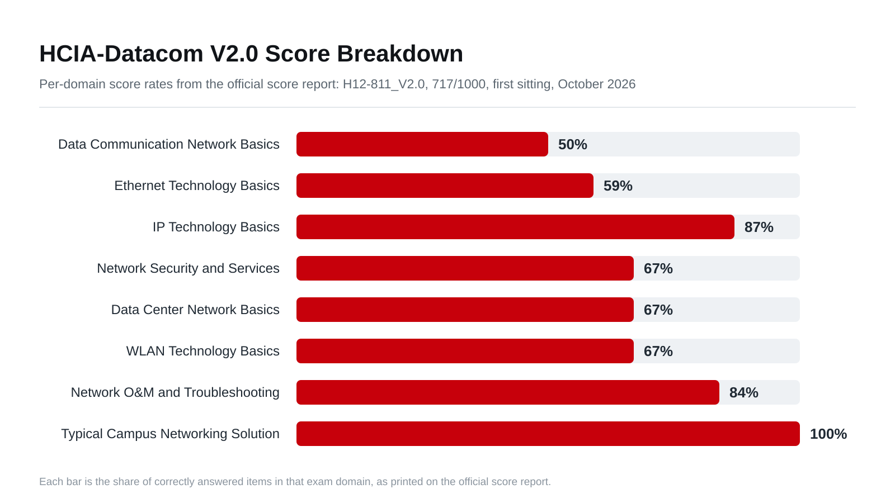

# HCIA-Datacom Study Companion

Open study notes and a documented preparation method for the **Huawei HCIA-Datacom V2.0** certification, written and engineering-verified by [Philopater Shenouda](https://lnkd.in/p/eAKCgESZ) - passed **717/1000 on the first sitting** (October 2026).

## What you will find here

1. **The Method** - the complete, reusable preparation system: quiz-first drilling, exact-set grading, a validated question-bank build pipeline, error-memory export/import, sibling-family comparison, a per-question exhibit sweep, and an exam-day sheet. Every step was field-tested end to end.
2. **23 course units** - open study notes covering the full official HCIA-Datacom V2.0 blueprint: data communication basics, reference models, VRP, Ethernet switching, VLANs, STP, link aggregation, IP addressing and DHCP, routing and inter-VLAN routing, OSPF, IPv6, ACLs, AAA, network services, NAT, data center fabrics, WLAN (3 units), device management and automation, troubleshooting, and the campus solution. Each unit carries its CLI configurations and verification commands.

## What this is not

This is **not an exam dump**. There are no recalled exam questions or answer keys here. The certification exam itself is protected material - this project publishes only original study notes and the preparation methodology, and it strongly discourages using illegal dumps: Huawei enforces lifetime bans, and a certification you did not earn collapses the moment someone asks you a follow-up question.

## Why publish the method instead of the answers

Because the method is the part that transfers. Anyone can memorize a bank; the system documented here - building a validated study engine, auditing every answer against the official curriculum, and closing every error loop - is what turned a first sitting into a 717 and will turn the same effort into your next certification.

## Status

| Item | Detail |
| --- | --- |
| Exam | H12-811_V2.0-ENU |
| Result | 717/1000 - Pass (first sitting) |
| Certificate | Valid through October 2029 |

## Score breakdown

## About the author

I work in penetration testing, and networking is the foundation everything else stands on. You can find me on [LinkedIn](https://www.linkedin.com/in/philopater-shenouda/) and [GitHub](https://github.com/PhilopaterSh).

## Support this project

If these notes saved you time, consider supporting the work. It keeps projects like this open and maintained.

