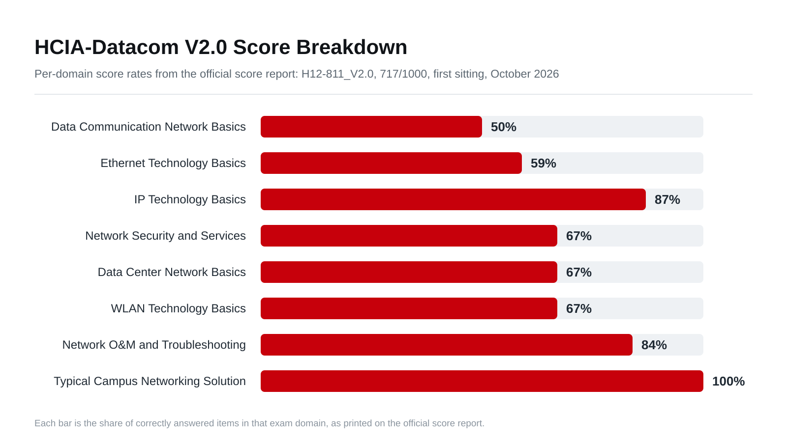

## Result

**H12-811_V2.0-ENU taken 2026-10-31: PASSED with 717/1000** (minimum 600, 60 items, first sitting). Official certificate No. 010103901855810455291409, valid through 2029-10-30, archived at `Obsidian/Attachments/Documents/Huawei/HCIA-Datacom Certificate 010103901855810455291409.pdf`. Exam engine time was 90 minutes; the Pearson booking's "115 Minutes" was the appointment window including check-in and tutorial.

Per-domain rates: Data Comm Network Basics 50 · Ethernet Technology Basics 59 · IP Technology Basics 87 · Network Security and Services 67 · Data Center Network Basics 67 · WLAN Technology Basics 67 · Network O&M and Troubleshooting 84 · Typical Campus Networking Solution 100. The two weakest domains map exactly to the sprint's never-completed quiz batches (Cat 5-8) and are the first study pointers toward HCIP-Datacom.

## The Method That Worked (reusable checklist)

1. **Quiz-first per category:** answer the whole batch before any teaching; score honestly; log every miss with the trap (not the letter) in the tracker.
2. **Strict set grading from day one:** a multi-select question grades the FULL correct set; a partial pick is a miss. Train the habit in practice, because the exam grades the same way.
3. **Generated web app with a validated pipeline:** raw transcript → generator with an audited answer-key map → validated bank file → offline quiz app (the DQS-1 custom-engine pattern, see `web/hcia-v2-review/README.md`). Every curated line is mechanically validated; the build fails on transcription drift.
4. **Error memory with export/import:** every wrong pick reaches a persistent ever-wrong store keyed by stable ids; export/sync keeps the vault tracker mirrored. Reading modes must never inflate it (the reveal-all sweep once inflated it to 131 entries before the passive-mode fix).
7. **Answer-key audit against the official material:** the full key audited against the V2.0 training material (135/138 at audit time), concept-term coverage for every paraphrased question, and corrections recorded with evidence.
8. **Exam-day sheet:** one collapsible card inside the study app holding the corrected keys, the caveats, the fill-in facts, and the exam tactics. The morning review needs nothing outside the app.

## Family Quick Rules (the 31 sibling questions in 14 families)

- The MAC address table records (source MAC + VLAN) → the INTERFACE; "MAC address of the port" is always a trap.
- VLAN membership derives from the ingress port; moving a PC between access ports changes its VLAN entirely, and the ping succeeds with the current VLAN's peer only.
- Inside the switch the frame always carries the ingress VLAN tag; access egress strips it. `undo vlan` on two access ports reverts both to VLAN 1 and connectivity survives.
- A router rewrites only the L2 frame: never the IP header, never the transport header content.
- Basic ACL matches source only; first match wins. `< cr >` means no further completion; there is no `undo system-view`.
- Lowest route preference wins. DHCP server sends OFFER and ACK only. DAD uses NS/NA; link-local is FE80::/10.
- PFC backpressure fires at a stop threshold; the leader AP manages Fit APs via CAPWAP.
- Static routes: each edge router needs a route to the remote network via a directly reachable next hop; the transit router needs none.
- Square STP topology recipe: RPC per switch (ingress-port costs along the cheapest path) → root port (lowest RPC, then sender BID, then PID) → designated per segment (same ladder). Read costs from the printed figure, never from the prose.

## Weakest-Domain Pointers (if continuing to HCIP-Datacom)

Data Comm Network Basics (50%) and Ethernet Technology Basics (59%) were the un-drilled categories; frame formats, Ethernet fundamentals, and the data-comm theory chapters are the first refresh targets. The strongest domains (IP 87, O&M 84, Campus 100) followed exactly the closed error loops, which is the method's own validation.

## References

- Question-bank entry points: HCIA-Datacom Question Bank MOC and Huawei HCIA Datacom.
- Study app and pipeline: `web/hcia-v2-review/` (README carries the replication checklist) and `web/quiz-template/README.md` (DQS-1 standard).

