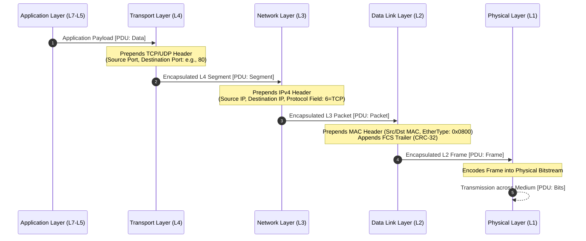

# 02. Network Reference Models

> 💡 Unit 02 of 23 - HCIA-Datacom course. ☰ MOC | ← Unit 01 | Unit 03 →

> **Book Slide References (Parsed via MarkItDown):**
> - V2 Unit 2: common TCP/IP protocols, pp. 60-61
> - V2 Unit 2: application protocols and ports, pp. 62-66
> - V2 Unit 2: PPP and link establishment, pp. 72-74
> - V2 Unit 2: physical layer and transmission media, pp. 75-78
> - V2 Unit 2: sender encapsulation and communication process, pp. 80-84
> - V1 comparative reference: Network Reference Model

### 2.1 Encapsulation Architecture, PDU Hierarchy & Demultiplexing Mechanics

#### 1. PDU Hierarchy Across the Protocol Stack
Data encapsulation is the systematic process where each layer prepends a protocol-specific header (and Layer 2 appends a trailer) to the payload received from the layer immediately above it:

#### 2. Demultiplexing Fields & Header Comparison
When receiving data, the target device de-encapsulates the PDU in reverse. Every layer uses a dedicated **demultiplexing pointer** inside its header to know which upper-layer protocol must process the stripped payload:

| Layer | Added Unit | PDU Name | Addressing Scope | Demultiplexing Field (Points Upward) | Standard Exam Values |
| :--- | :--- | :--- | :--- | :--- | :--- |
| **Layer 4 (Transport)** | TCP/UDP Header | **Segment** | Host Application Process | **Destination Port** (16 bits) | HTTP: 80, HTTPS: 443, Telnet: 23, SSH: 22, DNS: 53 |
| **Layer 3 (Network)** | IPv4 Header | **Packet** | Logical Node-to-Node Path | **Protocol Field** (8 bits) | ICMP: 1, TCP: 6, UDP: 17, OSPF: 89 |
| **Layer 2 (Data Link)** | Ethernet Header + Trailer | **Frame** | Hop-by-Hop Local Link | **EtherType Field** (16 bits) | IPv4: `0x0800`, ARP: `0x0806`, IPv6: `0x86DD` |
| **Layer 1 (Physical)** | Physical Signaling | **Bits** | Raw Medium Transmission | N/A (Preamble / SFD) | Bitstream synchronization |

> 💡 Critical Exam Trap: Port vs. Protocol Number
> - **Port Number (Layer 4):** 16-bit identifier (0 to 65535) embedded inside the **TCP or UDP header**. Identifies the specific software service (e.g. Destination Port 80 = Web Server process).
> - **Protocol Field (Layer 3):** 8-bit identifier embedded inside the **IPv4 header**. Tells the IP layer which transport protocol is carried inside the IP payload (Protocol `6` = TCP, Protocol `17` = UDP, Protocol `1` = ICMP).
> - **Trap:** Any exam option that claims "Port 6 is TCP" or "Protocol 80 is HTTP" is **false**.

### 2.2 Protocol Roles, TCP/UDP Scenarios, PPP, and Media

| V2 example | Role and transport shown in the course |
|---|---|
| HTTP | Web browsing; TCP port 80; browser/client sends a request and web server returns a response. |
| SMTP | Internet email; TCP port 25. |
| Telnet | Remote management; TCP port 23. |
| FTP | Internet file resource sharing; TCP ports 20 and 21 in the course's protocol table. |
| DNS | Resolves domain names to IP addresses; UDP port 53 in the course's table. |

V2 contrasts TCP's connection-oriented reliable delivery (including ordered delivery in the course example) with UDP's connectionless, best-effort service and lower overhead/latency. It associates TCP with web browsing, file transfer, and email when data integrity is important, and UDP with video calls, online gaming, and DNS queries when low latency matters and some loss is tolerable. These are stated scenarios, not universal protocol-selection rules. Protocol/port table, p. 62 TCP/UDP characteristics and scenarios, p. 66

#### PPP Link Establishment

PPP is a WAN data-link protocol for point-to-point transmission over full-duplex links. The course gives branch-to-headquarters connectivity as a scenario and notes PPP negotiation can provide an IP address. PPP supports synchronous and asynchronous links; PPPoE extends PPP over Ethernet. PPP uses LCP to negotiate link parameters, optional PAP or CHAP authentication, and NCP to negotiate network-layer protocols and parameters. The course says PPP has no retransmission mechanism. PPP role and properties, p. 72

The source describes this sequence:

1. **Establish:** LCP negotiates link parameters (including working mode, MRU, authentication mode, and magic number). Successful negotiation moves LCP to Opened.
2. **Authenticate (optional):** If configured, PAP or CHAP authenticates the peer. Failure terminates the link; if authentication is not configured, negotiation proceeds to the network phase.
3. **Network:** NCP selects/configures the network-layer protocol and negotiates its parameters. IPCP negotiates IP parameters, including the peers' IP addresses in the course example. After successful negotiation, network-layer packets can traverse the link.
4. **Terminate:** Physical disconnection, authentication failure, timer expiry, or administrative closure can end the connection; resources are released and the peers return to Dead until a new connection starts.

PPP state/negotiation sequence, p. 73 NCP completion and termination conditions, p. 74

#### Physical Transmission Media

The physical layer carries bitstreams and standardizes physical characteristics such as cables, pins, voltages, and interfaces. V2 names twisted pair, optical fiber, hybrid cable, and electromagnetic waves. It describes twisted pair as the common Ethernet medium (RJ45, up to 100 m for the cited cable examples), single-mode fiber as suitable for longer distances, multimode fiber as suitable for shorter distances, hybrid cable as combining data transmission with power delivery, and wireless transmission through electromagnetic waves. The detailed hybrid cable 1.0/2.0 connector distinctions are source-specific; do not generalize them to unrelated vendor hardware. Physical layer and media overview, p. 75 Twisted pair, fiber, and hybrid cable examples, p. 76 Fiber and hybrid cable details, p. 77 Wireless medium, p. 78

