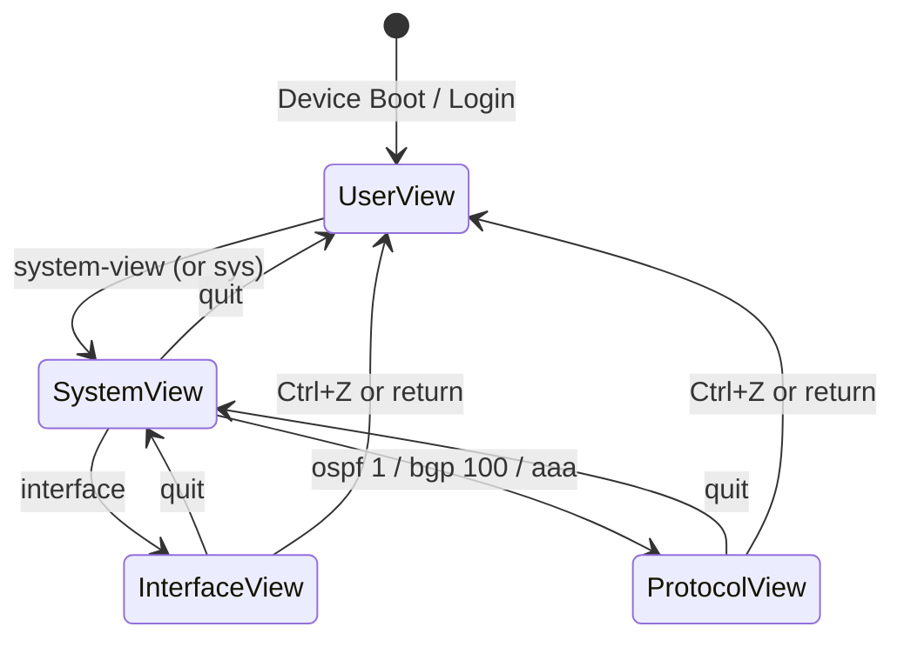
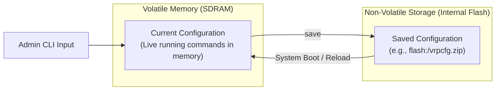
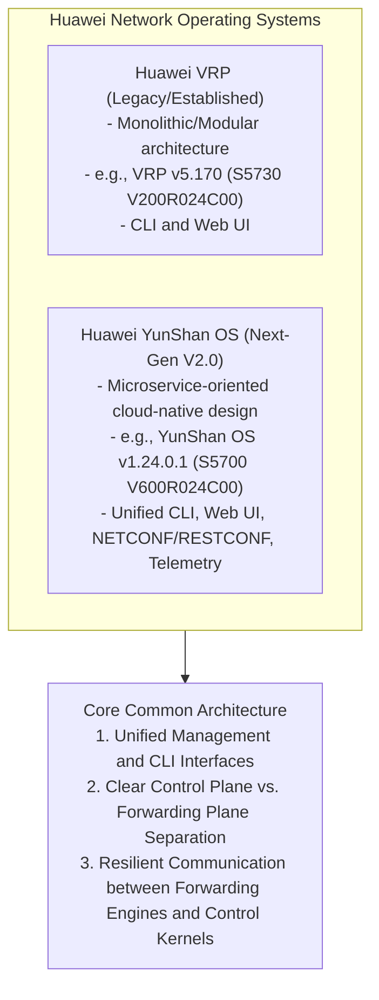

# 03. Network Device Operating Systems (YunShan OS & VRP)

> 💡 Unit 03 of 23 — HCIA-Datacom course. ☰ MOC | ← Unit 02 | Unit 04 →


> **Book Slide References (Parsed via MarkItDown):**
> - Ch. 3 p. 76-122: Huawei VRP Platform & CLI Basics

### 3.1 VRP Command Views Hierarchy & Navigation Mechanics

V2 introduces YunShan OS/VRP device management through both CLI and web-system access, with Console, Telnet, and STelnet listed as CLI login methods. The command-view, editing, help, and error-handling material below develops the CLI path. YunShan OS and VRP, p. 94 Device-management methods, p. 96 CLI login methods, p. 97 Command structure and views, p. 107 Command editing and completion, p. 111 Online help, p. 114 Command error messages, p. 117 Command history, p. 120

#### 1. Command View Transitions
Huawei VRP organizes CLI configuration into a hierarchical tree. Prompts clearly differentiate operational level:



| View Name | Prompt Display | Primary Role & Capabilities | Common Commands |
| :--- | :--- | :--- | :--- |
| **User View** | `<Huawei>` | Default login level. Read-only inspection, file operations, diagnostics. | `display version`, `dir`, `save`, `reboot`, `ping`, `system-view` |
| **System View** | `[Huawei]` | Global device configuration, system naming, entry point to sub-views. | `sysname R1`, `header login`, entering sub-views |
| **Interface View** | `[Huawei-GE0/0/1]` | Physical and logical interface parameters, IP assignments, state toggles. | `ip address 192.168.1.1 24`, `shutdown`, `undo shutdown` |
| **Protocol / Routing View** | `[Huawei-ospf-1]` | Routing engines, dynamic protocols, security AAA parameters. | `area 0`, `network 192.168.1.0 0.0.0.255`, `authentication-mode` |

#### 2. Navigation Shortcuts & Command Execution Control

| Shortcut / Keyword | Operational Mechanism | Crucial Exam Distinction |
| :--- | :--- | :--- |
| **`quit`** | Steps back **one single level** to the immediate parent view. | If 3 levels deep (e.g. `[Huawei-ospf-1-area-0.0.0.0]`), `quit` returns to `[Huawei-ospf-1]`. |
| **`return`** / **`Ctrl + Z`** | Jumps **immediately to User View `<Huawei>`** in one action. | Fast-exit to root level from any sub-view. |
| **`undo`** | **Negates, cancels, or restores default settings** for a command. | Never moves between views (e.g., `undo shutdown` activates an interface). |
| **`Tab`** | Autocompletes partially typed keywords. | If ambiguous, cycles through matching commands. |
| **`?`** | Context-sensitive online help. | `dis?` shows words starting with `dis`; `display ?` shows next valid parameters. |
| **`Ctrl + C`** | Aborts execution of the currently running command. | Stops continuous `ping` or paginated `display` screen dumps. |

### 3.2 VRP Configuration Lifecycle (RAM vs. Flash & Storage Mechanics)

#### 1. Volatile Memory (SDRAM) vs. Persistent Storage (Flash)
Huawei VRP separates running device state from persisted startup instructions:



- **Current Configuration:** Active commands loaded in SDRAM. Real-time changes take effect immediately upon hitting Enter. Changes are lost if device powers off before saving.
- **Saved Configuration:** Persistent file (usually `.zip` or `.cfg`) stored in Flash storage. Loaded into SDRAM during device initialization.

V2 also distinguishes the storage media by role: **SDRAM** holds running information; **NVRAM** caches logs before they are written to Flash; **Flash** stores system software and configuration files; **SD cards** provide nonvolatile storage expansion; and a **USB flash drive** connects external storage for upgrades or data transfer. Supported media vary by device model. Storage-media roles, p. 128

#### 2. V2 Configuration File Commands

V2 distinguishes the running configuration from the file selected for the next startup. Use its documented commands to inspect, save, choose, and verify configuration files; the optional `save` filename accepts 5-64 characters with `.zip`, `.cfg`, or `.dat` format. V2 configuration-file operations, p. 138

```text
<Huawei> display current-configuration
<Huawei> display saved-configuration
<Huawei> display configuration <configuration-file>
<Huawei> display startup
<Huawei> save [configuration-file]
<Huawei> startup saved-configuration <configuration-file>
<Huawei> reboot
```

V2 also documents scheduled automatic saving. It saves when the configured interval or delay arrives and the current configuration differs from the next-startup file. The source gives defaults of 30 minutes for the interval, 5 minutes for the delay, and 50% for the CPU limit. These are V2 source values; verify support and syntax on the target device and release. Manual and automatic configuration saving, p. 138

```text
[Huawei] configuration file auto-save [ interval <minutes> | delay <minutes> | cpu-limit <percentage> ]
```

#### 3. File-System and Startup-File Management

V2 distinguishes local file management from transfers between devices. A logged-in device can act as a client or server; the course lists local management, TFTP, FTP, SFTP, and SCP as transfer/management methods. It focuses its command examples on local file management. File-system management methods and local operations, p. 127

| Operation | VRP command pattern |
| :--- | :--- |
| Show or change the current directory | `pwd`; `cd <directory>` |
| List files | `dir [/all] [filename]` |
| Show the backup partition | `display backup-file` |
| Create or remove a directory | `mkdir <directory>`; `rmdir <directory>` |
| Read, copy, move, or rename a file | `more <filename>`; `copy <source> <destination>`; `move <source> <destination>`; `rename <old-name> <new-name>` |

These are device CLI commands, not shell commands. Directory removal requires an empty directory, and deleted directories cannot be restored from the recycle bin. The file system stores system software (`.cc`), patches (`.pat`), and configuration files (`.cfg`, `.zip`, or `.dat`). File operations and file types, p. 127

Configuration management includes saving, viewing, backing up, restoring, compressing, and selecting the file used at the next startup. V2 also documents `.defcfg` as the preset configuration-file type, alongside `.cfg`, `.zip`, and `.dat`. To change and verify the startup configuration, use:

```text
<Huawei> startup saved-configuration <configuration-file>
<Huawei> display startup
```

The configured file takes effect after the device restarts. Configuration-file management and next-startup selection, p. 138

#### 4. V2 System-Software Upgrade Sequence

The V2 example uploads the new system software and patch to device storage over SFTP, checks available files and storage, saves the current configuration, selects the software, configuration, and patch for the next startup, verifies those selections, then reboots. The course directs readers to its Network Services and Applications material for SFTP setup; see 14. Network Services and Applications (SSH - STelnet, SFTP, FTP) for related transfer and remote-management concepts. This is the source's upgrade sequence, not a tested upgrade procedure. System-software upgrade roadmap and example, p. 145

```text
<Huawei> dir
<Huawei> save
<Huawei> startup system-software <software-file.cc>
<Huawei> startup saved-configuration <configuration-file.zip>
<Huawei> startup patch <patch-file.pat> all
<Huawei> display startup
<Huawei> reboot
```

Check the exact package names, available storage, hardware compatibility, and VRP release instructions before applying this sequence to a device.

> 💡 Critical Exam Concept: Reset Saved-Configuration
> `reset saved-configuration` clears service configurations from the file selected for the next startup; it does not clear stack configuration or the BIOS password. The V2 sequence is to run `reset saved-configuration`, then `reboot fast` so the cleared startup configuration takes effect. If no next-startup file is selected, the device uses `default.cfg` or its preset configuration when available; otherwise, it starts with an empty configuration.
>
> `reset factory-configuration` has a wider effect: after restart, it clears service configurations and data files, including stack configuration and the configured BIOS password. V2 says the next-startup system-software package, patch, module, and license file are retained. Confirm the exact model behavior before using either reset on a device. V2 reset commands and impact scope, pp. 143-144

```text
<Huawei> reset saved-configuration
<Huawei> reboot fast
<Huawei> reset factory-configuration
```

- **Interface Configuration:**

```bash
interface <interface-type> <interface-number>
ip address <ip-address> { <mask> | <mask-length> }
```

### 3.3 Next-Generation Network Operating System: Huawei YunShan OS

In HCIA-Datacom V2.0 (Unit 3), Huawei introduces **YunShan OS** alongside the traditional **Versatile Routing Platform (VRP)** as the foundational management brain across modern enterprise routing and switching platforms (specifically demonstrated on CloudEngine S5755-H series switches running `V600R024C00`). V2 Unit 3: YunShan OS and VRP comparison, p. 94



#### 1. Architectural Evolution: VRP vs. YunShan OS
While both operating systems present a familiar CLI command hierarchy (`<Huawei>` User View $\rightarrow$ `[Huawei]` System View), they serve different hardware and operational generations:

| Feature / Dimension | Classic Huawei VRP (VRPv5 / VRPv8) | Huawei YunShan OS (V2.0 Focus) |
| :--- | :--- | :--- |
| **System Architecture** | Process-based routing platform kernel | Microservices-based cloud-native modular operating system |
| **Target Hardware** | AR routers, traditional S-series campus switches (e.g. S5730) | CloudEngine campus switches (e.g. S5755-H), data center switches |
| **Display Version Output** | `Huawei Versatile Routing Platform Software` <br/> `VRP (R) software, Version 5.170` | `Huawei YunShan OS` <br/> `Version 1.24.0.1 (S5700 V600R024C00)` |
| **Management Interfaces** | Console, Telnet, SSH/STelnet, SNMPv1/v2c/v3, Web UI | Console, SSH/STelnet, HTTPS Web UI, **NETCONF/YANG, RESTCONF, gRPC Telemetry** |
| **Programmability** | CLI scripts, basic SNMP MIBs | Model-driven telemetry, automated zero-touch provisioning (ZTP), Python/Paramiko |

#### 2. Three Invariant Architectural Functions
Regardless of whether an engineer logs into a VRP or YunShan OS device, the operating system strictly delivers three foundational networking functions:
1. **Unified User and Management Interface:** Standardizes user interaction across CLI, graphical Web systems, and programmatic APIs.
2. **Control Plane Implementation and Forwarding Abstraction:** Executes routing protocols (OSPF, BGP), signaling, and state machines while programming forwarding specifications into Layer 2/3 hardware ASIC forwarding engines.
3. **Control-Plane to Forwarding-Plane Communication:** Ensures non-blocking IPC (Inter-Process Communication) and hardware queue synchronization between the central CPU management brain and the line-card network processors (NP/ASIC).

---

