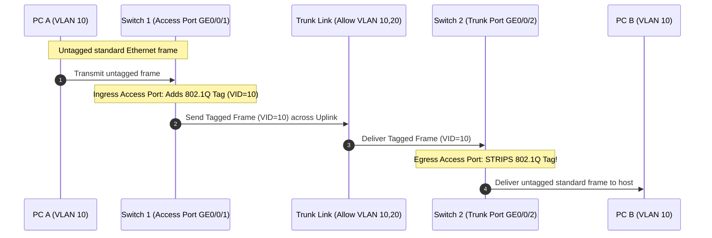

# 05. VLAN Fundamentals and Configuration

> 💡 Unit 05 of 23 - HCIA-Datacom course. ☰ MOC | ← Unit 04 | Unit 06 →


---

### 8.1 What is VLAN & 802.1Q Encapsulation
> **Verified source PDF pages:**
> - PDF page 318: Issues Facing a Traditional Ethernet and PDF page 319: VLAN
> - PDF page 322: VLAN Tag (IEEE 802.1Q)
> - PDF page 330: Layer 2 Ethernet Interface Types; Access Interface; Trunk Interface; Hybrid Interface
> - PDF page 333: Trunk frame sending and PVID behavior and Hybrid interface frame processing

#### 1. IEEE 802.1Q Tag Format (4 Bytes / 32 Bits)
Inserted directly between the Source MAC address and the EtherType/Length field in a standard Ethernet II frame:

```text
+-------------------+-------------------+-------------------+-------------------+
+-------------------+-------------------+-------------------+-------------------+
                                                  │
                ┌─────────────────────────────────┴─────────────────────────────────┐
                ▼                                                                   ▼
       +--------------------+--------------------+--------------------+--------------------+
       +--------------------+--------------------+--------------------+--------------------+
       |   Value: 0x8100    |  Values: 0 to 7    |  Values: 0 or 1    | Values: 1 to 4094  |
       |  Identifies 802.1Q |  Layer 2 QoS / CoS |  Drop Precedence   | (0 & 4095 reserved)|
       +--------------------+--------------------+--------------------+--------------------+
```

| Field | Length | Description & Architectural Function |
| :--- | :---: | :--- |
| **TPID (Tag Protocol Identifier)** | 2 Bytes (16 bits) | Fixed value `0x8100`. When a network interface reads `0x8100` where EtherType usually is, it immediately recognizes that the frame carries an **802.1Q VLAN Tag**. |
| **PRI (Priority / 802.1p)** | 3 bits | 3 bits allow $2^3 = 8$ distinct priority values (`0` through `7`). Used for Layer 2 QoS (Voice/Video vs Best Effort). |
| **CFI / DEI (Drop Eligible)** | 1 bit | Canonical Format Indicator (DEI). Used for token ring compatibility and congestion drop indicator. |
| **VLAN ID (VID)** | 12 bits | 12 bits allow $2^{12} = 4096$ theoretical numbers (`0` through `4095`). Boundary values `0` and `4095` are permanently reserved by IEEE standard. Therefore, the **usable VLAN range is 1 to 4094**. |

---

### 8.2 Three Port Link Types on Huawei Switches (Access, Trunk, Hybrid)

In Huawei VRP, every physical Ethernet interface has a **PVID (Port VLAN ID)**, which defaults to **VLAN 1**.

| Port Type | Intended Connection | Received Untagged Frame Behavior | Received Tagged Frame Behavior | Outbound (Transmitted) Frame Behavior |
| :--- | :--- | :--- | :--- | :--- |
| **Access** | Terminal devices (PC, server, printer) | Tags the frame with port's **PVID**. | Accepts only if Tag VID == PVID; otherwise drops. | **Strips tag (untagged)**; hosts never receive 802.1Q tags. |
| **Trunk** | Uplinks between switches or routers | Tags frame with **PVID**; accepts if PVID is in `allow-pass` list. | Accepts if VID is in `allow-pass` list; otherwise drops. | If VID == PVID: **strips tag** (sent untagged). If VID $\neq$ PVID: **retains tag** (sent tagged). |
| **Hybrid** *(Huawei Default)* | Flexible: hosts, servers, voice IP phones, or uplinks | Tags frame with port's **PVID**; checks untagged/tagged permission. | Accepts if VID is in permitted tagged/untagged list. | Transmits with tag **stripped** or **retained** based on explicit `port hybrid untagged/tagged` configuration. |

#### Huawei VRP Configuration Syntax:
```bash
# 1. Create VLANs globally
[Huawei] vlan 10
[Huawei] vlan batch 10 20 30

# 2. Configure Access Port (End-User Port)
[Huawei-GigabitEthernet0/0/1] port link-type access
[Huawei-GigabitEthernet0/0/1] port default vlan 10

# 3. Configure Trunk Port (Switch-to-Switch Uplink)
[Huawei-GigabitEthernet0/0/2] port link-type trunk
[Huawei-GigabitEthernet0/0/2] port trunk allow-pass vlan 10 20 30
# Optional: Change Trunk PVID (Default is VLAN 1)
[Huawei-GigabitEthernet0/0/2] port trunk pvid vlan 10
```



> 💡 Exam Traps & Anti-Patterns
> 1. **VTP is Cisco-Proprietary:** Huawei switches do **NOT** use VTP (VLAN Trunking Protocol). Do not confuse trunking (transmitting multiple VLANs over a link) with VTP (a proprietary Cisco database-sync protocol).
> 2. **Access Port Egress Invariant (Never Delivers Tagged Frames to PCs):** End-user devices (PCs, servers, network printers) do **not** understand 802.1Q VLAN tags. An Access port **always strips (removes) the 802.1Q tag** before transmitting the frame out to the PC. The frame arriving at the PC's network card is ALWAYS a standard **untagged** Ethernet II frame. If an Access port kept the tag, the PC would drop the frame as malformed.
>
> ```text
> [ PC ] <====== UNTAGGED CABLE ======> [ Access Port | Switch Fabric | Trunk Port ] <====== TAGGED CABLE ======> [ Switch 2 ]
>          (Standard Ethernet II)               (Tagged internally)                     (802.1Q Tagged: VID 10)
>          Wireshark: NO 802.1Q Tag!                                                    Wireshark: HAS 802.1Q Tag!
> ```
>
> 3. **Huawei Default Port Type:** On Huawei S-series switches, ports default to **Hybrid** mode (with PVID = 1), unlike Cisco switches which default to dynamic or access.
> 4. **The Trunk Stripping Rule:** A Trunk port **strips the 802.1Q tag** when sending frames of its own PVID (default VLAN 1). It only transmits frames tagged when VID $\neq$ PVID!

---

### 8.3 VLAN Assignment Methods and Frame Processing

The V2 course distinguishes **VLAN identification/assignment** from **frame forwarding**. A switch first classifies ingress traffic into a VLAN; the ingress and egress interface rules then determine whether that tagged frame is accepted and transmitted. These are related steps, not interchangeable names for port types.

#### VLAN Assignment Methods

| Method | Classification input | How the VLAN is selected | Main operational trade-off |
| :--- | :--- | :--- | :--- |
| Interface-based | Ingress switch interface | The interface PVID classifies untagged frames; this is the common, straightforward method. | A moved host inherits the VLAN of its new port. |
| MAC address-based | Source MAC address | A configured MAC-to-VLAN mapping selects the VLAN. | Host mobility is easier, but a MAC can be spoofed. |
| IP subnet-based | Source IP address and subnet | A configured IP-prefix-to-VLAN mapping selects the VLAN. | Follows the address plan; depends on the configured mapping and parsed network-layer fields. |
| Protocol-based | Protocol suite / encapsulation | A configured protocol-to-VLAN mapping selects the VLAN. | Can separate protocol families such as IPv4 and IPv6. |
| Policy-based | A policy using fields such as interface, MAC, and IP | The matching configured policy assigns the VLAN. | Flexible classification, with more policy configuration to maintain. |

For the common interface/PVID method, an untagged ingress frame is assigned to the receiving interface's PVID. For MAC-, IP-subnet-, protocol-, and policy-based methods, V2 describes configured mappings or policies that classify the untagged frame. Do not confuse this classification step with the later tagged-frame acceptance and egress checks. VLAN assignment and frame-processing overview, p. 201 Assignment method definitions, p. 202

#### Frame Processing Decision Points

| Interface / direction | Untagged frame received | Tagged frame received | Frame sent out |
| :--- | :--- | :--- | :--- |
| Access | Add the interface PVID and process within that VLAN. | Accept only when VID equals PVID; otherwise discard. | Send an in-VLAN frame without the VLAN tag; a different-VLAN frame is not sent through the port. |
| Trunk | Classify using PVID; accept only when that PVID is permitted on the trunk. | Accept only when VID is in the allowed VLAN list. | Send the PVID VLAN untagged; send other allowed VLANs tagged. |
| Hybrid | Classify using PVID subject to the port configuration. | Accept according to the configured VLAN permissions. | Send tagged or untagged according to the per-VLAN egress configuration. |

The access and trunk rules above follow the V2 frame-processing examples; hybrid egress is configurable and should not be generalized into a single fixed tag rule. See Access interface ingress and egress processing, p. 206, Trunk interface ingress and egress processing, p. 208, and Hybrid interface ingress and egress processing, p. 211. This adds the V2 classification and decision flow without reopening the already mastered 802.1Q basics and port-type gate.


---

