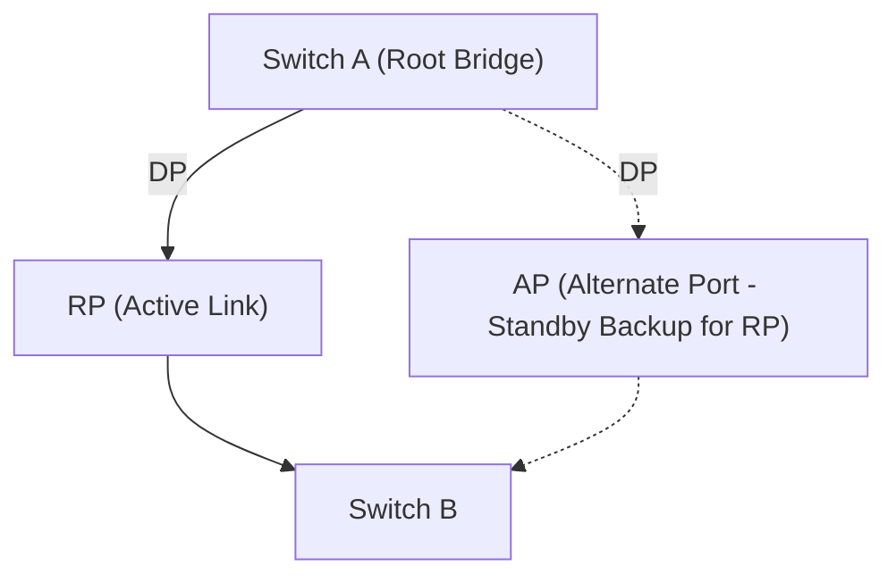

# 06. STP Fundamentals and Configuration

> 💡 Unit 06 of 23 - HCIA-Datacom course. ☰ MOC | ← Unit 05 | Unit 07 →


---

> **Book Slide References (Parsed via MarkItDown):**
> - PDF page 368: Redundancy and Layer 2 Loops
> - PDF page 370: Issues Caused by Layer 2 Loops
> - PDF page 378: STP Basic Concepts - BID
> - PDF page 384: STP Basic Concepts - BPDU
> - PDF page 388: STP Calculation (1)
> - PDF page 396: STP Port States
> - PDF page 404: Basic STP Configuration Commands (1)

### 9.1 The Layer 2 Loop Problem (Why STP Exists)
When network engineers introduce redundant links between switches to eliminate single points of failure, an unmanaged Layer 2 network creates three catastrophic loop side-effects:
1. **Broadcast Storms:** Because Layer 2 Ethernet headers contain **NO TTL (Time To Live)** field, broadcast frames circulate endlessly, saturating 100% of link bandwidth.
2. **Multiple Frame Copies:** End-user stations receive duplicate copies of the same unicast frame.
3. **MAC Address Table Flapping:** A switch continuously receives frames with the same Source MAC from alternating ports, constantly overwriting its forwarding table entries and triggering high CPU usage.

---

### 9.2 Bridge ID (BID) & The 4-Step STP Calculation Workflow

STP breaks physical loops by logically **blocking redundant ports**, dynamically unblocking them if an active link fails.

#### 1. Bridge ID (BID) Structure (8 Bytes)
Every switch running STP has a unique 8-byte Bridge ID:
$$\text{Bridge ID (BID)} = \text{Bridge Priority (2 Bytes / 16 bits)} + \text{Base MAC Address (6 Bytes / 48 bits)}$$
- **Default Bridge Priority:** `32768` (Configurable in steps of `4096`: 0, 4096, 8192, 12288 ... 61440).
- **Comparison Rule:** **Lowest value wins!** If priority is tied, the switch with the lowest Base MAC address wins.

> 💡 BID & Root Bridge Golden Rules for the Exam:
> 1. **Root Bridge Port Role Rule:** The Root Bridge **NEVER has a Root Port**! A "Root Port" is a port pointing *towards* the Root. Since the Root Bridge is itself the center of the tree, **ALL active ports on the Root Bridge are Designated Ports (DP)**!
> 2. **Bridge Priority Step Size:** The 16-bit Priority field uses the top 4 bits for priority (values 0-15) and the bottom 12 bits for SysID/VLAN. Because $2^{12} = 4096$, Bridge Priority can **ONLY be configured in multiples of 4096** (0, 4096, 8192 ... 61440).
> 3. **Default Values:** Default Bridge Priority on Huawei switches is **32768** (which is $8 \times 4096$).

#### 2. The 4-Step Calculation Pipeline:
1. **Elect ONE Root Bridge per Network:**
   - The switch with the **lowest BID** across the entire Layer 2 broadcast domain is elected as the **Root Bridge**.
   - The Root Bridge's own Root Path Cost (RPC) is **0** (it is zero hops away from itself).
2. **Elect ONE Root Port (RP) per Non-Root Switch:**
   - On every non-root switch, the single port that provides the lowest Root Path Cost back to the Root Bridge is elected as the **Root Port**. It forwards traffic to the Root.
   - Tie-breakers: Lowest Root Path Cost (RPC) $\rightarrow$ Lowest Sender BID $\rightarrow$ Lowest Sender PID (Port Priority + Port Number) $\rightarrow$ Lowest Local PID.
3. **Elect ONE Designated Port (DP) per Segment (Link):**
   - Each physical link between switches must have exactly one **Designated Port** that forwards BPDUs and data onto that link.
   - All active ports on the Root Bridge are **always Designated Ports**.
   - On links between non-root switches, the switch that advertises the lowest Root Path Cost wins the Designated Port.
4. **Block All Remaining Ports (Alternate / Blocking Ports):**
   - Any port that is neither a Root Port nor a Designated Port becomes an **Alternate / Blocked Port** (AP). It discards data frames and listens for BPDUs to maintain a loop-free logical tree.

---

### 9.3 STP Port States (802.1D)

STP uses 5 states to transition a port cleanly without creating momentary loops during topology convergence:

| Port State | Receives BPDUs? | Transmits BPDUs? | Learns MACs? | Forwards Data Frames? | State Purpose / Duration |
| :--- | :---: | :---: | :---: | :---: | :--- |
| **Disabled** | No | No | No | No | Port is administratively shutdown or has no link. |
| **Blocking** | **Yes** | No | No | No | Listens for BPDUs; blocks user data to eliminate loops. |
| **Listening** | **Yes** | **Yes** | No | No | Elects Root/RP/DP; transmits BPDUs (lasts **Forward Delay = 15s**). |
| **Learning** | **Yes** | **Yes** | **Yes** | No | Learns Source MACs to populate MAC table (lasts **Forward Delay = 15s**). |
| **Forwarding** | **Yes** | **Yes** | **Yes** | **Yes** | Normal operational state; sends and receives data frames. |

> 💡 The 30-50 Second Convergence Delay (Exam Trap)
> - Transitioning from Blocking to Forwarding requires passing through Listening (15s) and Learning (15s), taking **at least 30 seconds** ($2 \times \text{Forward Delay}$).
> - If an indirect link failure occurs, the Max Age timer (20s) must expire first, resulting in **50 seconds** of convergence downtime ($20\text{s} + 15\text{s} + 15\text{s} = 50\text{s}$). This slow convergence is the primary motivation for **RSTP (802.1w)**.

---

### 9.4 Huawei VRP STP Configuration & Verification

```bash
# 1. Globally enable STP (Huawei switches default to MSTP mode)
[Huawei] stp mode stp                              # Change mode from default MSTP to classic STP

# 2. Configure Bridge Priority (Lower is better; must be multiple of 4096)
[Huawei] stp priority 0                            # Explicitly forces switch to become Root Bridge
# Alternative shortcut:
[Huawei] stp root primary                          # Sets priority to 0
[Huawei] stp root secondary                        # Sets priority to 4096 (Backup Root)

# 3. Verification Commands
<Huawei> display stp                               # Comprehensive STP status and Root Bridge ID
<Huawei> display stp brief                         # Quick overview of Port Roles (ROOT, DESI, ALTE) and States (FORWARDING, DISCARDING)
```

---

### 9.5 RSTP (802.1w) Principles & Rapid Convergence Improvements
> **Book Slide References (Parsed via MarkItDown):**
> - PDF page 411: RSTP Overview
> - PDF page 414: Port Roles in RSTP
> - PDF page 416: Port States in RSTP
> - PDF page 413: Improvements Made in RSTP
> - PDF page 415: Edge Port

#### 1. The Core Limitation of Classic STP (802.1D)
Classic STP relies passively on timers (`Forward Delay = 15s`, `Max Age = 20s`). When a link fails, a blocked port takes **30 to 50 seconds** to resume forwarding data. This latency causes severe drops in real-time enterprise services (VoIP, video, database sessions).

#### 2. RSTP Improvement 1: Streamlined Port States (Reduced from 5 to 3)
RSTP merges the non-forwarding states (`Disabled`, `Blocking`, `Listening`) into a single operational state called **Discarding**:

| STP State (802.1D) | RSTP State (802.1w) | Port Role Assignment | Forwards Data Frames? | Learns MAC Addresses? |
| :--- | :--- | :--- | :---: | :---: |
| **Disabled** | **Discarding** | Included | No | No |
| **Blocking** | **Discarding** | Included | No | No |
| **Listening** | **Discarding** | Included | No | No |
| **Learning** | **Learning** | Included | No | **Yes** |
| **Forwarding** | **Forwarding** | Included | **Yes** | **Yes** |

#### 3. RSTP Improvement 2: Refined Port Roles (4 Roles)
In classic STP, non-designated blocking ports had no functional differentiation. RSTP clearly defines **two distinct backup roles**:
1. **Root Port (RP):** The single port on a non-root switch with the lowest path cost to the Root Bridge.
2. **Designated Port (DP):** The port that transmits BPDUs onto a segment.
3. **Alternate Port (AP):** Acts as a hot standby backup for the **Root Port**. Receives superior BPDUs from *other switches*. If the active Root Port fails, the Alternate Port immediately transitions to Root Port without waiting 30-50s.
4. **Backup Port (BP):** Acts as a backup for the switch's own **Designated Port**. Receives superior BPDUs from *the same switch* (typically in shared hub loops).

> 💡 Exam Trap, What RSTP 802.1w Actually Added (vs STP 802.1D):
> ```text
> +-------------------------------------+----------------------------------------------+
> |       STP 802.1D (EXISTED)          |       RSTP 802.1w (NEWLY INTRODUCED)         |
> +-------------------------------------+----------------------------------------------+
> |  Root Port (RP)   → ALREADY IN STP  |  Alternate Port (AP) → NEW in RSTP only!    |
> |  Designated Port  → ALREADY IN STP  |  Backup Port (BP)    → NEW in RSTP only!    |
> +-------------------------------------+----------------------------------------------+
> ```
> The exam question "Which roles are *newly defined* in RSTP?" expects only **C (Alternate Port)** and **D (Backup Port)**. Root Port and Designated Port are NOT new, they have always existed since original STP 802.1D.



#### 4. RSTP Improvement 3: Fast Convergence Mechanisms
1. **Proposal/Agreement (P/A) Handshake:**
   - On Point-to-Point full-duplex links between switches, ports negotiate roles directly via a handshake instead of waiting for timer expiration.
   - Designated port sends a Proposal BPDU; downstream switch blocks other non-edge ports (sync operation) and returns an Agreement BPDU.
   - The Designated port immediately transitions to **Forwarding** in **sub-second time (< 1s)**!
2. **Edge Port:**
   - A port connected to terminal devices (PCs, servers, printers) rather than another switch.
   - Configured with `stp edged-port enable`.
   - Transitions directly to the **Forwarding** state immediately upon link-up (0 seconds delay), skipping Discarding and Learning completely.
   - If an Edge Port receives a BPDU, it automatically loses its edge port status and reverts to a normal STP port.

#### 5. Huawei VRP RSTP Configuration Commands

```bash
# 1. Enable RSTP mode globally
[Huawei] stp mode rstp

# 2. Configure Edge Port on access interfaces facing user PCs
[Huawei] interface GigabitEthernet 0/0/1
[Huawei-GigabitEthernet0/0/1] stp edged-port enable
[Huawei-GigabitEthernet0/0/1] quit

# 3. Verification
<Huawei> display stp brief
# Returns:
# MSTID  Port                        Role  STP State     Protection
# 0      GigabitEthernet0/0/1        DESI  FORWARDING    NONE
# 0      GigabitEthernet0/0/2        ROOT  FORWARDING    NONE
# 0      GigabitEthernet0/0/3        ALTE  DISCARDING    NONE
```

> 💡 Exam Trap: Port Role vs. Port State Distinction
> Huawei certification questions frequently try to confuse **Port Roles** with **Port States**:
> - **Port Role (What job the port performs in topology):** Root Port (RP), Designated Port (DP), Alternate Port (AP), Backup Port (BP).
> - **Port State (What data-plane action the port takes):** Discarding, Learning, Forwarding.
> - An **Alternate Port (AP)** is a *Role*; its operational *State* is **Discarding** (it does not forward frames or learn MACs while the primary Root Port is up).

---

### 9.6 Multiple Spanning Tree Protocol (MSTP)

MSTP (IEEE 802.1s) extends the spanning-tree model by maintaining multiple independent spanning-tree instances within an MST region. Each **MSTI** represents a tree for a set of VLANs. VLANs with the same desired topology can be mapped to one instance; the port state for that instance controls forwarding for its mapped VLANs. Different instances can calculate different topologies, allowing VLAN groups to use different forwarding paths while retaining loop prevention. MSTP regions, MSTIs, VLAN mapping, and per-instance topology, p. 295

| Protocol | Tree model | VLAN traffic behavior |
| :--- | :--- | :--- |
| STP | One spanning-tree topology | VLANs share the single topology. |
| RSTP | One rapidly converging spanning-tree topology | Faster convergence; still a single tree for the bridged network. |
| MSTP | Multiple independent MSTIs inside a region | VLAN groups map to instances; instances can have different topologies and distribute traffic across paths. |

MSTP is therefore not simply “RSTP with another name”: its V2 delta is the VLAN-to-instance mapping and independent per-instance topology. Region membership and interoperable configuration details depend on matching region parameters; this note records the source-backed conceptual objective and does not claim a completed configuration lab. The source also identifies compatibility with STP/RSTP and fast convergence. MSTP overview, p. 295


---

