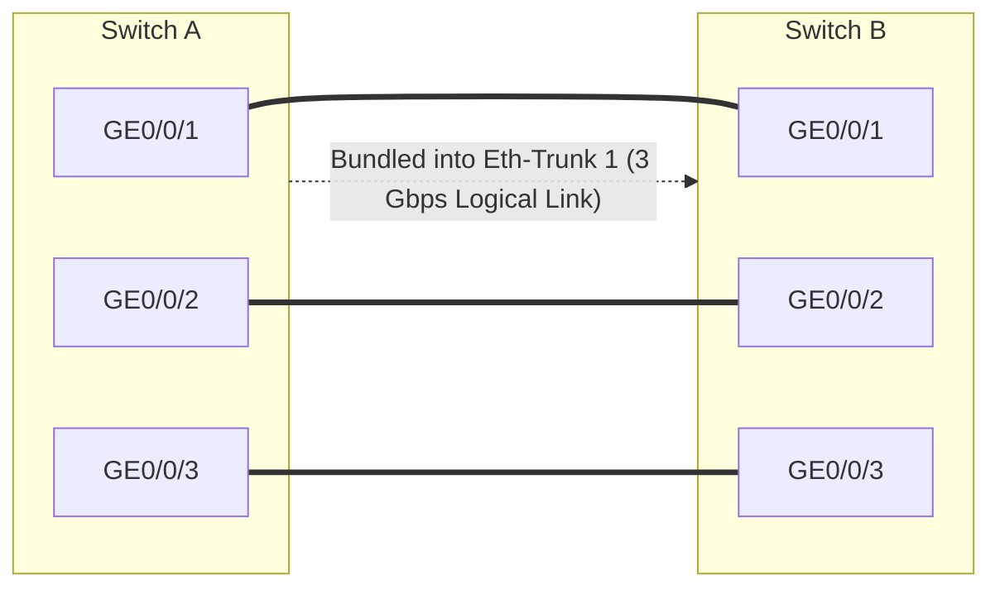

# 07. Ethernet Link Aggregation (Eth-Trunk & LACP)

> 💡 Unit 07 of 23 - HCIA-Datacom course. ☰ MOC | ← Unit 06 | Unit 08 →


> **V2.0 source pages (primary for the current audit):**
> - Link aggregation motivation and STP limitation, pp. 303-304
> - Eth-Trunk definition and deployment scenarios, pp. 305-306
> - LAG terms and model-dependent constraints, pp. 307-308
> - Manual mode, pp. 310-312
> - LACP negotiation and mode behavior, pp. 314-318
> - Actor and active-interface election example, pp. 319-322
> - Eth-Trunk configuration commands and examples, pp. 326-331
>
> **V1.0 comparative references (not a substitute for the V2-specific behavior above):**
> - Slide 10: Increasing Link Bandwidth and Slide 11: Eth-Trunk
> - Slide 12: Basic Concepts of Eth-Trunk; Slide 14: Manual Mode
> - Slide 18: LACP Active-Interface Selection through Slide 26: Active Link Election
> - Slide 27: Load Balancing and Slide 28: Load-Balancing Mode
> - Slide 33: Configuration Commands (1) through Slide 35: Configuration Commands (3)
> - Slide 40: Introduction to iStack and CSS through Slide 44: Recommended Architecture

### 11.1 Core Problems Solved by Eth-Trunk
In traditional enterprise access and aggregation layers, running multiple physical cables between two switches triggers two major problems:
1. **STP Blocks Redundant Links:** Standard STP detects a physical loop and blocks all redundant links, leaving only **one link active** and wasting up to 50%-75% of available cable bandwidth.
2. **Bandwidth Limitations:** A single physical link cannot exceed its port speed (e.g. 1 Gbps).

**Eth-Trunk (Link Aggregation)** bundles multiple physical Ethernet interfaces into a single **logical interface**:
- **Increased Bandwidth:** Up to 8 or 16 member links bundle together, multiplying capacity (e.g., $4 \times 1\text{ Gbps} = 4\text{ Gbps}$).
- **Automatic Fault Redundancy:** If one physical link fails, traffic seamlessly shifts to the remaining active links in milliseconds without STP topology reconvergence.
- **Traffic Load Balancing:** Traffic is distributed across all active member links using hashing algorithms.



---

### 11.2 Eth-Trunk Member Port Constraints
Before adding physical interfaces to an Eth-Trunk, they must satisfy strict prerequisite conditions:
1. **Member compatibility depends on platform and mode:** the V1 material's rate/duplex matching guidance and same-VLAN-attributes example are not universal requirements for every V2 LACP deployment. Follow the target model's restrictions and keep the two ends' Eth-Trunk configuration aligned. In particular, the V2 LACP rate/duplex exception and its forwarding limitation are described below. (V1 comparative guidance; V2 model-dependent constraints, pp. 307-308)
2. **Rate and duplex behavior is mode- and platform-dependent:** the V2 course says different-rate, different-duplex, and different-card interfaces can be members in LACP mode, but different-rate members cannot forward simultaneously and half-duplex members cannot forward. Its command example separately shows `lacp mixed-rate link enable` and explains that, by default, different-rate members forward at only one rate, so the aggregation does not load-balance across those rates. Do not simplify this into “different rates are rejected”; check the exact switch model and VRP documentation before applying it. (V2 member-interface constraints, p. 308; V2 mixed-rate command and default behavior, p. 327)
3. **Same Switch Unit:** In standalone switches, all member ports must reside on the same physical switch (unless using iStack/CSS virtualization).
4. **No Prior Configuration & No Member IP Addresses:** Member ports must not have individual Layer 2 or Layer 3 configurations applied before joining. Physical member ports **cannot have IP addresses configured on them**. Layer 3 IP addressing belongs exclusively to the logical `interface Eth-Trunk`.
5. **Bandwidth Determination Formula:** For active member links operating at the same rate, the nominal aggregate bandwidth is based on the active member count and member-link rate:
   $$\text{Total Bandwidth} = (\text{Bandwidth of Individual Member Port}) \times (\text{Number of Active Member Ports})$$
   (e.g., $1\text{ Gbps} \times 3\text{ active ports} = 3\text{ Gbps}$). This simple calculation does not apply to mixed-rate members, which have the forwarding/load-balancing limitation described above. The achieved per-flow throughput is also bounded by the selected member link; upper-layer IP addresses or protocol settings do not increase physical link capacity.

---

### 11.3 Two Working Modes: Manual vs. LACP

| Comparison Dimension                     | Manual Mode (Default)                                                                                                                  | LACP Static Mode                                                                                                    |
| :--------------------------------------- | :------------------------------------------------------------------------------------------------------------------------------------- | :------------------------------------------------------------------------------------------------------------------ |
| **Control Protocol**                     | No protocol packets exchanged.                                                                                                         | Uses IEEE **802.3ad LACP** (Link Aggregation Control Protocol) packets (LACPDUs).                                   |
| **Link State Detection**                 | Relies strictly on physical carrier status (UP/DOWN). Cannot detect unidirectional (أحادي الاتجاه) fiber faults or software deadlocks. | Detects cable misconnections, unidirectional link failures, and device stalls via periodic LACPDU keepalives.       |
| **Link Redundancy (Active vs Inactive)** | **All member links forward data.** No standby backup links.                                                                            | Supports **$M:N$ redundancy**: $M$ links forward data (Active), while $N$ links act as cold/hot standby (Inactive). |
| **Typical Deployment**                   | Peer device does not support LACP.                                                                                                     | Standard enterprise backbone, data centers, and multi-switch uplinks.                                               |

> 💡 Core Exam Rule: Standby Links Require LACP!
> - In **Manual Mode**: **Every member link that is physically UP is forced to forward data.** There is **no mechanism** to put a link on standby. If you connect 4 cables in Manual mode, all 4 will forward.
> - In **LACP Static Mode**: You can configure `max active-linknumber M`. If you have 4 cables and set `max active-linknumber 3`, LACP will elect **3 Active links** and place **1 Inactive (Standby) link**.
> - **Rule for Exam:** Whenever a question mentions **"standby link"**, **"backup link"**, or **"M:N mode"**, the answer is strictly **LACP**, never Manual!

---

### 11.4 LACP Static Mode Mechanics
When Eth-Trunk operates in LACP mode:
1. **LACP System Priority (Actor Selection):**
   - Both switches exchange LACPDUs containing their **System LACP Priority** (default `32768`, 2 bytes) and **System MAC address**.
   - The switch with the **lower value** becomes the **Actor (Master)** switch. The Actor determines which specific physical links become active!
2. **Active Link Selection (Port Priority & Port ID):**
   - The Actor switch selects active links up to `max active-linknumber` using this strict hierarchy:
     1. **Lowest Port Priority wins** (default: `32768`).
     2. **Tie-Breaker (If Port Priority is equal): Lowest Port Number wins!** (`G0/0/1` < `G0/0/2` < `G0/0/3`).
   - Remaining member ports become **Inactive (Standby)**.
   - The non-Actor switch **must match** the Actor's active port selection, regardless of its own local port numbers or priorities.

> 💡 The "Lower Number Wins" Invariant (Like Gold Medal Positions):
> In Huawei switching (STP Bridge ID, Root Port election, LACP System Priority, LACP Port Priority, and Port ID):
> **THE SMALLER / LOWER NUMBER ALWAYS WINS.**
> - Port `1` is smaller than Port `3` $\rightarrow$ **Port 1 is selected as Active!**
> - Port `2` is smaller than Port `4` $\rightarrow$ **Port 2 is selected as Active!**
> - Higher numbered ports (`3`, `4`) lose the race and become **Standby**.

```text
[ Switch A (ACTOR - Priority: 4096) ]            [ Switch B (Priority: 32768) ]
   ├── Port G0/0/1 (Prio 32768) = ACTIVE ───► G0/0/1 = ACTIVE (Smallest port number: 1)
   ├── Port G0/0/2 (Prio 32768) = ACTIVE ───► G0/0/2 = ACTIVE (Second smallest: 2)
   └── Port G0/0/3 (Prio 32768) = STANDBY ──► G0/0/3 = STANDBY (Larger port number: 3)
```

3. **LACP Preemption:**
   - If an active link fails, a standby link immediately takes over.
   - When the failed link recovers, if `lacp preempt enable` is configured, it reclaims its active state after the preemption delay expires.

---

### 11.5 Load Balancing Modes (Per-Flow Has hing)
To prevent out-of-order packet delivery, Eth-Trunk performs **per-flow load balancing** using mathematical hash functions rather than round-robin per-packet:

```bash
[Huawei-Eth-Trunk1] load-balance ?
  dst-ip       According to destination IP hash
  dst-mac      According to destination MAC hash
  src-dst-ip   According to source and destination IP hash
  src-dst-mac  According to source and destination MAC hash
  src-ip       According to source IP hash
  src-mac      According to source MAC hash
```

- **In Layer 2 switching networks:** Use `src-dst-mac` (Source and Destination MAC address).
- **In Layer 3 routed networks:** Use `src-dst-ip` (Source and Destination IP address), because MAC addresses change hop-by-hop!

---

### 11.6 Huawei VRP Configuration Commands

```bash
# ==========================================
# 1. Manual Load Balancing Mode Configuration
# ==========================================
[SwitchA] interface Eth-Trunk 1
[SwitchA-Eth-Trunk1] mode manual load-balance      # Default mode
[SwitchA-Eth-Trunk1] trunkport GigabitEthernet 0/0/1 to 0/0/3
[SwitchA-Eth-Trunk1] port link-type trunk
[SwitchA-Eth-Trunk1] port trunk allow-pass vlan 10 20
[SwitchA-Eth-Trunk1] quit

# ==========================================
# 2. LACP Static Mode Configuration (Recommended)
# ==========================================
[SwitchA] lacp priority 4096                       # Lower priority makes SwitchA the Actor
[SwitchA] interface Eth-Trunk 2
[SwitchA-Eth-Trunk2] mode lacp                    # V1.0 training-material syntax; confirm on the device release
[SwitchA-Eth-Trunk2] max active-linknumber 2       # 2 active links, 1 standby backup link
[SwitchA-Eth-Trunk2] lacp preempt enable           # Enable preemption upon recovery
[SwitchA-Eth-Trunk2] trunkport GigabitEthernet 0/0/1 to 0/0/3
[SwitchA-Eth-Trunk2] quit

# 3. Verification Commands
<SwitchA> display eth-trunk 2                      # Displays working mode, Actor status, active/inactive ports
<SwitchA> display interface Eth-Trunk 2            # Checks aggregate line bandwidth (e.g. 2 Gbps)
```

> 💡 V2.0 Curriculum Shift, Stacking & Clustering Deleted
> **iStack (Intelligent Stacking) and CSS (Cluster Switch System) have been completely removed from the official HCIA-Datacom V2.0 syllabus and exam.** 

### 11.7 iStack and CSS: Multi-Switch Virtualization (V1.0 Historical Reference)

The training material distinguishes two ways to present multiple physical switches as one logical switching device:

- **iStack:** Connects multiple iStack-capable switches using stacking links to form one <font color="#ff0000">logical switch</font> that participates in forwarding.
- **CSS (Cluster Switch System):** Bundles two CSS-capable switches into one logical switch. 
The course material describes <font color="#ff0000">CSS as commonly used on modular switches</font> and <font color="#ff0000">iStack on fixed switches</font>; treat this as a course-level pattern, not a universal rule. Confirm support and limits for the exact device model and VRP release.

The described benefits are simplified management, improved resilience when a member device fails, and inter-device link aggregation. The recommended topology in the course places CSS at the core and iStack at aggregation/access, with Eth-Trunk connections between logical devices.

> 💡 Study distinction
> iStack/CSS virtualize devices into one logical device; Eth-Trunk aggregates physical links. They can be combined: an Eth-Trunk can connect to a stacked logical switch, and inter-device links can provide uplink bandwidth and redundancy.

**Source:** Slide 40: Introduction to iStack and CSS, Slide 41: Advantages of iStack and CSS, Slide 42: Application (1), Slide 43: Application (2), and Slide 44: Recommended Architecture.

---


| QBank Question | Topic & Concept | Answer |
| :--- | :--- | :---: |

---

