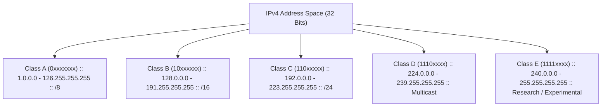

# 08. IP Address and Configuration (IPv4 & DHCP)

> 💡 Unit 08 of 23 — HCIA-Datacom course. ☰ MOC | ← Unit 07 | Unit 09 →


---

### 4.1 Network Layer Protocols Overview
> **Book Slide References (Parsed via MarkItDown):**
> - V2 Unit 8: network-layer protocol scope, p. 339
> - V2 Unit 8: IP functions and versions, p. 340
> - Slide 124: Chapter Cover & Overview
> - Slide 128: Network Layer Protocols Architecture
> - Slide 129: Internet Protocol Definition
> - Slide 130: Data Encapsulation & PDU Hierarchy

The Network Layer (Layer 3 in the OSI model, Internet Layer in the TCP/IP suite) provides **connectionless, best-effort packet delivery** across interconnected networks:
- **Connectionless:** No end-to-end handshake is negotiated at Layer 3 prior to forwarding data. Each packet is treated independently.
- **Core Protocols Operating at Layer 3:**
  1. **IPv4 / IPv6:** Core logical addressing and routing forwarding engine.
  2. **ICMP (Internet Control Message Protocol):** Diagnostic and operational error reporting (Protocol ID = `1`).
  3. **IGMP (Internet Group Management Protocol):** Multicast group membership management (Protocol ID = `2`).
  4. **Legacy / Alternative Protocols:** IPX (Novell NetWare).

---

### 4.2 IPv4 Packet Header Deep-Dive & Bitwise Architecture
> **Book Slide References (Parsed via MarkItDown):**
> - V2 Unit 8: IPv4 header fields, p. 341
> - V2 Unit 8: fragmentation fields, pp. 343-345
> - Slide 131: IPv4 Packet Format Diagram
> - Slide 132: IPv4 Header Fields Specifications
> - Slide 133: Packet Fragmentation (Identification, Flags, Offset)
> - Slide 134: Time to Live (TTL) & Loop Prevention
> - Slide 135: Protocol Field Demultiplexing

An IPv4 packet consists of an IP Header followed by User Data (Payload). The header has a minimum fixed size of **20 bytes** and can expand up to **60 bytes** if optional fields are included:


#### Detailed Bitwise Field Specifications

| Field Name | Bit Width | Functional Purpose & Technical Mechanics | Exam Nuance / Vendor Trap |
| :--- | :--- | :--- | :--- |
| **Version** | 4 bits | Identifies IP version (`0100` = IPv4, `0110` = IPv6). | Slide 341: Fixed binary value. |
| **Header Length (IHL)** | 4 bits | Indicates IP header length in **32-bit (4-byte) words**. Minimum value = `5` ($5 \times 4 = 20$ bytes). Maximum = `15` ($15 \times 4 = 60$ bytes). | Multiplied by 4 bytes. If IHL is 5, no options exist. |
| **Type of Service (ToS)** | 8 bits | Used for Quality of Service (QoS) and Differentiated Services (DiffServ/DSCP). | Takes effect when QoS traffic classification is implemented. |
| **Total Length** | 16 bits | Total size of entire IP packet (Header + Payload) in bytes. Maximum = 65,535 bytes. | Minimum total length = 20 bytes (header only, zero data). |
| **Identification** | 16 bits | Unique sequence assigned by source to group fragments originating from the same packet. | Used by receiving host to assemble matching fragments. |
| **Flags** | 3 bits | Controls packet fragmentation behavior:<br>- Bit 0: **Reserved** (Must always be `0`).<br>- Bit 1: **DF (Don't Fragment)**: `1` = Do not fragment; `0` = Fragmentation allowed.<br>- Bit 2: **MF (More Fragments)**: `1` = More fragments follow; `0` = Last fragment (or unfragmented). | If packet exceeds link MTU (1500B) and DF=1, router drops packet and sends ICMP Type 3 Code 4. |
| **Fragment Offset** | 13 bits | Specifies relative position of fragment payload within the original unfragmented packet, measured in **units of 8 bytes (64 bits)**. | Slide 344: Multiplied by 8 to obtain byte start offset. |
| **Time to Live (TTL)** | 8 bits | Maximum router hop count. Decremented by 1 at each Layer 3 forwarding hop. When TTL reaches 0, router drops packet and transmits ICMP Time Exceeded (Type 11 Code 0) to source. | Slide 344: Eliminates infinite loops on network. |
| **Protocol** | 8 bits | Demultiplexing identifier indicating which upper-layer protocol handles the stripped payload. | Common values: `1`=ICMP, `2`=IGMP, `6`=TCP, `17`=UDP, `89`=OSPF. |
| **Header Checksum** | 16 bits | Verifies integrity of the **IP Header only** (excludes payload). Recalculated at every router hop because TTL decrements! | Layer 4 TCP/UDP have their own end-to-end checksums. |
| **Source IP** | 32 bits | IPv4 address of originating node interface. | Unicast address. |
| **Destination IP** | 32 bits | IPv4 address of final receiving node interface. | Unicast, Multicast, or Broadcast. |
| **Options + Padding** | 0-40 bytes | Optional security, source routing, or timestamping parameters. Padded with 0s to guarantee 32-bit word alignment. | Rarely used in modern networks; processed in software CPU. |

> 💡 Deep-Dive Rationale: Why Is Fragment Offset Scaled by 8 Bytes?
> - **The Problem:** The Total Length field is 16 bits, allowing packets up to $65,535$ bytes. However, the Fragment Offset field only has **13 bits**, which can represent integers from $0$ to $8,191$ ($2^{13} - 1$).
> - **The Architectural Solution:** To address up to byte position $65,535$ using only $8,192$ discrete values, the protocol architects scaled the unit by $8$ ($8,192 \times 8 = 65,536$ bytes).
> - **Mathematical Formula:**
>   $$\text{Actual Payload Byte Offset} = \text{Fragment Offset Value} \times 8$$
> - **Exam Example:** If the Fragment Offset field reads `150`, the starting payload position is:
>   $$150 \times 8 = 1200 \text{ bytes}$$
> - **Vendor Trap:** Distractors will offer direct byte values (`150`), 4-byte word values like IHL (`600`), or bit values. Always multiply Fragment Offset by 8!

---

### 4.3 IPv4 Address Classification & Special Address Space
> **V2 source pages:** address concepts and format, pp. 347-350; address classes, pp. 353-355; public/private ranges, pp. 357-360.
> **Book Slide References (Parsed via MarkItDown):**
> - Slide 137: What Is an IP Address?
> - Slide 138: IP Address Notation & Decimal/Binary Conversion
> - Slide 139: IP Address Structure (Network ID vs Host ID)
> - Slide 140: Layer 2 vs Layer 3 Addressing & Gateways
> - Slide 141-145: Classful Addressing Hierarchy (Classes A to E)
> - Slide 146: Private IP Address Ranges (RFC 1918)
> - Slide 147-148: Special IPv4 Addresses

An IPv4 address is a 32-bit binary number represented in **dotted decimal notation** ($4 \times 8$-bit octets separated by dots, range `0.0.0.0` to `255.255.255.255`). It is an attribute of a **network interface**, not the device itself.

#### 1. Classful Addressing System



| Class | High-Order Bits | First Octet Range | Default Mask | Net / Host Bits | Total Usable Networks | Usable Hosts per Network |
| :--- | :--- | :--- | :--- | :--- | :--- | :--- |
| **A** | `0` | `1` to `126` | `255.0.0.0` (/8) | 8 Net / 24 Host | $126$ ($2^7 - 2$) | $16,777,214$ ($2^{24} - 2$) |
| **B** | `10` | `128` to `191` | `255.255.0.0` (/16) | 16 Net / 16 Host | $16,384$ ($2^{14}$) | $65,534$ ($2^{16} - 2$) |
| **C** | `110` | `192` to `223` | `255.255.255.0` (/24) | 24 Net / 8 Host | $2,097,152$ ($2^{21}$) | $254$ ($2^8 - 2$) |
| **D** | `1110` | `224` to `239` | N/A (Multicast) | No Host Bits | N/A | Destination group identifier |
| **E** | `1111` | `240` to `255` | N/A (Experimental) | No Host Bits | N/A | Reserved by IETF for research |

#### 2. Private IP Addresses (RFC 1918)
To mitigate IPv4 address exhaustion, RFC 1918 reserved non-routable address blocks for internal private networks:
- **Class A Private Block:** `10.0.0.0` to `10.255.255.255` (`10.0.0.0/8`, 1 Class A network).
- **Class B Private Block:** `172.16.0.0` to `172.31.255.255` (`172.16.0.0/12`, 16 contiguous Class B networks).
- **Class C Private Block:** `192.168.0.0` to `192.168.255.255` (`192.168.0.0/16`, 256 contiguous Class C networks).

> 💡 NAT Requirement
> Private IP packets are dropped by public Internet edge routers. Hosts using private IPs must undergo **Network Address Translation (NAT)** on an egress router to access the Internet.

#### 3. Special IPv4 Addresses

| Address / Range    | Classification     | Operating Behavior & Restriction                                                             |
| :----------------- | :----------------- | :------------------------------------------------------------------------------------------- |
| `0.0.0.0 / 32`     | Unspecified Source | Used by unconfigured devices during initialization (e.g. DHCP Discover source IP).           |
| `0.0.0.0 / 0`      | Default Route      | Matches any IPv4 destination in routing tables (`ip route-static 0.0.0.0 0 ...`).            |
| `127.0.0.0 / 8`    | Loopback Address   | Internal software testing (e.g., `127.0.0.1`). Packets never leave the local TCP/IP stack.   |
| `255.255.255.255`  | Limited Broadcast  | Transmitted to all nodes on local physical link. **Never forwarded across Layer 3 routers**. |
| Subnet Broadcast   | Directed Broadcast | Host bits all `1` (e.g. `192.168.1.255/24`). Targets all nodes within that specific subnet.  |
| `169.254.0.0 / 16` | Link-Local (APIPA) | Self-assigned automatically by hosts when DHCP server discovery times out without response.  |

---

### 4.4 Subnetting Calculations, VLSM & Bit Borrowing Mechanics
> **V2 source pages:** subnetting rationale and process, pp. 362-366; VLSM allocation exercise, pp. 367-369; address-planning suggestions, p. 370.
> **Book Slide References (Parsed via MarkItDown):**
> - Slide 151: The Need for Subnetting
> - Slide 152: Subnetting Principles & Bit Borrowing
> - Slide 153-157: Practice: Computing Subnets
> - Slide 158: Variable Length Subnet Masking (VLSM)

Subnetting divides a large network into smaller subnets by **borrowing bits from the Host portion** and adding them to the Network portion:

$$\text{Subnets Created} = 2^S \quad (S = \text{Borrowed Subnet Bits})$$
$$\text{Total Addresses per Subnet} = 2^H \quad (H = \text{Remaining Host Bits})$$
$$\text{Usable Host Addresses} = 2^H - 2 \quad (\text{Excludes Network ID and Directed Broadcast})$$
 
#### Subnetting Fast-Reference & Magic Number Table (/24 to /30)

| Prefix | Subnet Mask (Dotted Decimal) | Borrowed Bits ($S$) | Host Bits ($H$) | Block Size (Magic Number: $256 - \text{Mask}$) | Usable Hosts ($2^H - 2$) | Primary Enterprise Use Case |
| :---: | :--- | :---: | :---: | :---: | :---: | :--- |
| **/24** | `255.255.255.0` | 0 | 8 | 256 | **254** | Standard user department / VLAN |
| **/25** | `255.255.255.128` | 1 | 7 | 128 | **126** | Large branch office |
| **/26** | `255.255.255.192` | 2 | 6 | 64 | **62** | Medium workgroup |
| **/27** | `255.255.255.224` | 3 | 5 | 32 | **30** | Small branch or server farm |
| **/28** | `255.255.255.240` | 4 | 4 | 16 | **14** | Management network / DMZ |
| **/29** | `255.255.255.248` | 5 | 3 | 8 | **6** | Small server cluster / Firewall link |
| **/30** | `255.255.255.252` | 6 | 2 | 4 | **2** | Point-to-Point router interconnection |

> 💡 Rapid 3-Step VLSM Host Sizing Algorithm (Exam Technique)
> When an exam question asks: *"What subnet mask provides at least $N$ usable hosts while minimizing waste?"*:
> 1. **Step 1: Calculate Minimum Host Bits ($H$):**
>    Find the smallest integer $H$ such that:
>    $$2^H - 2 \ge N$$
>    - If $N = 25 \rightarrow 2^4 - 2 = 14$ (Too small), $2^5 - 2 = 30$ (Satisfies requirement!). Therefore, $H = 5$.
> 2. **Step 2: Determine Prefix Length ($P$):**
>    Subtract host bits from 32:
>    $$P = 32 - H = 32 - 5 = /27$$
> 3. **Step 3: Convert to Subnet Mask:**
>    - 4th octet has $27 - 24 = 3$ network bits: `11100000` in binary = $128 + 64 + 32 = 224$.
>    - Subnet Mask = `255.255.255.224`.
 
#### Step-by-Step Subnet Calculation Example
Given IP `192.168.10.138/27`:
1. **Identify Subnet Mask:** `/27` has 3 borrowed bits in the 4th octet $\rightarrow$ `11100000` = `224` $\rightarrow$ `255.255.255.224`.
2. **Calculate Magic Number (Block Size):** $256 - 224 = 32$.
3. **Determine Subnet Multiples:** `0`, `32`, `64`, `96`, `128`, `160`, `192`, `224`.
4. **Locate Target Range:** Since `138` falls between `128` and `160`:
   - **Network Address:** `192.168.10.128`
   - **First Usable Host:** `192.168.10.129`
   - **Last Usable Host:** `192.168.10.158`
   - **Broadcast Address:** `192.168.10.159`

---

### 4.5 ICMP Architecture & Diagnostic Protocols
> **V2 source pages:** ICMP format and purpose, pp. 372-373; Echo diagnostics, p. 374; ICMP error reports and tracert, pp. 375-376.
> **Book Slide References (Parsed via MarkItDown):**
> - Slide 159: What Is ICMP?
> - Slide 160: ICMP Message Format
> - Slide 161: ICMP Error Reporting & Querying
> - Slide 162: Ping Application Operation
> - Slide 163: Tracert Application Operation

ICMP (Internet Control Message Protocol) is encapsulated directly inside IPv4 packets (**Protocol field = `1`**). It functions as an error reporting and diagnostic tool:


#### Core ICMP Message Types Tested in H12-811

| Message Category | Type | Code | Descriptive Definition | Operating Trigger |
| :--- | :---: | :---: | :--- | :--- |
| **Echo Reply** | **0** | **0** | Ping Response | Sent by target host in response to an Echo Request. |
| **Destination Unreachable** | **3** | 0 | Network Unreachable | Router has no route to destination prefix in routing table. |
| | **3** | 1 | Host Unreachable | Destination host does not answer ARP or link is down. |
| | **3** | 2 | Protocol Unreachable | Destination transport protocol (L4) not supported. |
| | **3** | 3 | Port Unreachable | Target UDP port has no application listening on destination host. |
| | **3** | 4 | Fragmentation Needed & DF Set | Packet exceeds path MTU but DF flag is set to 1. |
| **Redirect** | **5** | 0 | Redirect for Network | Router informs host of a more optimal next-hop gateway on segment. |
| **Echo Request** | **8** | **0** | Ping Request | Sent by source to verify connectivity and measure RTT. |
| **Time Exceeded** | **11** | **0** | TTL Expired in Transit | Router decrements TTL to 0 and drops packet. Used by `tracert`. |
| | **11** | 1 | Fragment Reassembly Time Exceeded | Host reassembly timer expires before all fragments arrive. |

#### Operational Mechanics: Ping vs. Tracert
1. **Ping:**
   - Source transmits ICMP Type 8 Code 0 (Echo Request) with a sequence number and timestamp.
   - Destination answers with ICMP Type 0 Code 0 (Echo Reply).
   - Validates Layer 3 bidirectional reachability and measures Round-Trip Time (RTT).
2. **Tracert (Traceroute):**
   - Source transmits probe packets with incrementally increasing TTL values, beginning with `TTL = 1`.
   - First router receives packet, decrements TTL to 0, drops the packet, and responds with **ICMP Type 11 Code 0 (Time Exceeded)**.
   - Source notes the first router's IP, then transmits probe with `TTL = 2`, discovering the second hop.
   - Process repeats hop-by-hop until reaching the final destination, which responds with Echo Reply (or Port Unreachable).

---

### 4.6 Huawei VRP IPv4 Interface Configuration & Verification
> **Book Slide References (Parsed via MarkItDown):**
> - Slide 164: Interface Configuration Commands
> - Slide 165: Configuration Case & Topology
> - Slide 166: Verification Commands (display)

#### CLI Configuration Syntax

```bash
# 1. Physical Interface Configuration
<Huawei> system-view
[Huawei] sysname RouterA
[RouterA] interface GigabitEthernet 0/0/1
[RouterA-GigabitEthernet0/0/1] description Connection-to-LAN
# Huawei allows either dotted-decimal mask or CIDR length:
[RouterA-GigabitEthernet0/0/1] ip address 192.168.1.1 255.255.255.0
# Or equivalently:
[RouterA-GigabitEthernet0/0/1] ip address 192.168.1.1 24
[RouterA-GigabitEthernet0/0/1] undo shutdown
[RouterA-GigabitEthernet0/0/1] quit

# 2. Logical Loopback Interface Configuration (Always Up, Ideal for Router ID & Management)
[RouterA] interface LoopBack 0
[RouterA-LoopBack0] ip address 1.1.1.1 32
[RouterA-LoopBack0] return
```

#### CLI Verification Commands

```bash
<RouterA> display ip interface brief               # Summary of interface physical/protocol status and IP
<RouterA> display interface GigabitEthernet 0/0/1  # Detailed line status, MTU (1500), duplex, and traffic statistics
<RouterA> display ip routing-table                # Verify direct routes generated by active interfaces
```

---

