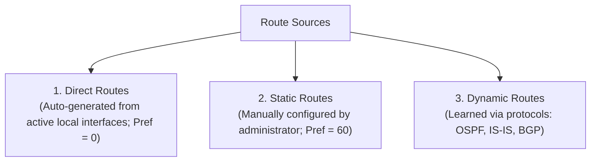
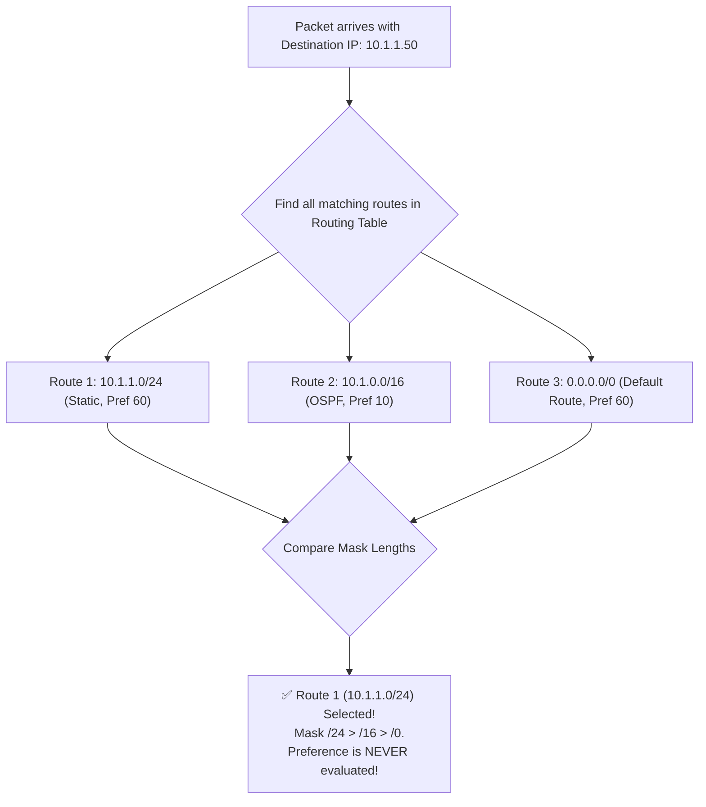
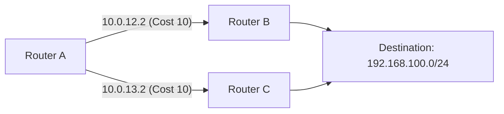
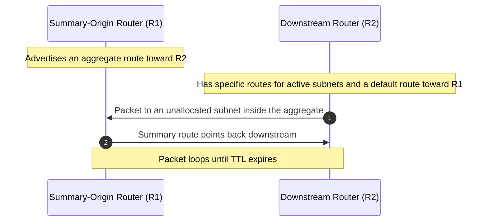
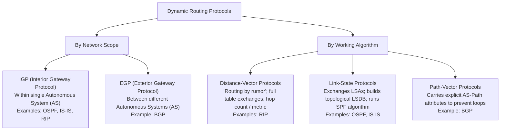

# 09. IP Routing Basics & Inter-VLAN Routing

> 💡 Unit 09 of 23 - HCIA-Datacom course. ☰ MOC | ← Unit 08 | Unit 10 →


---

### 5.1 Routing Table Architecture & Forwarding Fundamentals
> **Book Slide References (Parsed via MarkItDown):**
> - V2 Unit 9: routing purpose, p. 399
> - V2 Unit 9: routing-table fields and forwarding, pp. 401-402
> - V2 Unit 9: routing-table inspection, pp. 404-405
> - Slide 184-187: Route-based Forwarding Process & FIB

A router is a Layer 3 network device that operates at the network layer to forward packets between different IP subnets. To determine how to reach a destination, each router maintains a **Routing Table** (RIB: Routing Information Base) generated by the control plane, and programs a **Forwarding Information Base (FIB)** into hardware ASIC tables for wire-speed forwarding.

#### 1. Routing Entry Structure (`display ip routing-table`)

Every valid routing entry contains six core fields:

| Field | Description & Mechanics | Exam Nuance |
| :--- | :--- | :--- |
| **Destination/Mask** | Target network address and subnet mask length (e.g., `192.168.1.0/24`). | Identifies the destination network segment. |
| **Proto** | Protocol through which the router learned the route (`Direct`, `Static`, `OSPF`, `IS-IS`, `BGP`). | Direct routes require both physical and protocol states to be **Up**. |
| **Pre (Preference)** | Protocol trustworthiness metric. **Lower value = higher priority**. Range: 0-255. | Vendor-specific priority assigned to route source. |
| **Cost** | Protocol metric (distance, bandwidth, delay) used to choose the best path **within the same protocol**. | Compared only when routes originate from the same protocol. |
| **NextHop** | IP address of the adjacent next-hop router interface on the path to the destination. | Next-hop Layer 3 gateway address. |
| **Interface** | Local egress interface through which the packet leaves the router (e.g., `GigabitEthernet0/0/1`). | Physical or logical local port. |

#### 2. Route Classification by Source



1. **Direct Routes:** Automatically created when an interface is configured with an IP address and its physical link and data link layer states are both `Up`. If the interface goes `Down`, the direct route is immediately purged from the routing table.
2. **Static Routes:** Manually configured via CLI. Low resource consumption, but cannot adapt dynamically to topology changes.
3. **Dynamic Routes:** Discovered and updated automatically through routing protocols (OSPF, RIP, IS-IS, BGP). Suitable for medium-to-large networks.

---

### 5.2 Optimal Route Selection Mechanics: Longest Match vs. Preference
> **Book Slide References (Parsed via MarkItDown):**
> - V2 Unit 9: route preference and metric examples, pp. 406-408
> - V2 Unit 9: longest-prefix matching, pp. 410-411
> - Slide 180-183: Longest Match Rule Mechanics & Case Analysis

Routing decisions operate in two distinct architectural phases: **Control Plane installation** and **Data Plane packet forwarding**.

#### 1. Huawei Protocol Preference Hierarchy (Control Plane)

When multiple protocols discover a route to the **exact same destination prefix and same mask length**, the router compares their **Preference** values. The route with the lowest numerical preference is selected and installed into the active routing table:

| Protocol / Route Type | Huawei Default Preference | RFC / Cisco Comparison |
| :--- | :---: | :--- |
| **Direct** | **0** | Directly connected interfaces (highest priority) |
| **OSPF (Internal)** | **10** | Cisco AD: 110 |
| **IS-IS** | **15** | Cisco AD: 115 |
| **Static Route** | **60** | Cisco AD: 1 (Huawei uses 60) |
| **RIP** | **100** | Cisco AD: 120 |
| **OSPF (External / ASE)** | **150** | Cisco AD: 110 (Huawei separates external OSPF) |
| **BGP** | **255** | External BGP (EBGP) / Internal BGP (IBGP) |

> 💡 Cost / Metric Tie-Breaker
> If two routes are learned from the **same protocol** for the same destination and mask (having identical preference), the route with the **lower Cost (metric)** wins. If preference and cost are both identical, **Equal-Cost Multi-Path (ECMP)** installs both for load sharing.

#### 2. The Longest Prefix Match Rule (Data Plane Forwarding)

When forwarding a live packet, the router inspects the packet's destination IP address and compares it against all matching entries in the routing table.

$$\text{Longest Prefix Match Rule: The route with the most specific (longest) mask ALWAYS wins.}$$



> 💡 Critical Exam Rule
> Preference is **only evaluated** when competing routes have the **identical destination network and identical subnet mask**. If subnet masks differ, the **Longest Prefix Match Rule takes absolute precedence**, and preference is completely ignored!

---

### 5.3 Static Routing Principles & Configuration
> **Book Slide References (Parsed via MarkItDown):**
> - V2 Unit 9: static-route scenarios and constraints, pp. 428-430

#### 1. CLI Configuration Syntax

```bash
# Standard VRP Static Route Command:
ip route-static <destination-ip> { <mask-length> | <mask> } { <next-hop-ip> | <interface-type> <interface-number> } [ preference <preference-value> ]
```

#### 2. Interface Rules: Broadcast (Ethernet) vs. Point-to-Point (Serial)

| Interface Link Type                      | Command Requirement                | Technical Rationale                                                                                                                               |
| :--------------------------------------- | :--------------------------------- | :------------------------------------------------------------------------------------------------------------------------------------------------ |
| **Broadcast Multi-Access (Ethernet)**    | **Must specify Next-Hop IP**       | Multiple devices share the broadcast domain. The router must know which adjacent host IP to resolve via ARP to build the Layer 2 destination MAC. |
| **Point-to-Point (Serial / PPP / HDLC)** | **Can specify Outbound Interface** | Only one device exists on the other end of the link. Next-hop IP resolution is unnecessary.                                                       |

#### 3. Default Route (`0.0.0.0/0`)
- A default route is a special static or dynamic route whose destination IP and mask are both `0.0.0.0 0.0.0.0` (or `0.0.0.0 0`).
- Because its prefix length is `/0` (the shortest possible mask), it matches **all** packets, but only takes effect when no more specific route matches.
- Commonly deployed on campus edge routers pointing to the ISP gateway:

```bash
[Router] ip route-static 0.0.0.0 0 203.0.113.1
```

---

### 5.4 Advanced Routing Features: ECMP, Floating Routes & Route Summarization
> **Book Slide References (Parsed via MarkItDown):**
> - V2 Unit 9: recursive lookup, pp. 434-435
> - V2 Unit 9: floating routes, pp. 436-437
> - V2 Unit 9: summarization and CIDR, pp. 438-441
> - V2 Unit 9: summarization loop and Null0 solution, pp. 442-443

#### 1. Equal-Cost Multi-Path (ECMP)
When multiple paths to the same destination have the **same preference and the same cost**, the router installs all of them into the routing table. Forwarding hardware automatically load-balances traffic across these links based on flow hashing (source IP, destination IP, 5-tuple).



#### 2. Floating Static Routes (Active/Standby Failover)
A **Floating Static Route** is a backup static route configured with a **higher preference value** than the primary route:
- **Normal Operation:** The primary route (e.g. static with default preference `60`, or OSPF with preference `10`) is installed in the active routing table. The floating route is dormant and does not appear in `display ip routing-table`.
- **Link Failure:** If the primary link goes down and its route is removed from the table, the floating static route automatically activates and enters the routing table.
- **Link Restoration:** Once the primary link recovers, the router re-installs the lower-preference primary route, preempting the floating backup.

```bash
# Primary static route via High-Speed Fiber link (Default Preference = 60)
[Router] ip route-static 192.168.20.0 24 10.1.1.2

# Floating backup route via Backup LTE link (Configured with Preference = 100)
[Router] ip route-static 192.168.20.0 24 10.2.2.2 preference 100
```

#### 3. Route Summarization & Loop Prevention via Null0 Interface

Route summarization (CIDR / supernetting) aggregates multiple contiguous smaller subnets into one larger route, reducing routing-table size. The forwarding loop and correct discard-route placement depend on the topology. V2 demonstrates a loop when a downstream router sends unmatched traffic to an upstream router's summary route, which then points traffic back to the downstream router. In that topology, Huawei installs the summary prefix to `NULL0` on the downstream router (RTB), preventing unmatched traffic from following the default route upstream. Other designs may place an aggregate discard route on the summary-origin router; place it where it breaks the actual loop and preserve more-specific routes for active subnets. Loop topology, p. 442 V2 NULL0 placement and behavior, p. 443

> 💡 Summary-route loop
> If an aggregate advertises address space with no active specific route, a downstream router's default route can send traffic to the summary origin, whose summary route can point it back. The packet loops until its TTL expires unless a discard route breaks the cycle.



**Null0 fix shown in V2:** install a discard route for the aggregate on the downstream router that would otherwise send unmatched traffic upstream:

```bash
[RTB] ip route-static 10.1.0.0 16 NULL0
```

More-specific routes for active subnets win by longest-prefix match and continue forwarding normally. Traffic for unallocated subnets within the aggregate matches the `NULL0` route and is dropped, breaking the loop.

---

### 5.5 Dynamic Routing Protocol Classification
> **Book Slide References (Parsed via MarkItDown):**

Dynamic routing protocols are classified along two primary dimensions:



---

### 5.6 CLI Inspection & Verification Commands

```bash
# 1. Inspect the active routing table (installed routes only)
<Huawei> display ip routing-table

# 2. Inspect a specific destination prefix
<Huawei> display ip routing-table 192.168.10.0

# 3. Inspect detailed verbose routing attributes (including inactive routes and FIB state)
<Huawei> display ip routing-table verbose

# 4. Inspect protocol-filtered routing table
<Huawei> display ip routing-table protocol static
<Huawei> display ip routing-table protocol ospf
```

---

### 10.1 Two Primary Inter-VLAN Routing Architectures

Because VLANs strictly isolate Layer 2 broadcast domains, traffic between different VLANs must be routed by a **Layer 3 device**:

| Architecture | Core Hardware | Layer 2 Uplink Port Mode | Gateway Implementation | Pros & Cons |
| :--- | :--- | :--- | :--- | :--- |
| **Router-on-a-Stick (Sub-interfaces)** | Layer 2 Switch + Router | **Trunk or Hybrid** carrying the required VLANs | Logical Sub-interface on router (`GE0/0/1.10`, `GE0/0/1.20`) | Economical (uses 1 physical router port), but single-link bottleneck. V2's worked setup uses Trunk; its review answer also permits Hybrid. |
| **Layer 3 Switching (VLANIF Interfaces)** | Layer 3 Switch (Multilayer Switch) | Internal switch backplane | Logical **VLANIF** Layer 3 interface (`interface Vlanif 10`) | High performance (hardware ASIC wire-speed routing), no physical bottleneck. |

---

### 10.2 Router-on-a-Stick Configuration (Huawei VRP)

On a Huawei router, the sub-interface must be configured to terminate the VLAN tag. On supported Huawei VRP platforms, `arp broadcast enable` is also needed when the termination sub-interface must generate ARP broadcasts to resolve an adjacent host and the access device does not provide automatic ARP forwarding. Do not teach this as an unconditional requirement for every model or topology. The V2 Unit 9 worked example shows VLAN termination and IP addressing but does not include the ARP command; Huawei's product documentation describes the ARP setting and its conditions. V2 worked example, p. 421 [Huawei: Configuring IP Services on VLAN Tag Termination Sub-interfaces](https://info.support.huawei.com/hedex/api/pages/EDOC1100363264/AEN0403J/05/resources/vrp/dc_vrp_qinq_cfg_0010.html)

```bash
# 1. Switch Uplink Port configuration (must be a Trunk allowing the VLANs)
[Huawei-Switch] interface GigabitEthernet0/0/24
[Huawei-Switch-GigabitEthernet0/0/24] port link-type trunk
[Huawei-Switch-GigabitEthernet0/0/24] port trunk allow-pass vlan 10 20

# 2. Router Sub-interface for VLAN 10 Gateway
[Huawei-Router] interface GigabitEthernet0/0/1.10
[Huawei-Router-GigabitEthernet0/0/1.10] ip address 192.168.10.254 24
[Huawei-Router-GigabitEthernet0/0/1.10] dot1q termination vid 10     # Associates sub-interface with VLAN 10 (strips/adds 802.1Q tag)
[Huawei-Router-GigabitEthernet0/0/1.10] arp broadcast enable        # Use when required for ARP resolution on this platform/topology

# 3. Router Sub-interface for VLAN 20 Gateway
[Huawei-Router] interface GigabitEthernet0/0/1.20
[Huawei-Router-GigabitEthernet0/0/1.20] ip address 192.168.20.254 24
[Huawei-Router-GigabitEthernet0/0/1.20] dot1q termination vid 20
[Huawei-Router-GigabitEthernet0/0/1.20] arp broadcast enable
```

> 💡 Exam and platform qualification
> - `dot1q termination vid <id>` binds a VLAN tag to the sub-interface; V2 explicitly teaches this step.
> - `arp broadcast enable` is not shown in the V2 Unit 9 example. Huawei's platform documentation says VLAN-tag-termination sub-interfaces do not forward broadcast packets by default; whether the command is needed for successful address resolution depends on whether the connected device provides automatic ARP forwarding. Verify the target model and topology before treating it as required. The local question bank tests the command, but that alone does not establish a universal requirement. [Huawei command guide](https://info.support.huawei.com/hedex/api/pages/EDOC1100362944/AZN04029/06/resources/command/yunshan/ARPBROADCASTENABLE%28ETHBASEOM%29.html)

---

### 10.3 Layer 3 Switch VLANIF Configuration (Huawei VRP)

A **VLANIF** is a logical Layer 3 interface created directly inside a Layer 3 switch for each VLAN. When an L3 switch receives a frame, it checks the destination MAC address: if it is the switch's VLANIF MAC, the switch sends the packet to its Layer 3 routing process; otherwise, it performs Layer 2 forwarding. V2 forwarding decision, p. 444

```bash
# 1. Create VLANs
[Huawei-L3Switch] vlan batch 10 20

# 2. Configure VLANIF 10 as Gateway for VLAN 10
[Huawei-L3Switch] interface Vlanif 10
[Huawei-L3Switch-Vlanif10] ip address 192.168.10.254 24

# 3. Configure VLANIF 20 as Gateway for VLAN 20
[Huawei-L3Switch] interface Vlanif 20
[Huawei-L3Switch-Vlanif20] ip address 192.168.20.254 24
```

> 💡 VLANIF State Up Condition
> A VLANIF interface enters the **UP** state if and only if:
> 1. The corresponding VLAN is created in the switch VLAN database.
> 2. At least **one physical interface** assigned to that VLAN (Access, Trunk, or Hybrid) is in the **UP** operational state.
>
> **IP address configuration alone does NOT affect the VLANIF UP/DOWN state.**
>
> **Cross-Technology ARP Trap (High-Frequency Exam Mistake):**
> | Technology | Device | Needs `arp broadcast enable`? |
> | :--- | :--- | :---: |
> | Router-on-a-Stick Sub-interface | Router | **Conditional:** may be needed for ARP resolution on VLAN-tag-termination sub-interfaces |
> | VLANIF Interface | Layer 3 Switch | **NO, Handled natively by ASIC** |
>
> Do not apply `arp broadcast enable` to a VLANIF. For a router sub-interface, confirm the platform and peer behavior before adding the command.

---


---

