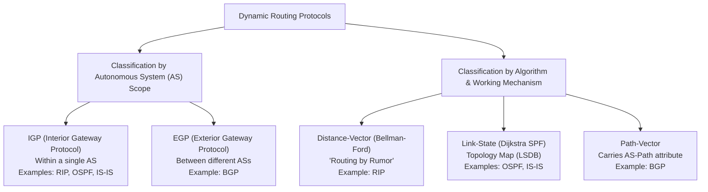
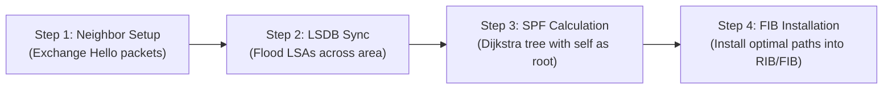
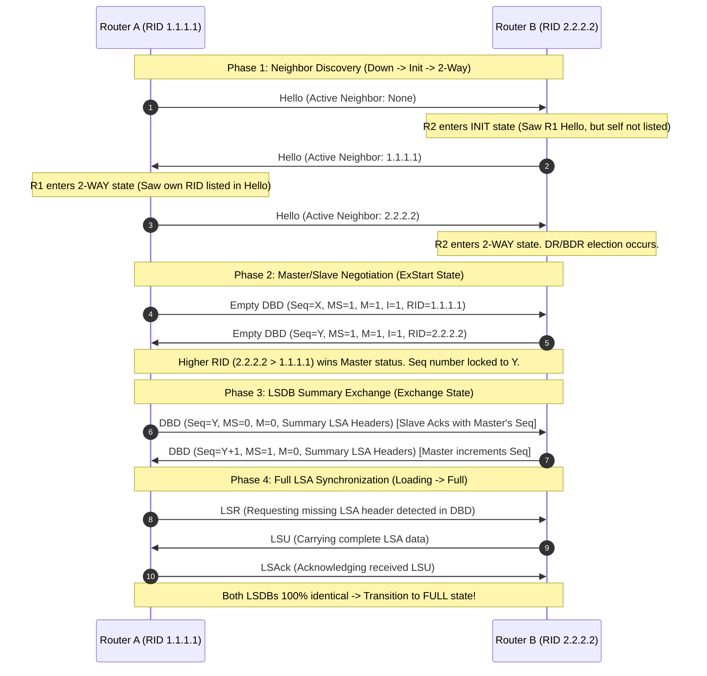
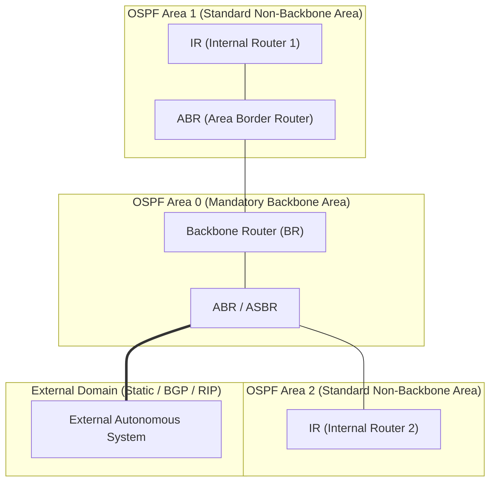
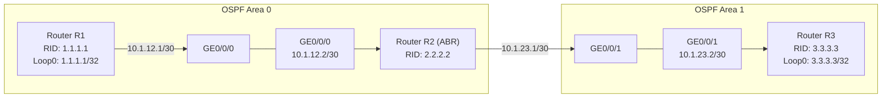

# 10. OSPF Fundamentals and Configuration

> 💡 Unit 10 of 23 - HCIA-Datacom course. ☰ MOC | ← Unit 09 | Unit 11 →


---

### 6.1 OSPF Overview

#### 6.1.1 Classification of Dynamic Routing Protocols
> **Book Slide References (Parsed via MarkItDown):**
> - Slide 226: Why Are Dynamic Routing Protocols Used?
> - Slide 227: Classification of Dynamic Routing Protocols (by AS and by Algorithm)
> - Slide 228: Distance-Vector Routing Protocol Mechanics ("Routing by Rumor")
> - Slide 229: Link-State Routing Protocol, LSA Flooding
> - Slide 230: Link-State Routing Protocol, LSDB Creation
> - Slide 231: Link-State Routing Protocol, SPF Calculation
> - Slide 232: Link-State Routing Protocol, Routing Table Generation
> - Slide 233: Summary of Link-State Routing Protocol Operation

##### 1. Why Dynamic Routing Protocols Are Essential
> **V2 source pages:** need for dynamic routing, p. 451; protocol classification, pp. 452-453; link-state flooding and LSDB, pp. 454-458.

Static routing requires manual configuration per prefix. On live enterprise networks, it suffers from two major limitations:
1. **Inability to scale:** Configuration workload grows exponentially ($O(N^2)$) as devices increase.
2. **Inability to respond dynamically to topology faults:** When a physical link fails, a static route remains in the FIB until manually deleted or until the next-hop interface goes physically down. Dynamic routing protocols automatically detect neighbor loss, flood topology updates, and recalculate optimal paths.

##### 2. Dynamic Routing Protocol Taxonomies



##### 3. Distance-Vector vs. Link-State Protocols

| Evaluation Dimension | Distance-Vector (RIP) | Link-State (OSPF / IS-IS) |
| :--- | :--- | :--- |
| **Basic Transmission Unit** | Full routing table entries (`Destination + Cost`) | Link State Advertisements (**LSAs**) describing interface states and costs |
| **Topology Awareness** | Zero. Only knows distance (hops) and next-hop direction ("Routing by Rumor"). | Full area topology graph stored in the Link-State Database (**LSDB**). |
| **Algorithm** | Bellman-Ford algorithm | Dijkstra Shortest Path First (**SPF**) algorithm |
| **Loop-Free Guarantee** | Prone to counting-to-infinity; relies on split horizon, poison reverse, and holddown timers. | Mathematically guaranteed 100% loop-free intra-area by constructing a shortest path tree. |
| **Update Mechanism** | Periodic flooding of full routing table (every 30 seconds). | Triggered incremental updates sent only when a topology change occurs. |
| **Hop Count Limit** | Max 15 hops (16 = unreachable). | No hop count limit; constrained by link bandwidth and CPU/memory. |

##### 4. The 4-Step Link-State Operational Flow Slide 233



1. **Neighbor Discovery:** Routers exchange Hello packets on interconnected interfaces to establish bidirectional neighbor relationships.
2. **LSDB Synchronization:** Routers exchange LSA summaries and flood detailed LSAs until all routers in the area possess identical LSDBs.
3. **SPF Calculation:** Each router independently executes Dijkstra's SPF algorithm on its local LSDB, calculating a loop-free shortest path tree with itself as the root.
4. **Routing Table Generation:** The optimal paths from the SPF tree are installed into the OSPF Routing Table and downloaded to the Forwarding Information Base (FIB).

---

#### 6.1.2 Introduction to OSPF
> **Book Slide References (Parsed via MarkItDown):**
> - V2 Unit 10: OSPF concepts and scenarios, pp. 459-467
> - V2 Unit 10: OSPF packets, p. 464
> - Slide 234: Introduction to OSPF (RFC 2328 vs RFC 2740)
> - Slide 235: OSPF Application on Campus Networks
> - Slide 236: Basic OSPF Concepts, Area
> - Slide 237: Basic OSPF Concepts, Router ID
> - Slide 238: Basic OSPF Concepts, Cost Value & Accumulated Cost
> - Slide 239: 5 Types of OSPF Packets
> - Slide 240: Entries in the Neighbor Table (display ospf peer)
> - Slide 241: Entries in the LSDB Table (display ospf lsdb)
> - Slide 242: Entries in the OSPF Routing Table (display ospf routing)

##### 1. Protocol Specifications & Versions
- **OSPFv2 (RFC 2328):** Designed specifically for IPv4. Encapsulates directly in IP packets (**IP Protocol Number 89**; no TCP or UDP transport layer overhead).

##### 2. Core Architectural Concepts

###### A. OSPF Area
- An area is a logical grouping of OSPF routers and networks identified by a 32-bit Area ID (written either as a decimal integer `0` or in dotted-decimal notation `0.0.0.0`).
- **Area 0 (`0.0.0.0`):** The designated **Backbone Area**. All non-backbone areas must maintain direct logical or physical connectivity to Area 0 to prevent inter-area routing loops.
- **LSDB Boundary:** Routers within the same area share a 100% identical LSDB. LSA flooding is bounded by the area perimeter, shielding other areas from localized topology churn.

A 32-bit unique identifier written in dotted-decimal format (e.g., `1.1.1.1`):
1. **Manual Configuration (`ospf 1 router-id x.x.x.x`):** Highest precedence. It is an arbitrary 32-bit number and does **not** have to match any active physical interface IP address.
2. **Highest IP on Active Loopback Interfaces:** If no manual RID is specified, VRP scans configured loopback interfaces and elects the largest numerical IP.
3. **Highest IP on Active Physical Interfaces:** If no loopback exists, VRP selects the largest IP among active physical interfaces.
4. **Global Domain Uniqueness Invariant:** The Router ID must be **globally unique across the entire OSPF AS domain**. It is NEVER identical within an area or per area. Manual configuration is optional; VRP will always auto-select if omitted.

> Changing or reconfiguring an OSPF Router ID **does NOT take effect immediately**. The running OSPF process retains the original RID to prevent network flapping. The new Router ID only activates after explicitly restarting the OSPF process:
> ```bash
> <Huawei> reset ospf process
> Warning: The OSPF process will be reset. Continue? [Y/N]: y
> ```
>
> ```mermaid
> flowchart LR
>     A["1. Enter CLI Command<br/>`ospf 1 router-id 10.0.0.1`"] --> B["2. Stored in Configuration<br/>(Pending state)"]
>     B --> C["3. Live Process Retains Old RID<br/>(Neighbor adjacencies stay UP)"]
>     C --> D["4. Execute `<Huawei> reset ospf process`<br/>(New RID takes effect, adjacencies reset)"]
> ```

###### C. Metric (Cost) Calculation & Reference Bandwidth
OSPF assigns a cost to every enabled interface based on its operational bandwidth:
$$\text{Interface Cost} = \left\lfloor \frac{\text{Reference Bandwidth}}{\text{Interface Bandwidth}} \right\rfloor$$
- **Default Reference Bandwidth:** **100 Mbit/s** (`10^8` bps).
- **Default Calculated Interface Costs:**
  - 100M FastEthernet (FE): $100 / 100 = \mathbf{1}$
  - 1000M GigabitEthernet (GE): $100 / 1000 = 0.1 \rightarrow$ Clamped to minimum integer value $\mathbf{1}$
  - 10GE (10,000 Mbps): $100 / 10000 = 0.01 \rightarrow$ Clamped to minimum integer value $\mathbf{1}$
  - 1.544M Serial Link: $100 / 1.544 \approx \mathbf{64}$
- **Fraction Orientation Rule (Exam Trap Alert):**
  $$\text{Cost} = \frac{\mathbf{\text{Reference Bandwidth (Numerator / البسط)}}}{\mathbf{\text{Interface Bandwidth (Denominator / المقام)}}}$$
  - **Intuitive Memory Anchor (The Routing Logic):** In routing, **Cost is a penalty** (تكلفة/إرهاق). A lower cost path is preferred over a higher cost path!
    - We want a **faster link** (high bandwidth) to have a **LOWER cost** (better path).
    - We want a **slower link** (low bandwidth) to have a **HIGHER cost** (worse path).
    - To make a bigger interface bandwidth produce a smaller cost, the **Interface Bandwidth MUST be in the denominator (المقام تحت)**:
      $$\text{Huge Bandwidth (Faster link)} \implies \frac{\text{Reference}}{\mathbf{\text{Huge Bandwidth}}} = \mathbf{\text{Small Cost (Preferred!)}}$$
      $$\text{Tiny Bandwidth (Slower link)} \implies \frac{\text{Reference}}{\mathbf{\text{Tiny Bandwidth}}} = \mathbf{\text{Large Cost (Avoided!)}}$$
    - *Trap Warning:* If you inverted the fraction to $\frac{\text{Interface}}{\text{Reference}}$, a 10GE link would have cost 10 and a 100M link would have cost 1, causing OSPF to prefer the slow 100M link over the fast 10GE link!
  - **Concrete Reference Tuning Example:**
    - If Reference = 1,000 Mbps:
      - 100 Mbps (FastEthernet): $\frac{1000}{100} = \mathbf{10}$ (Higher cost = slower link)
      - 1,000 Mbps (GigabitEthernet): $\frac{1000}{1000} = \mathbf{1}$ (Lower cost = faster link)
      - 10,000 Mbps (10GE): $\frac{1000}{10000} = 0.1 \rightarrow$ Clamped to minimum $\mathbf{1}$
- **Why Fast Interfaces Default to Cost 1 (The Clamping Rule):**
  - OSPF interface cost must be an integer $\ge 1$. A link cost can never be 0 or fractional.
  - When calculating $100 / 1000 = 0.1$, the value is less than 1, so VRP **clamps** it up to the minimum cost of **1**.
  - This is why an un-tuned OSPF network sees 100M, 1G, and 10G links as having identical cost (1), failing to prefer higher-speed links until `bandwidth-reference` is raised.
- **Path Cost Accumulation Rule:** The total cost of an OSPF route is the cumulative sum of the costs of all **inbound (ingress) interfaces** along the forwarding path from the destination back to the local router.
- **Reference Bandwidth Tuning:** Because FE, GE, and 10GE all default to cost 1, the reference bandwidth must be adjusted globally on high-speed enterprise networks:
  ```bash
  [Huawei-ospf-1] bandwidth-reference 10000    # Scales reference to 10 Gbps (10,000 Mbps)
  ```

> 💡 OSPF Cost Retrieval Checkpoint
> **Derived application of the formula above:** With the reference bandwidth set to 10,000 Mbps, calculate the interface cost of a 1,000 Mbps link and explain why its default cost was 1 before the reference bandwidth was changed.
>

###### D. Multicast Addresses & Encapsulation
OSPF bypasses L4 transport protocols and writes directly into IPv4 payloads (**Protocol 89**):
- **`224.0.0.5` (AllSPFRouters):** Listened to by all OSPF-enabled routers. Used for periodic Hello packets and DR/BDR multicast updates to DRothers.
- **`224.0.0.6` (AllDRouters):** Listened to **exclusively by the DR and BDR**. DRothers transmit link-state updates (LSU) and acknowledgments (LSAck) to `224.0.0.6`.

##### 3. The 5 OSPF Packet Types Slide 234

All 5 OSPF packets share a common 24-byte base header:

| Type | Packet Name | Destination IP | Core Function |
| :---: | :--- | :--- | :--- |
| **1** | **Hello** | `224.0.0.5` (or unicast in NBMA) | Discovers neighbors, negotiates timers/parameters, acts as keepalive heartbeat, and elects DR/BDR. |
| **3** | **Link State Request (LSR)** | Unicast to neighbor | Requests specific missing or outdated LSAs identified during the Exchange state. |
| **4** | **Link State Update (LSU)** | `224.0.0.5` / `224.0.0.6` or Unicast | Carries full instances of requested or triggered LSAs. **The ONLY packet carrying complete routing/topology data**. Unacknowledged LSUs are retransmitted after the 5s retransmission timer. |

##### 4. The Three Core OSPF Tables in Huawei VRP

```bash
# 1. Neighbor Table: Displays established neighbor relationships and FSM states
<Huawei> display ospf peer

# 2. LSDB Table: Displays all LSAs stored in the local link-state database
<Huawei> display ospf lsdb

# 3. OSPF Routing Table: Displays optimal paths calculated by SPF before FIB download
<Huawei> display ospf routing
```

---

### 6.2 OSPF Working Mechanism

#### 6.2.1 Establishing an OSPF Adjacency Relationship
> **Book Slide References (Parsed via MarkItDown):**
> - V2 Unit 10: OSPF packet exchange and adjacency, pp. 469-474
> - V2 Unit 10: OSPF network types, pp. 475-478
> - V2 Unit 10: areas and multi-area operation, pp. 479-483
> - Slide 244: Neighbor Relationship vs Adjacency
> - Slide 245: Adjacency Establishment Process (4 Steps)
> - Slide 246: Step 1, Hello Exchange & 2-Way State
> - Slide 247: Steps 2 & 3, ExStart Master/Slave & Exchange DBDs
> - Slide 248: Step 4, Loading LSR/LSU/LSAck & Full State
> - Slide 249: Detailed Review of display ospf peer Command Output

##### 1. Neighbor Relationship vs. Adjacency
- **Neighbor Relationship:** Two routers exchange Hello packets and confirm bidirectional communication (**2-Way state**).
- **Adjacency:** Two routers advance past 2-Way, exchange DBDs, synchronize their LSDBs via LSR/LSU/LSAck, and reach the **Full state**.

##### 2. The 8-State Finite State Machine (FSM) Walkthrough



##### 3. Critical State Characteristics & Exam Traps
1. **Down:** Initial state; no Hello packets received.
2. **Attempt:** Strictly valid **only on NBMA networks** where neighbors are manually configured via `peer <ip>`. On Broadcast and P2P networks, receiving a Hello transitions directly from Down to Init, the Attempt state is never entered.
3. **Init:** A Hello packet is received from the peer, but the local router's RID is not yet present in the received Hello's neighbor list.
   - **DR/BDR election** occurs at this state.
   - `MS` bit = Master (1 = Master, 0 = Slave).
   - `M` bit = More (1 = More DBDs coming, 0 = Last DBD).
   - `I` bit = Initialize (1 = Initial negotiation packet, 0 = Subsequent packet).
   - The router with the **higher Router ID** becomes the Master. The Slave uses the Master's sequence numbers to acknowledge packets.
6. **Exchange:** Routers exchange non-empty DBD packets containing LSA summary headers.
7. **Loading:** Routers send **LSR** for missing LSAs, receive **LSU**, and acknowledge via **LSAck**.

##### 4. Comprehensive Breakdown of `display ospf peer` Fields Slide 249

```text
<R1> display ospf peer
          OSPF Process 1 with Router ID 1.1.1.1
                  Neighbors 

 Area 0.0.0.0 interface 10.1.1.1(GigabitEthernet1/0/0)'s neighbors
 Router ID: 2.2.2.2          Address: 10.1.1.2        GR State: Normal     
 State: Full  Mode:Nbr is  Master  Priority: 1
 DR: 10.1.1.1  BDR: 10.1.1.2  MTU: 0    
 Dead timer due in 35  sec
 Retrans timer interval: 5 
 Authentication Sequence: [ 0 ]
```

| Field in Output | Architectural Meaning | Exam Nuance |
| :--- | :--- | :--- |
| **OSPF Process 1 with Router ID 1.1.1.1** | Identifies local process ID and local RID. | Local process ID is locally significant; does not need to match neighbor. |
| **Area 0.0.0.0** | Area ID to which this interface belongs. | Area ID **must match** between directly connected neighbors. |
| **Router ID: 2.2.2.2** | Router ID of the remote neighboring device. | Must be unique across the entire OSPF domain. |
| **Address: 10.1.1.2** | IP address configured on the neighbor's interface. | Must be in the same IP subnet as the local interface on broadcast links. |
| **GR State: Normal** | Graceful Restart state. | Default is Normal (device supports non-stop forwarding during control plane reboot). |
| **State: Full** | Current state of the OSPF FSM. | Stable state is `Full` (or `2-Way` between two DRothers). |
| **Mode: Nbr is Master** | DBD exchange role. | Indicates whether the remote neighbor is Master or Slave (negotiated in ExStart). |
| **Priority: 1** | DR election priority of the neighbor interface. | Default is 1. Range is 0-255 (0 = ineligible for DR/BDR). |
| **DR: 10.1.1.1 / BDR: 10.1.1.2** | IP addresses of the elected DR and BDR on this segment. | On P2P links, DR and BDR display as `None`. |
| **Dead timer due in 35 sec** | Countdown timer for neighbor liveness. | Resets to 40s (or 120s) each time a valid Hello is received. Reaching 0 tears down adjacency. |
| **Retrans timer interval: 5** | Interval (in seconds) before unacknowledged LSAs are retransmitted. | Default retransmission timeout is 5 seconds. |

---

#### 6.2.2 OSPF Network Types
> **Book Slide References (Parsed via MarkItDown):**
> - Slide 250: OSPF Network Types Overview
> - Slide 251: Network Types, P2P vs BMA
> - Slide 252: Network Types, NBMA vs P2MP
> - Slide 253: Background of DR and BDR (Adjacency Explosion Problem)
> - Slide 254: DR and BDR Working Principles
> - Slide 255: Single-Area Scalability Limitations
> - Slide 256: Multi-Area OSPF Architecture
> - Slide 257: Types of OSPF Routers (IR, BR, ABR, ASBR)
> - Slide 258: Typical Enterprise Networking Scenarios

##### 1. Comparison of 4 OSPF Network Types

```bash
# Manually change network type on interface:
[Huawei-GigabitEthernet0/0/0] ospf network-type { broadcast | nbma | p2mp | p2p }
```

| Parameter | Broadcast (BMA) | Point-to-Point (P2P) | Non-Broadcast (NBMA) | Point-to-Multipoint (P2MP) |
| :--- | :--- | :--- | :--- | :--- |
| **Default Link Layer** | Ethernet, FastEthernet, GE | Serial with PPP or HDLC | Frame Relay, ATM, X.25 | None (must be manually configured) |
| **DR/BDR Election?** | **Yes** | **No** | **Yes** | **No** |
| **Hello / Dead Timers** | **10s / 40s** | **10s / 40s** | **30s / 120s** | **30s / 120s** |
| **Packet Destination IP** | Multicast (`224.0.0.5`, `224.0.0.6`) | Multicast (`224.0.0.5`) | Unicast (`peer <ip>`) | Multicast (`224.0.0.5`) |
| **Neighbor Discovery** | Automatic | Automatic | Manual (`peer` command) | Automatic |

> 💡 Exam Traps & Architectural Rules for OSPF Network Types
> 1. **DR/BDR Election Boundary (Critical Rule):**
>    - **Broadcast (BMA) & NBMA:** **ELECT DR/BDR.** Because multiple routers share the medium, a DR/BDR is essential to prevent the $N(N-1)/2$ adjacency explosion.
>    - **Point-to-Point (P2P) & Point-to-Multipoint (P2MP):** **DO NOT ELECT DR/BDR.** On a P2P link, exactly two routers connect directly to each other ($N=2 \rightarrow 1$ adjacency). There is no third router, no explosion risk, and no broadcast domain; electing a DR would create unnecessary delay and protocol overhead.
> 2. **Timer Mismatch Adjacency Block:** OSPF neighbor formation strictly requires identical Hello and Dead intervals in the Hello packet header. If one side is configured as Broadcast (10s/40s) and the other as P2MP (30s/120s), the neighbor relationship will **never reach 2-Way or Full**.
> 3. **Manual Peer Requirement:** Only **NBMA** requires manual configuration of the neighbor's IP via the `peer <ip>` command, because legacy NBMA media cannot propagate broadcast or multicast traffic.

##### 2. The DR/BDR Election Problem & Mechanics
On a multi-access network with $N$ routers, a full mesh of adjacencies requires:
$$\text{Total Adjacencies} = \frac{N(N - 1)}{2}$$
For $N = 6$, this equals 15 adjacencies. With DR/BDR, total adjacencies drop to:
$$\text{Total Adjacencies with DR/BDR} = 2N - 3$$
For $N = 6$, this requires only 9 adjacencies, drastically cutting LSA flooding.

###### Election Rules:
1. **Highest Interface Priority Wins:** Configured with `ospf dr-priority <0-255>` (Default = **1**).
   - Priority 0 means the router **never participates** in election (permanently DRother).
2. **Highest Router ID Breaks Ties:** If priorities are identical, the highest RID wins.
3. **Non-Preemptive Principle (Critical Trap):** DR/BDR election is **non-preemptive**. Once elected, a newly connected router with higher priority or higher RID **cannot take over** the DR/BDR role unless the current DR fails, the OSPF process restarts, or the link flaps.
5. **DRother Adjacency Invariant (Exam Trap):** On any multi-access segment with $N \ge 3$ routers, a **DRother router forms exactly TWO (2) Full adjacencies**:
   - One Full adjacency with the **DR**.
   - One Full adjacency with the **BDR**.
   - With all remaining $(N - 3)$ DRothers, it halts at the **2-Way state** (confirms bidirectional Hello discovery, but strictly prohibits LSDB synchronization or DBD exchange). This invariant holds regardless of whether the segment connects 5, 8, or 100 routers.

##### 3. Hierarchical Multi-Area Architecture & Router Roles



###### Router Classifications:
- **Internal Router (IR):** All interfaces belong strictly to a single non-backbone area.
- **Backbone Router (BR):** Has at least one interface belonging to Area 0.

---

### 6.3 Typical OSPF Configuration

#### 6.3.1 Basic OSPF Configuration
> **Book Slide References (Parsed via MarkItDown):**
> - V2 Unit 10: configuration commands, pp. 485-486
> - V2 Unit 10: configuration example and verification, pp. 487-491
> - Slide 260: Basic OSPF Configuration Commands (ospf, area, network)
> - Slide 261: Advanced Configuration Commands (ospf cost, bandwidth-reference, ospf dr-priority)

##### Core CLI Syntax
```bash
# 1. Create OSPF process with explicit Router ID
[Huawei] ospf [ process-id | router-id <router-id> ]

# 2. Enter OSPF Area View
[Huawei-ospf-1] area <area-id>

# 3. Enable OSPF on interfaces using Wildcard Mask
# Wildcard mask is the inverse of subnet mask (0 = must match, 1 = ignore)
[Huawei-ospf-1-area-0.0.0.0] network <network-address> <wildcard-mask>

# 4. Optional interface tuning
[Huawei-GigabitEthernet0/0/1] ospf cost <1-65535>           # Manually set link cost
[Huawei-GigabitEthernet0/0/1] ospf dr-priority <0-255>       # Tune DR election priority
[Huawei-ospf-1] bandwidth-reference <value-in-mbps>          # Adjust reference bandwidth
```

> 💡 Huawei VRP OSPF 3-Tier Hierarchy & Command Trap
> 1. **The 3-Tier View Hierarchy:**
>    - Step 1 (System $\rightarrow$ Process): `[Huawei] ospf 1 router-id 1.1.1.1`
>    - Step 2 (Process $\rightarrow$ Area): `[Huawei-ospf-1] area 0`
>    - Step 3 (Area $\rightarrow$ Interfaces): `[Huawei-ospf-1-area-0.0.0.0] network <ip> <wildcard-mask>`
> 2. **Exam Trap Alert (No `ospf enable` command):** In Huawei VRP IPv4 OSPF, interfaces are **never** activated with a command like `ospf enable <ip>`. Interfaces are matched and activated strictly from within the Area View using the **`network <network-address> <wildcard-mask>`** statement.

###### Wildcard Mask Calculation Rule:
$$\text{Wildcard Mask} = 255.255.255.255 - \text{Subnet Mask}$$
- **Binary Meaning:**
  - Bit `0`: The corresponding bit of the interface IP **must strictly match**.
  - Bit `1`: The corresponding bit is **ignored (wildcard)**.
- **Common Examples in Huawei Exams:**
  - Subnet `/24` ($255.255.255.0$): $255.255.255.255 - 255.255.255.0 = \mathbf{0.0.0.255}$
    - E.g.: `network 192.168.1.0 0.0.0.255` enables OSPF on any interface with an IP in `192.168.1.0/24`.
  - Subnet `/30` ($255.255.255.252$): $255.255.255.255 - 255.255.255.252 = \mathbf{0.0.0.3}$
    - E.g.: `network 10.1.1.0 0.0.0.3` enables OSPF on the point-to-point interconnect.
  - Exact Interface IP Match (`/32`): $255.255.255.255 - 255.255.255.255 = \mathbf{0.0.0.0}$
    - E.g.: `network 192.168.1.1 0.0.0.0` matches **strictly and only** the interface having the exact IP `192.168.1.1`.
- **Exam Trap Alert:** Do NOT enter a regular subnet mask like `255.255.255.0` in the `network` command; Huawei VRP expects the **Wildcard Mask**. If you enter `255.255.255.0`, VRP will reject or misinterpret the command.

##### Subnet Mask vs. Wildcard Mask Conversion Reference
| Target Match Scope | Standard Subnet Mask (قناع الشبكة العادي) | OSPF Wildcard Mask (القناع العكسي) | Correct Huawei VRP Command |
| :--- | :--- | :--- | :--- |
| **Entire /24 Network** (e.g. 192.168.1.0/24) | `255.255.255.0` | `0.0.0.255` | `network 192.168.1.0 0.0.0.255` |
| **Entire /30 Link** (e.g. 10.1.1.0/30) | `255.255.255.252` | `0.0.0.3` | `network 10.1.1.0 0.0.0.3` |
| **Single Exact Interface IP** (e.g. 192.168.1.1) | `255.255.255.255` | `0.0.0.0` | `network 192.168.1.1 0.0.0.0` |
| **All Interfaces Everywhere** | `0.0.0.0` | `255.255.255.255` | `network 0.0.0.0 255.255.255.255` |

---

#### 6.3.2 OSPF Configuration Example
> **Book Slide References (Parsed via MarkItDown):**
> - Slide 262: Configuration Topology Description
> - Slide 263: Step 1, Configuring Device Interfaces
> - Slide 264: Step 2, Configuring OSPF on R1
> - Slide 265: Step 2, Configuring OSPF on R2 (ABR) & R3
> - Slide 266: Step 3, Verification (display ospf peer brief)
> - Slide 267: Step 3, Verification (display ip routing-table & ping -a)
> - Slide 268: Checkpoint Quiz

##### 1. Lab Topology & Addressing Plan



##### 2. Complete Configuration Commands

```bash
# ==========================================
# Router R1 Configuration (Area 0 Internal)
# ==========================================
[R1] interface LoopBack 0
[R1-LoopBack0] ip address 1.1.1.1 32
[R1-LoopBack0] quit
[R1] interface GigabitEthernet 0/0/0
[R1-GigabitEthernet0/0/0] ip address 10.1.12.1 30
[R1-GigabitEthernet0/0/0] quit

[R1] ospf 1 router-id 1.1.1.1
[R1-ospf-1] area 0
[R1-ospf-1-area-0.0.0.0] network 1.1.1.1 0.0.0.0         # Wildcard 0.0.0.0 matches exact 32-bit IP
[R1-ospf-1-area-0.0.0.0] network 10.1.12.0 0.0.0.3       # Wildcard 0.0.0.3 matches /30 subnet
[R1-ospf-1-area-0.0.0.0] quit
[R1-ospf-1] quit

# ==========================================
# Router R2 Configuration (ABR: Area 0 & 1)
# ==========================================
[R2] interface GigabitEthernet 0/0/0
[R2-GigabitEthernet0/0/0] ip address 10.1.12.2 30
[R2-GigabitEthernet0/0/0] quit
[R2] interface GigabitEthernet 0/0/1
[R2-GigabitEthernet0/0/1] ip address 10.1.23.1 30
[R2-GigabitEthernet0/0/1] quit

[R2] ospf 1 router-id 2.2.2.2
[R2-ospf-1] area 0
[R2-ospf-1-area-0.0.0.0] network 10.1.12.0 0.0.0.3       # Interface GE0/0/0 in Area 0
[R2-ospf-1-area-0.0.0.0] quit
[R2-ospf-1] area 1
[R2-ospf-1-area-0.0.0.1] network 10.1.23.0 0.0.0.3       # Interface GE0/0/1 in Area 1
[R2-ospf-1-area-0.0.0.1] quit
[R2-ospf-1] quit

# ==========================================
# Router R3 Configuration (Area 1 Internal)
# ==========================================
[R3] interface LoopBack 0
[R3-LoopBack0] ip address 3.3.3.3 32
[R3-LoopBack0] quit
[R3] interface GigabitEthernet 0/0/1
[R3-GigabitEthernet0/0/1] ip address 10.1.23.2 30
[R3-GigabitEthernet0/0/1] quit

[R3] ospf 1 router-id 3.3.3.3
[R3-ospf-1] area 1
[R3-ospf-1-area-0.0.0.1] network 3.3.3.3 0.0.0.0
[R3-ospf-1-area-0.0.0.1] network 10.1.23.0 0.0.0.3
[R3-ospf-1-area-0.0.0.1] quit
[R3-ospf-1] quit
```

##### 3. CLI Verification Commands
```bash
# Check neighbor status on R2 (must show Full for both interfaces)
<R2> display ospf peer brief
# Area Id     Interface             Neighbor id    State
# 0.0.0.0     GigabitEthernet0/0/0  1.1.1.1        Full
# 0.0.0.1     GigabitEthernet0/0/1  3.3.3.3        Full

# Inspect routing table on R1 for inter-area route to 3.3.3.3/32
<R1> display ip routing-table protocol ospf
# Destination/Mask   Proto   Pre  Cost  Flags  NextHop     Interface
# 3.3.3.3/32         OSPF    10   2     D      10.1.12.2   GigabitEthernet0/0/0

# Verify bidirectional end-to-end connectivity with source IP
<R1> ping -a 1.1.1.1 3.3.3.3
# Reply from 3.3.3.3: bytes=56 Sequence=1 ttl=254 time=50 ms
```

On Huawei VRP, exam questions strictly distinguish between commands that inspect **configured text parameters** vs. those that inspect **live operational protocol state**:

| Inspection Objective | Authoritative VRP Commands | What is Returned |
| :--- | :--- | :--- |
| **View Configured OSPF Parameters** | 1. `display current-configuration` (global)<br>2. `display this` inside `[Huawei-ospf-1]` view | Returns the exact CLI configuration commands (`area`, `network`, `router-id`, `authentication`). |
| **Inspect Live Neighbor Status** | `display ospf peer` / `display ospf peer brief` | Returns dynamic operational runtime states (`Init`, `2-Way`, `Full`), dead timers, and elected DR/BDR. |
| **Inspect Forwarding Database** | `display ip routing-table` / `display ospf routing` | Returns active routing table entries calculated by SPF and downloaded to the RIB. |

---


| QBank Question | Topic | Answer |
| :--- | :--- | :---: |

---

