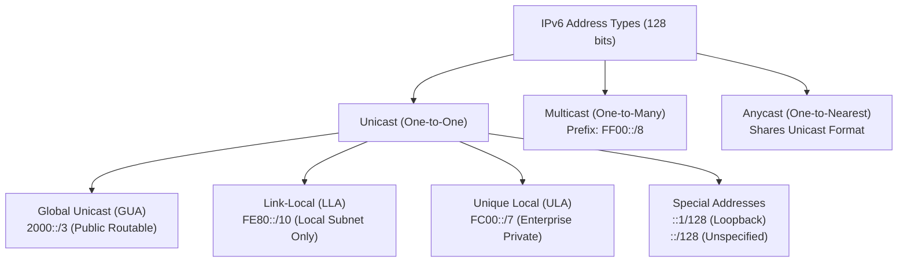
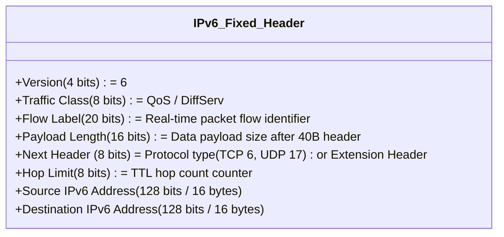
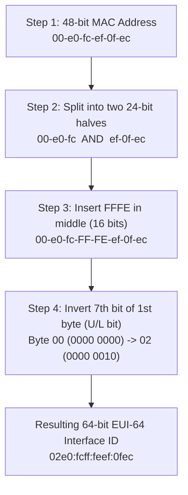

# 11. IPv6 Address and Configuration

> 💡 Unit 11 of 23 - HCIA-Datacom course. ☰ MOC | ← Unit 10 | Unit 12 →


> **Vendor Trap Mechanics & Distractor Analysis:**
>   - Step 1: Split MAC into two 24-bit halves: `00e0:fc` and `ef:0fec`.
>   - Step 2: Insert `FFFE` in the middle: `00e0:fcFF:FEef:0fec`.
>   - Step 3: Invert the 7th bit of the first byte (`00` in binary = `00000000` $\rightarrow$ invert bit 7 $\rightarrow$ `00000010` = `02`). Resulting Interface ID = `02e0:fcff:feef:0fec`. Distractor answers forget to invert the 7th bit or insert `FFFF` instead of `FFFE`.

> **Source slides (physical PDF page anchors verified against the local 985-page training material):**
> - V2 Unit 11: IPv6 benefits and address space, pp. 502-503
> - V2 Unit 11: address format and address types, pp. 504-519
> - V2 Unit 11: packet header and extension headers, pp. 521-527
> - V2 Unit 11: ICMPv6 and PMTU, pp. 529-532
> - V2 Unit 11: NDP, pp. 534-541
> - V2 Unit 11: SLAAC/DHCPv6 modes and RA flags, pp. 543-550
> - V2 Unit 11: IPv6 configuration examples, pp. 552-557
> - Slide 2: IPv6 Overview & Address Exhaustion Motivation
> - Slide 4: IPv6 Address Format & Representation Rules
> - Slide 7: IPv6 Address Classifications (Unicast, Multicast, Anycast)
> - Slide 10: Global Unicast, Unique Local, and Link-Local Addresses
> - Slide 13: IPv6 Packet Header Architecture (40-Byte Fixed)
> - Slide 16: IPv6 Extension Headers & Next Header Chain
> - Slide 19: ICMPv6 Protocol & Neighbor Discovery Protocol (NDP)
> - Slide 22: Address Resolution using NS and NA Messages
> - Slide 25: Stateless Address Autoconfiguration (SLAAC) & DAD
> - Slide 29: Huawei VRP IPv6 Basic CLI Configuration

---

### 11.1 IPv6 Addressing Architecture & Representation

IPv6 expands the IP address space from 32 bits ($2^{32} \approx 4.3 \times 10^9$) to **128 bits** ($2^{128} \approx 3.4 \times 10^{38}$ addresses), providing virtually inexhaustible globally unique IP allocations.

#### 1. Text Representation and Compression Rules
An IPv6 address is written as eight 16-bit hexadecimal blocks separated by colons:
`2001:0DB8:0000:0000:0000:0000:1428:57AB`

Two mandatory abbreviation rules simplify readability:
1. **Omit Leading Zeros:** Within each 16-bit block, leading zeros may be omitted:
   `2001:DB8:0:0:0:0:1428:57AB`
2. **Double Colon Compression (`::`):** One or more consecutive blocks of zeros can be replaced by `::`:
   `2001:DB8::1428:57AB`
   *Rule:* The double colon `::` can be used **only once** in an address to maintain unambiguous mathematical expansion.

#### 2. IPv6 Address Classifications



| Address Type | Prefix / Range | Scope & Routing | Description / Equivalent |
| :--- | :--- | :--- | :--- |
| **Global Unicast (GUA)** | `2000::/3` (`2000::`-`3FFF::`) | Global Internet | Globally routable public IPv6 addresses. |
| **Link-Local (LLA)** | `FE80::/10` (`FE80::`-`FEBF::`) | Local Link Only | Auto-configured on every IPv6 interface; used for NDP and routing adjacencies. Never routed across Layer 3 routers! |
| **Unique Local (ULA)** | `FC00::/7` (`FC00::`-`FDFF::`) | Enterprise Internal | Private routable within enterprise campus/VPN; replaces IPv4 RFC 1918. |
| **Multicast** | `FF00::/8` (`FF00::`-`FFFF::`) | Group / Scope dependent | Replaces IPv4 broadcast entirely. |
| **Loopback** | `::1/128` | Local Host Only | Equivalent to IPv4 `127.0.0.1`. |
| **Unspecified** | `::/128` | Local Host Boot | Equivalent to IPv4 `0.0.0.0`. Used in DAD before address confirmation. |

---

### 11.2 IPv6 Fixed Packet Header (40 Bytes)

Unlike IPv4's variable-length header (20-60 bytes), IPv6 utilizes a **streamlined 40-byte fixed header** with exactly 8 fields to maximize hardware forwarding efficiency:



- **Traffic Class (8 bits):** Directly equivalent to IPv4 ToS / DSCP for QoS classification.
- **Flow Label (20 bits):** Newly added in IPv6 to label packets belonging to a specific real-time flow (e.g. VoIP or video stream), allowing routers to forward packets along the same path without inspecting Layer 4 headers.
- **Next Header (8 bits):** Replaces IPv4 `Protocol` field. Points directly to the upper-layer protocol (TCP 6, UDP 17, ICMPv6 58) or to the first **Extension Header** in the daisy chain (Hop-by-Hop, Routing, Fragment, ESP, AH).
- **Hop Limit (8 bits):** Directly equivalent to IPv4 TTL; decremented by 1 at each router hop. Packet is dropped if it reaches 0.

---

### 11.3 ICMPv6 and Neighbor Discovery Protocol (NDP)

ICMPv6 (IP Protocol `58`) is fundamental to IPv6 operation. **NDP** uses ICMPv6 for functions including router discovery, address resolution, and Duplicate Address Detection; IPv6 does not use ARP. Multicast listener management is provided by MLD, which serves the role analogous to IPv4 IGMP. These functions are related through IPv6/ICMPv6, but they are not all performed by NDP. ([RFC 4861](https://www.rfc-editor.org/rfc/rfc4861.html); [RFC 3810](https://www.rfc-editor.org/rfc/rfc3810.html))

| NDP Message Type | ICMPv6 Type | Purpose | Destination Address |
| :--- | :---: | :--- | :--- |
| **Router Solicitation (RS)** | Type 133 | Sent by host to prompt local routers to send RAs immediately. | `FF02::2` (All-Routers Multicast) |
| **Router Advertisement (RA)** | Type 134 | Sent periodically by routers to announce prefix, gateway, and SLAAC parameters. | `FF02::1` (All-Nodes Multicast) |
| **Neighbor Solicitation (NS)** | Type 135 | Address resolution (IPv6 ARP request) and Duplicate Address Detection (DAD). | Target's **Solicited-Node Multicast** (`FF02::1:FFxx:xxxx`) |
| **Neighbor Advertisement (NA)** | Type 136 | Address resolution reply (IPv6 ARP reply) or DAD collision notification. | Requesting host's unicast address or `FF02::1` |

#### 1. Address Resolution (Replacing IPv4 ARP)
In IPv4, ARP broadcasts (`255.255.255.255`) disturb every host on the subnet. In IPv6:
1. Host A generates a **Neighbor Solicitation (NS)** destined to the target's **Solicited-Node Multicast Address**.
2. Only the target host whose NIC listens on that specific multicast hash wakes up to process the request!
3. The target replies with a unicast **Neighbor Advertisement (NA)** containing its MAC address.

#### 2. Duplicate Address Detection (DAD) Workflow
Before any unicast address (GUA, LLA, or ULA) can be used, the node marks it as **tentative** and performs DAD:
1. Host sends an **NS message** with Source IP = `::` (unspecified) targeting its own tentative address's solicited-node multicast.
2. If another device is already using that address, it replies with an **NA message**.
3. If an NA is received, address assignment fails (duplicate detected). If no NA is received, the address is verified as unique and transitions to active.

#### 3. SLAAC: EUI-64 Interface ID Generation
Under Stateless Address Autoconfiguration (SLAAC), the client receives the 64-bit network prefix from a Router Advertisement (RA) and automatically generates its 64-bit Interface ID from its 48-bit MAC address:



#### 4. Address Autoconfiguration: SLAAC and DHCPv6

V2 distinguishes **SLAAC**, implemented through NDP/Router Advertisements, from **stateful DHCPv6**, where a server tracks address or prefix allocation and release. DHCPv6 also supports a stateless mode: the host forms its address from the RA prefix while DHCPv6 supplies other parameters such as DNS. V2 autoconfiguration modes, p. 543

| RA flag | Meaning in the V2 course | Client behavior described by V2 |
|---|---|---|
| `M` (Managed Address Configuration) | Indicates managed address configuration. | `M=1`: obtain the address and other information through DHCPv6; the client can ignore `O`. With `M=0`, the client uses the advertised prefix for stateless address configuration. |
| `O` (Other Configuration) | Indicates other configuration parameters. | `O=1`: use DHCPv6 for parameters other than the address. |

The M/O flags are sent in RA messages; the terminal operating system also affects which mode it uses. M/O flag behavior, p. 544

**SLAAC flow:** generate a link-local address → perform DAD → send RS → receive an RA prefix → form a unicast address → perform DAD on that address. SLAAC sequence, p. 545

DHCPv6 uses a client, server, and optional relay agent. The usual initial allocation is **Solicit → Advertise → Request → Reply**. When rapid commit is supported and requested, the server can instead respond **Solicit → Reply**. A relay forwards client/server messages when they are on different network segments. DHCPv6 roles, p. 546 Four-message exchange, p. 547 Rapid-Commit exchange, p. 548 DHCPv6 relay flow, p. 549

**V2 command patterns:**

```text
# DHCPv6 stateful address allocation (server)
[R2] dhcp enable
[R2] dhcpv6 pool pool1
[R2-dhcpv6-pool-pool1] address prefix 2002::/64
[R2] interface GigabitEthernet 0/0/0
[R2-GigabitEthernet0/0/0] dhcpv6 server pool1
[R2-GigabitEthernet0/0/0] ipv6 nd ra halt disable
[R2-GigabitEthernet0/0/0] ipv6 nd autoconfig managed-address-flag

# DHCPv6 client requesting an address; learn a default route
[R3] dhcp enable
[R3] interface GigabitEthernet 0/0/0
[R3-GigabitEthernet0/0/0] ipv6 address auto dhcp
[R3-GigabitEthernet0/0/0] ipv6 address auto global default

# SLAAC client; router must send RAs
[R4] interface GigabitEthernet 0/0/0
[R4-GigabitEthernet0/0/0] ipv6 address auto global
```

These are the commands shown in V2's small-network example. The course also states that Huawei interfaces do not send RAs by default and uses `ipv6 nd ra halt disable` to enable them. Basic IPv6 configuration, p. 552 RA enable command and default, p. 553 DHCPv6 server/client example, p. 555 SLAAC example, p. 556

---

### 11.4 Huawei VRP IPv6 Configuration Commands

```bash
# 1. Globally enable IPv6 packet forwarding on the device
[Huawei] ipv6

# 2. Configure IPv6 on an interface with GUA and automatic LLA
[Huawei] interface GigabitEthernet 0/0/1
[Huawei-GigabitEthernet0/0/1] ipv6 enable                   # Enable IPv6 processing on interface
[Huawei-GigabitEthernet0/0/1] ipv6 address auto link-local # Automatically generate Link-Local Address
[Huawei-GigabitEthernet0/0/1] ipv6 address 2001:db8:12::1 64 # Configure Global Unicast Address
[Huawei-GigabitEthernet0/0/1] ipv6 nd ra halt disable        # V2 syntax: enable Router Advertisement transmission
[Huawei-GigabitEthernet0/0/1] quit

# 3. Static IPv6 Routing
[Huawei] ipv6 route-static 2001:db8:34:: 64 GigabitEthernet 0/0/1 2001:db8:12::2

# 4. Verification Commands
<Huawei> display ipv6 interface brief                     # View IPv6 operational state on interfaces
<Huawei> display ipv6 interface GigabitEthernet 0/0/1     # Detailed IPv6 parameters, LLA, and GUA
<Huawei> display ipv6 routing-table                       # View global IPv6 routing table
<Huawei> display ipv6 neighbors                           # View IPv6 neighbor cache (NDP table)
```

---


| :--- | :--- | :---: |

---

### 11.6 Chapter Summary Quiz

1. *(Single Choice)* Which of the following address types is completely eliminated and NO LONGER exists in IPv6?
   - A. Unicast
   - B. Anycast
   - C. Multicast
   - D. Broadcast
   - *Rationale:* IPv6 eliminates broadcast entirely, replacing broadcast functions with multicast and anycast.

2. *(True/False)* The basic header of an IPv6 packet has a fixed length of 40 bytes, regardless of whether extension headers are present.
   - A. True
   - B. False
   - *Rationale:* The IPv6 basic header is strictly fixed at 40 bytes (8 fields); extension headers are daisy-chained between the basic header and payload via the Next Header field.

3. *(Multiple Choice)* Which of the following ICMPv6 Neighbor Discovery Protocol (NDP) packets are utilized during Duplicate Address Detection (DAD)? (Select all that apply)
   - A. Neighbor Solicitation (NS)
   - B. Router Solicitation (RS)
   - C. Router Advertisement (RA)
   - D. Neighbor Advertisement (NA)
   - *Rationale:* DAD sends a Neighbor Solicitation (NS) to the tentative address's solicited-node multicast; an existing host holding that address responds with a Neighbor Advertisement (NA).

> 💡 🔗 Convergent unit: 14. Network Services and Applications (SSH - STelnet, SFTP, FTP) carries the canonical DHCP/DHCPv6 service treatment; this unit covers the IPv6 addressing context (SLAAC vs DHCPv6).

