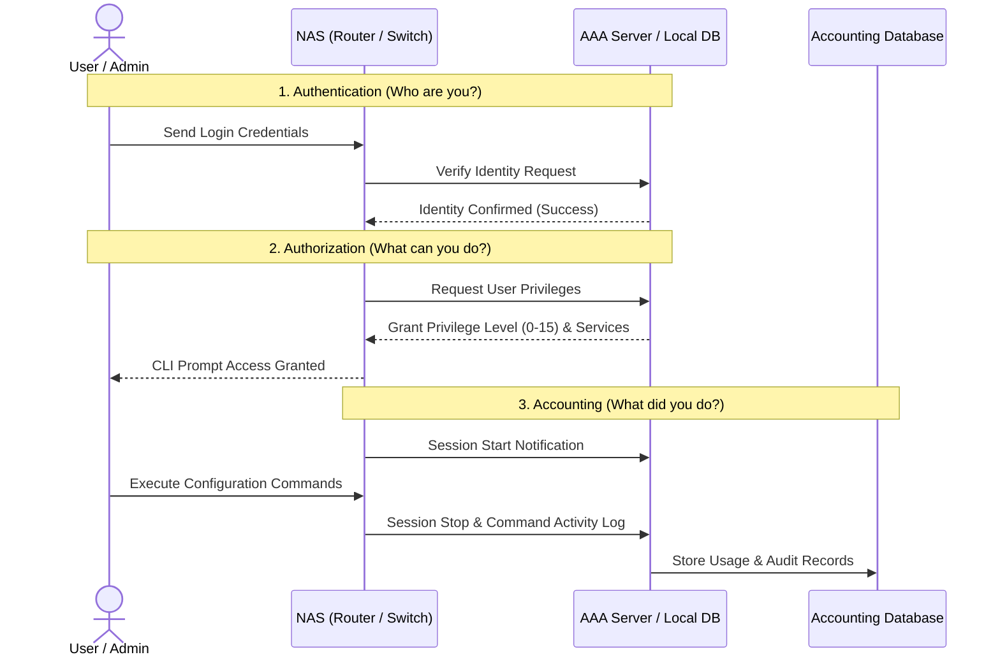
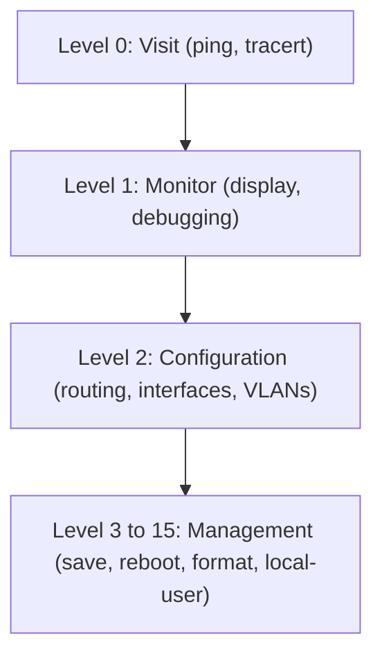
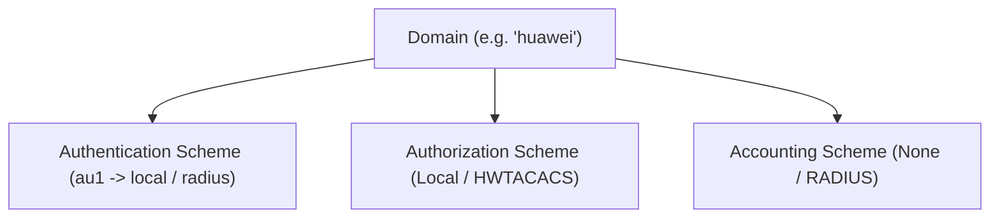

# 13. AAA Fundamentals and Configuration

> 💡 Unit 13 of 23 - HCIA-Datacom course. ☰ MOC | ← Unit 12 | Unit 14 →


---

> **V2 source anchors:** AAA roles, p. 596; RADIUS/HWTACACS/LDAP/AD comparison, p. 597; RADIUS client/server and shared key, p. 598; local and remote administrative AAA scenarios, p. 599; local and RADIUS AAA configuration examples, pp. 609-623.

### 13.1 AAA Architectural Triad (Authentication, Authorization, Accounting)

AAA provides a centralized, secure framework for controlling access to network devices and services:



1. **Authentication (Who are you?):**
   - Verifies the identity of a user accessing the network or device.
   - Answers: *"Is this user legitimate?"*
   - Methods: Username/password, digital certificates, biometrics.
   - Modes supported on Huawei VRP: `local`, `radius`, `hwtacacs`, or `none`.

2. **Authorization (What can you do?):**
   - Determines the specific access rights, commands, and services the authenticated user is permitted to execute.
   - Answers: *"Which commands and resources can this user access?"*
   - Parameters: User privilege level (0 to 15), service types (Telnet, SSH, FTP, HTTP), allowed VLANs, IP address assignment.

3. **Accounting (What did you do?):**
   - Tracks and records the resources, session duration, transmitted bytes, and commands executed by the user.
   - Answers: *"How long did the user stay connected, and what resources were consumed?"*
   - Used for billing, security auditing, capacity planning, and forensic analysis.

> 💡
> **Audit is NOT an "A" in AAA!**
> The three letters strictly stand for **Authentication**, **Authorization**, and **Accounting**.

---

### 13.2 Deployment Architectures: Local vs. Remote (RADIUS vs. HWTACACS)

A device acting as a **Network Access Server (NAS)** can enforce AAA using two primary deployment models:

1. **Local AAA:**
   - User credentials, privilege levels, and services are configured and stored directly in the local VRP database (device Flash memory).
   - *Pros:* Simple, independent of external servers, ideal for small networks or management fallback.
   - *Cons:* Administrative overhead; adding/updating a user requires logging into every switch and router individually.

2. **Remote AAA (Client/Server Model):**
   - The NAS device forwards authentication and accounting requests across the network to a dedicated centralized server.
   - The two dominant protocols supported by Huawei VRP are **RADIUS** and **HWTACACS**:

| Architectural Feature | RADIUS (RFC 2865 / 2866) | HWTACACS (Huawei TACACS+) |
| :--- | :--- | :--- |
| **Transport Layer** | **UDP** | **TCP** |
| **Port Numbers** | **1812** (Auth/Authz), **1813** (Acct)<br>*(Legacy: 1645 / 1646)* | **Port 49** |
| **Triad Integration** | **Combines Authentication & Authorization** | **Separates Authentication, Authorization, & Accounting** |
| **Encryption Scope** | Encrypts **ONLY the password** attribute (packet body plaintext) | Encrypts the **ENTIRE packet body** (only header in plaintext) |
| **Standards Body** | Open IETF RFC Standard | Proprietary / Enhanced extension of TACACS+ |
| **Primary Use Case** | Network access control (802.1X, PPPoE, Hotspots) | Device administrative management (CLI command authorization) |

#### RADIUS Message Flow
1. Client sends credentials $\rightarrow$ NAS sends **`Access-Request`** to RADIUS server.
2. RADIUS server evaluates credentials:
   - If valid $\rightarrow$ returns **`Access-Accept`** (includes authorization attributes).
   - If additional challenge required $\rightarrow$ returns **`Access-Challenge`** (e.g., OTP token).
   - If invalid $\rightarrow$ returns **`Access-Reject`**.

---

### 13.3 User Privilege Levels (0 to 15 Hierarchy)

Huawei VRP implements a hierarchical 16-level command authorization model (`0` through `15`):



| Level Tier | Level Range | Name | Allowed Capabilities & Typical Commands |
| :---: | :---: | :--- | :--- |
| **Tier 0** | **0** | **Visit** | Basic network diagnostics without modifying device status: `ping`, `tracert`. |
| **Tier 1** | **1** | **Monitoring** | System inspection, querying configurations, and real-time debugging: `display`, `debugging`. |
| **Tier 2** | **2** | **Configuration** | Service configuration affecting traffic forwarding: interface IP, routing protocols, VLANs, ACLs. |
| **Tier 3-15** | **3-15** | **Management** | Deep administrative control, file operations, system reboot, user management: `save`, `reboot`, `format`, `local-user`. |

> 💡 Crucial Exam Distinction: Level 0 (Visit) vs. Level 1 (Monitoring)
> - **Level 0 (Visit):** Can ONLY test connectivity using `ping` and `tracert`. Level 0 has **ZERO permission** to view system configurations or states (it CANNOT run `display` or `debugging`).
> - **Level 1 (Monitoring):** Authorizes all **`display`** (monitoring interface states, routing tables, system status) and **`debugging`** commands. It is strictly read-only and cannot alter device configuration.

---

### 13.4 Domain-Based Management & VRP CLI Configuration

In Huawei VRP, all users belong to an administrative **Domain**. The domain links authentication schemes, authorization schemes, and accounting schemes together.



#### 1. Configuring Local User with AAA in VRP
```bash
# Enter AAA view
[Huawei] aaa

# Configure a local administrative user with password, service type, and level 15
[Huawei-aaa] local-user admin password cipher Huawei@123
[Huawei-aaa] local-user admin service-type telnet ssh
[Huawei-aaa] local-user admin privilege level 15
[Huawei-aaa] quit

# Bind AAA to VTY management interfaces
[Huawei] user-interface vty 0 4
[Huawei-ui-vty0-4] authentication-mode aaa
[Huawei-ui-vty0-4] protocol inbound all
[Huawei-ui-vty0-4] quit
```

#### 2. Domain & Scheme Fallback Mechanics
```bash
[Huawei] aaa
[Huawei-aaa] authentication-scheme au1
[Huawei-aaa-authen-au1] authentication-mode radius local  # Primary RADIUS, fallback to Local
[Huawei-aaa-authen-au1] quit

[Huawei-aaa] authentication-scheme au2
[Huawei-aaa-authen-au2] authentication-mode local
[Huawei-aaa-authen-au2] quit

[Huawei-aaa] domain huawei
[Huawei-aaa-domain-huawei] authentication-scheme au1      # Primary scheme
[Huawei-aaa-domain-huawei] authentication-scheme au2      # Secondary scheme
[Huawei-aaa-domain-huawei] quit
```

> 💡 Domain Scheme Precedence & Fallback Rules (Exam Invariants)
> 1. **Scheme Precedence:** If multiple authentication schemes are bound to a domain (e.g. `au1` followed by `au2`), the device uses **`authentication-scheme au1`** by default. If `au1` is deleted, the system automatically falls back to **`au2`**!
> 2. **Remote Failure Local Fallback:** When a NAS router is configured for remote AAA authorization (RADIUS/HWTACACS), if the remote server fails to respond (timeout/network down), the device can authorize from the local network equipment side (`authorization-mode hwtacacs local`) to prevent total lockout.
> 3. **The `none` Mode:** The command `authentication-mode none` configures access that requires **no username and no password**.

#### 3. Enterprise Migration: Password Mode to AAA Multi-Administrator Access
In basic deployments, devices often use simple shared password authentication under VTY (`authentication-mode password`). However, enterprise security standards require:
1. **Individual Accountability:** Every administrator logs in with their own distinct username and password (non-repudiation).
2. **Role-Based Privilege Separation:** Each administrator is restricted to their assigned privilege tier (e.g., Level 1 for monitoring, Level 2 for routine config, Level 15 for full management).

```bash
# 1. Switch VTY lines from password mode to AAA mode
[Huawei] user-interface vty 0 4
[Huawei-ui-vty0-4] authentication-mode aaa
[Huawei-ui-vty0-4] protocol inbound all
[Huawei-ui-vty0-4] quit

# 2. Configure distinct users with individual credentials and privilege levels in AAA view
[Huawei] aaa
[Huawei-aaa] local-user admin1 password cipher Admin1@Pass
[Huawei-aaa] local-user admin1 service-type telnet ssh
[Huawei-aaa] local-user admin1 privilege level 15

[Huawei-aaa] local-user admin2 password cipher Admin2@Pass
[Huawei-aaa] local-user admin2 service-type telnet ssh
[Huawei-aaa] local-user admin2 privilege level 2
[Huawei-aaa] quit
```

---


---

