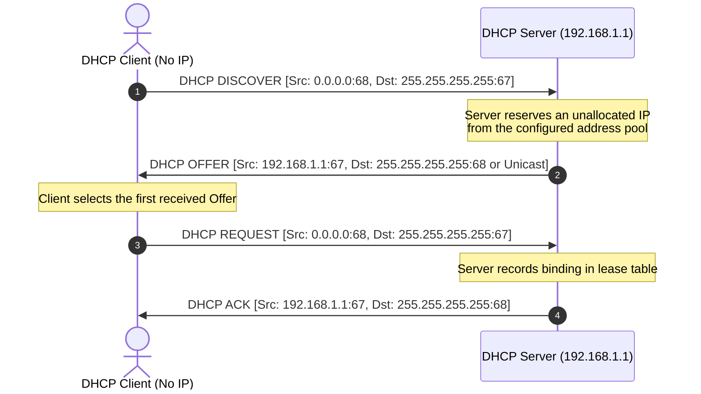
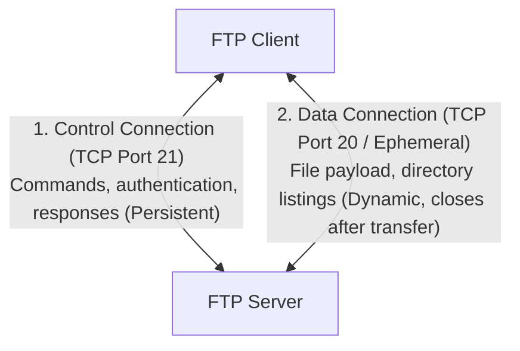

# 14. Network Services and Applications (SSH/STelnet, SFTP, FTP)

> 💡 Unit 14 of 23 - HCIA-Datacom course. ☰ MOC | ← Unit 13 | Unit 15 →


>   - The VTY line command `protocol inbound all` enables all interactive terminal CLI protocols supported by VTY (**Telnet and SSH/STelnet**).
>   - **FTP is NOT a terminal login protocol**; it is an independent application-layer file transfer service daemon (`ftp server enable`) that does not consume VTY lines. Configuring `protocol inbound all` on VTY lines does NOT grant FTP access to those lines!
> - **DHCP Initial DORA Packet Addressing Trap:**
>   - **Discover:** Source IP = `0.0.0.0`, Destination IP = `255.255.255.255` (UDP 68 $\rightarrow$ UDP 67).
>   - **Offer:** Server offers an available IP from its pool.
>   - **Request:** Client broadcasts its selection of the offered IP so other servers can retract their offers.
>   - **Ack:** Server acknowledges and confirms the lease bindings.
> - **Telnet VTY Privilege vs. Global Service Trap:** If a specific user cannot execute configuration commands, check user privilege level (needs Level 2). If only one specific user cannot log in, the user account is locked/disabled/deleted; if the service were disabled globally, *all* users would be blocked.
> 
> - V2 Unit 8: DHCP purpose and benefits, pp. 379-380
> - V2 Unit 8: DHCP address acquisition/DORA, pp. 381-382
> - V2 Unit 8: DHCP relay purpose and operation, pp. 383-384
> - V2 Unit 8: lease renewal, p. 385
> - V2 Unit 8: server pools and DHCP relay configuration, pp. 387-389

---

### 15.1 Dynamic Host Configuration Protocol (DHCP)

Dynamic Host Configuration Protocol (DHCP) automates the assignment of IP addresses, subnet masks, default gateways, and DNS server addresses to client hosts on an enterprise network, eliminating manual configuration errors and IP address conflicts.

#### 1. DHCP DORA Four-Way Handshake



| Packet Type       | Initiator | Transport Port                    | Source IP | Destination IP                 | Purpose                                                                              |
| :---------------- | :-------- | :-------------------------------- | :-------- | :----------------------------- | :----------------------------------------------------------------------------------- |
| **DHCP Discover** | Client    | UDP 67 (Server) / UDP 68 (Client) | `0.0.0.0` | `255.255.255.255`              | Discovers available DHCP servers on the local subnet.                                |
| **DHCP Offer**    | Server    | UDP 68 (Client) / UDP 67 (Server) | Server IP | `255.255.255.255` / Client MAC | Proposes an available IP address, mask, lease time, and gateway.                     |
| **DHCP Request**  | Client    | UDP 67 (Server) / UDP 68 (Client) | `0.0.0.0` | `255.255.255.255`              | Formally requests the offered IP and notifies other servers to release reservations. |
| **DHCP Ack**      | Server    | UDP 68 (Client) / UDP 67 (Server) | Server IP | `255.255.255.255` / Client IP  | Confirms the IP allocation and finalizes lease parameters.                           |
| **DHCP NAK**      | Server    | UDP 68 (Client) / UDP 67 (Server) | Server IP | `255.255.255.255`              | Rejects client request (e.g., requested IP is invalid or already leased).            |
| **DHCP Release**  | Client    | UDP 67 (Server) / UDP 68 (Client) | Client IP | Server IP (Unicast)            | Client voluntarily surrenders its allocated IP address upon graceful shutdown.       |

#### 2. DHCP Lease Renewal Mechanics (T1 & T2)
- **Default Lease Duration on Huawei VRP:** **1 day (24 hours / 86,400 seconds)** (`lease day 1 hour 0 minute 0`).
- **T1 Timer (50% Lease Expiry, 12 hours):** The client sends a **DHCP Request via Unicast** directly to the original DHCP server. If the server is online, it responds with a **DHCP ACK**, resetting the lease timer back to 100%.
- **T2 Timer (87.5% Lease Expiry, 21 hours):** If no response was received at T1, the client sends a **DHCP Request via Broadcast** to search for any alternative DHCP server on the network.
- **Lease Expiration (100%, 24 hours):** If no renewal ACK is received, the client must stop using the IP immediately and restart from **DHCP Discover**.

#### 3. Huawei VRP DHCP Server Deployment Modes
Huawei routers support two pool architectures:
1. **Interface Address Pool:** Addresses are allocated based on the subnet configured on the local interface (simplest for small branch networks).
2. **Global Address Pool:** Address pools are defined globally and can serve multiple interfaces, VLANs, or remote subnets via DHCP Relay.

```text
# Mode 1: Interface Address Pool Configuration
[Huawei] dhcp enable
[Huawei] interface GigabitEthernet 0/0/1
[Huawei-GigabitEthernet0/0/1] ip address 192.168.1.1 255.255.255.0
[Huawei-GigabitEthernet0/0/1] dhcp select interface
[Huawei-GigabitEthernet0/0/1] dhcp server dns-list 8.8.8.8
[Huawei-GigabitEthernet0/0/1] dhcp server excluded-ip-address 192.168.1.2 192.168.1.10
[Huawei-GigabitEthernet0/0/1] dhcp server lease day 2

# Mode 2: Global Address Pool Configuration
[Huawei] dhcp enable
[Huawei] ip pool BRANCH_POOL
[Huawei-ip-pool-BRANCH_POOL] network 192.168.10.0 mask 255.255.255.0
[Huawei-ip-pool-BRANCH_POOL] gateway-list 192.168.10.1
[Huawei-ip-pool-BRANCH_POOL] dns-list 114.114.114.114
[Huawei-ip-pool-BRANCH_POOL] lease day 1
[Huawei-ip-pool-BRANCH_POOL] quit
[Huawei] interface GigabitEthernet 0/0/2
[Huawei-GigabitEthernet0/0/2] ip address 192.168.10.1 255.255.255.0
[Huawei-GigabitEthernet0/0/2] dhcp select global
```

#### 4. DHCP Relay Across Broadcast Domains

A DHCP client initially sends broadcast messages that stay within its Layer 2 broadcast domain. When the DHCP server is on another subnet, configure a relay agent on the client-facing Layer 3 interface. The relay forwards the client messages to the server using unicast and relays the server's responses back to the client. The client/server DORA exchange remains the same; the relay handles the cross-subnet forwarding. Relay purpose, p. 383 Relay message flow, p. 384

```text
[Huawei] dhcp enable
[Huawei] interface GigabitEthernet 0/0/1
[Huawei-GigabitEthernet0/0/1] dhcp select relay
[Huawei-GigabitEthernet0/0/1] dhcp relay server-ip 192.0.2.10
```

Replace the example server address with the reachable DHCP server address. The V2 command sequence requires global DHCP enablement before configuring the relay interface and server address. DHCP enable prerequisite, p. 387 Relay configuration commands, p. 388

---

### 15.2 File Transfer Protocol (FTP)

File Transfer Protocol (FTP) uses client-server architecture over **TCP** to reliably transfer files across an IP network. V2 covers FTP's role, transfer modes, control and data connections, active/passive operation, and server/client configuration. FTP model and uses, p. 639 ASCII/binary guidance, p. 640 Control and data connections, p. 641 Active/passive modes, pp. 642-643 Server/client configuration examples, pp. 645-653

#### 1. Dual TCP Connection Architecture
Unlike single-connection application protocols (e.g. HTTP, Telnet), FTP strictly establishes **two separate TCP connections**:



- **Control Connection (Port 21):** Established first by the client. Remains active for the duration of the entire user session. Used exclusively for administrative commands (`USER`, `PASS`, `CWD`, `RETR`, `STOR`, `QUIT`).
- **Data Connection (Port 20 in Active Mode / Ephemeral Port in Passive Mode):** Established on-demand only when a file transfer or directory list (`ls`/`dir`) is executed, and torn down immediately upon transfer completion.

#### 2. Active Mode (PORT) vs. Passive Mode (PASV)
- **Active Mode:** Client sends `PORT <ip, port>` over the control connection, instructing the server to initiate a data connection from server TCP port **20** to the client's negotiated high port. 
	- *Problem: Client-side firewalls or NAT often block inbound connections initiated by external servers!*
- **Passive Mode:** Client sends `PASV`. The server opens a temporary high port ($> 1024$) and replies with its IP and port. The client initiates the outbound data connection to the server. *<mark style="background:#40a9ff">Firewall-friendly!</mark>*

#### 3. Transmission Modes: ASCII vs. Binary
- **ASCII Mode:** Used for text files such as TXT, LOG, and CFG. V2 says the sender converts text to ASCII and the receiver converts it back; it recommends ASCII for device configuration and log files.
- **Binary Mode:** Used for non-text files such as CC, BIN, EXE, and PNG. It transfers raw content without format conversion; V2 recommends it for network-device software. V2 Unit 14, FTP transfer modes, p. 640

#### 4. VRP System File Extensions & Patch Packages
Huawei VRP uses standard file extensions to identify different operational files:
- **System Software (`.cc`):** The primary VRP operating system image (e.g., `AR2200-V200R010C10SPC700.cc`).
- **Patch Package (`.pat`):** An incremental software patch deployed to fix specific security vulnerabilities or functional bugs without replacing the entire OS kernel (e.g., `patch.pat`).
- **Configuration File (`.cfg` / `.zip`):** Stores current/saved device configuration text.

```text
# Loading a Huawei Patch File via FTP (Client View)
<Huawei> ftp 192.168.1.200
[ftp] binary                              # Mandatory for binary packages!
[ftp] get patch.pat                       # Download patch package
[ftp] quit
<Huawei> patch load patch.pat             # Load patch into memory
<Huawei> patch active patch.pat           # Activate patch temporarily
<Huawei> patch run patch.pat              # Permanently run patch
```

---

> 💡 V2.0 Core Remote Access Standards
> In HCIA-Datacom V2.0 (Unit 14), legacy plaintext management services (Telnet, TFTP) are formally deprecated. The syllabus elevates **SSH / STelnet** for remote CLI terminal access and introduces **SFTP (Secure File Transfer Protocol)** as the mandatory secure subsystem over SSH Port 22, replacing plaintext FTP.

### 15.3 Remote Management: Telnet, SSH / STelnet & SFTP

Telnet and SSH allow network administrators to remotely manage routers and switches via virtual terminal (VTY) connections.
V2 introduces Telnet access and shows its relationship to remote CLI management; its SSH material then develops the secure alternative through connection setup and STelnet authentication. On the example platform, the source notes that enabling weak protocols may require the WEAKEA feature package. Telnet fundamentals and access, pp. 655-664 SSH configuration roadmap, pp. 671-672 Password-authenticated STelnet example, pp. 683-690 WEAKEA note, p. 650

| Feature | Telnet (RFC 854) | SSH / STelnet (RFC 4251) |
| :--- | :--- | :--- |
| **Transport Protocol** | TCP Port **23** | TCP Port **22** |
| **Security & Encryption** | **Cleartext (Plaintext)**; passwords and commands vulnerable to packet sniffing | **Encrypted**; cryptographic session keys protect credentials and data |
| **VRP Authentication Setup** | VTY can use password or AAA-based login, as configured | VTY is configured to support SSH; SSH user authentication can use password or public key. Host keys and user-authentication keys serve different roles. V2 demonstrates password-authenticated STelnet. |
| **Privilege Levels** | Level `0` (Visit), `1` (Monitoring), `2` (Configuration), `3-15` (Management) | Full RBAC / privilege level mapping via AAA |

#### 1. The 4 Mandatory Phases of SSH Connection Establishment
To establish a secure SSH session, the client and server strictly complete four sequential phases:
1. **Version Negotiation:** The client and server exchange version strings (e.g., `SSH-2.0`) to agree on a mutually supported SSH protocol version.
2. **Algorithm Negotiation:** The peers negotiate encryption algorithms (AES, 3DES), key exchange algorithms (Diffie-Hellman), and data integrity algorithms (HMAC-SHA).
3. **Key Exchange (KEX):** The peers dynamically compute and derive shared session keys for symmetric encryption without transmitting secrets over the wire.
4. **User Authentication:** The client authenticates to the SSH server using password authentication or public-key (RSA/ECC) authentication.

#### 2. SSH Client First-Time Login Invariant
When a Huawei device acts as an SSH client connecting to a remote server for the very first time, the server's public key is not yet stored in the client's local RSA key database.
- By default, the client refuses connection to untrusted keys.
- The administrator must explicitly execute:
  ```text
  [Huawei] ssh client first-time enable
  ```
  This allows first-login handling for the server public key on platforms requiring explicit enablement. Verify the target VRP version and configured trust policy; do not generalize a single first-login behavior across all versions. V2 discusses client first-login configuration in Unit 14.

#### 3. VTY Line Restrictions & The `protocol inbound all` Trap
VTY lines (`user-interface vty 0 4`) <mark style="background:#d3f8b6">provide CLI terminal access</mark>. 
- The command `protocol inbound all` <mark style="background:#b1ffff">enables all supported interactive terminal protocols</mark> (**Telnet and SSH/STelnet**).
- **Exam Invariant:** **FTP is NOT a terminal protocol and does NOT consume VTY lines.** FTP has an independent server daemon (`ftp server enable`); configuring `protocol inbound all` on VTY lines does NOT grant FTP access to those lines.

#### VTY Configuration Example on Huawei VRP
```text
# Configure SSH / Telnet access under VTY with AAA
[Huawei] telnet server enable
[Huawei] stelnet server enable
[Huawei] rsa local-key-pair create
[Huawei] user-interface vty 0 4
[Huawei-ui-vty0-4] authentication-mode aaa
[Huawei-ui-vty0-4] protocol inbound all
[Huawei-ui-vty0-4] user privilege level 3
[Huawei-ui-vty0-4] quit

[Huawei] aaa
[Huawei-aaa] local-user admin password cipher Huawei@123
[Huawei-aaa] local-user admin service-type telnet ssh
[Huawei-aaa] local-user admin privilege level 3
```

#### 4. Secure File Transfer Protocol (SFTP) Architecture (V2.0 Highlight)
Unlike legacy FTP which transmits credentials and file payloads in plaintext across two independent TCP ports (20 & 21), **SFTP (Secure File Transfer Protocol)** operates as an integrated secure subsystem of **SSH 2.0**:
- **Single Port Simplicity:** SFTP uses only **TCP Port 22** for both administrative command exchanges and encrypted file payloads, completely eliminating NAT traversal issues common to FTP Active/Passive data ports.
- **End-to-End Cryptography:** All session authentication, directory traversal, and data transmission are secured via symmetric session keys negotiated during the SSH key exchange phase.
- **Huawei VRP / YunShan OS SFTP Configuration:**
  ```text
  # 1. Globally enable the SFTP server daemon
  [Huawei] sftp server enable
  
  # 2. Configure local AAA user with SFTP service authorization
  [Huawei] aaa
  [Huawei-aaa] local-user fileadmin password cipher Admin@SecureFile123
  [Huawei-aaa] local-user fileadmin service-type sftp
  [Huawei-aaa] local-user fileadmin ftp-directory flash:/
  [Huawei-aaa] local-user fileadmin privilege level 3
  [Huawei-aaa] quit
  
  # 3. Authorize SSH user for SFTP service type
  [Huawei] ssh user fileadmin authentication-type password
  [Huawei] ssh user fileadmin service-type sftp
  ```
V2 Unit 14: SFTP architecture and principles, p. 671 V2 Unit 14: SFTP server configuration commands, p. 674

---

### 15.4 Domain Name System (DNS)

The Domain Name System (DNS) is an application layer protocol running over **UDP/TCP port 53** that translates human-friendly Fully Qualified Domain Names (FQDNs, e.g., `www.huawei.com`) into computer-routable IP addresses (e.g., `183.2.172.42`).

#### Key DNS Resource Records
- **A Record (Address):** Maps a hostname to an **IPv4 address** (32-bit).
- **AAAA Record (Quad-A):** Maps a hostname to an **IPv6 address** (128-bit).
- **CNAME Record (Canonical Name):** Maps an alias name to the true canonical domain name.
- **PTR Record (Pointer):** Performs reverse DNS lookup (maps an IP address back to a hostname).
- **NS Record (Name Server):** Specifies the authoritative DNS name server for a zone.

---


---

### 15.6 Chapter Summary Quiz

1. *(Single Choice)* When upgrading router operating system software (`.cc` image file) using FTP, which transmission mode must be configured on the FTP client?
   - A. Binary mode
   - B. Byte mode
   - C. Text mode
   - D. Stream byte mode
   - *Rationale:* Executable firmware binaries must be transmitted without carriage-return/line-feed translation; Binary mode transmits the exact raw bitstream.

2. *(Single Choice)* What is the source IP address in the header of the initial DHCP Discover packet transmitted by a client device booting on a network for the first time?
   - A. `127.0.0.1`
   - B. `169.254.1.1`
   - C. `0.0.0.0`
   - D. `255.255.255.255`
   - *Rationale:* A client with no configured IP address uses `0.0.0.0` as its source IP and broadcasts to `255.255.255.255`.

3. *(Multiple Choice)* Which of the following operations performed on router interface `GigabitEthernet0/0/1` will immediately terminate an active Telnet session connected to that interface's IP? (Select all that apply)
   - A. Modifying the IP address of interface `GigabitEthernet0/0/1`
   - B. Executing `shutdown` on interface `GigabitEthernet0/0/1`
   - C. Configuring a new static route on the router
   - D. Enabling OSPF on interface `GigabitEthernet0/0/1`
   - *Rationale:* Changing the interface IP or shutting down the physical interface directly breaks the underlying TCP connection socket.

---

