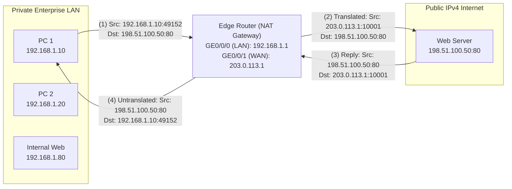
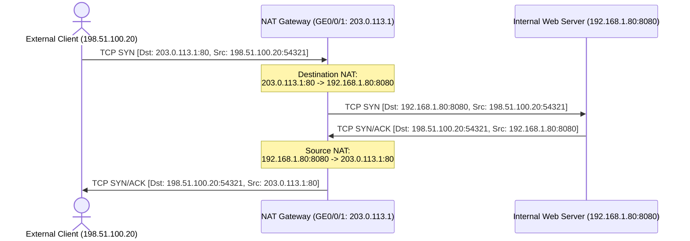

# 15. NAT Fundamentals and Configuration

> 💡 Unit 15 of 23 - HCIA-Datacom course. ☰ MOC | ← Unit 14 | Unit 16 →


---

### 14.1 NAT Fundamentals & Address Classification

Network Address Translation (NAT) was standardized in RFC 1631 and RFC 3022 to mitigate global IPv4 address depletion. It enables private enterprise networks using RFC 1918 addresses to access the public Internet by translating private IPv4 addresses into routable public IPv4 addresses at the enterprise boundary router.

> **V2 source anchors:** NAT purpose, p. 693, V2 NAT categories, p. 700, packet processing order and interface enablement, p. 701, source NAT policy matching and rule order, p. 704, server mapping versus session tables, p. 708.

> 💡 V2 Platform and NAT Taxonomy
> Unit 15 uses a Huawei NetEngine AR5700 running V600R024C00 for its configuration examples. Its course taxonomy is source NAT (No-PAT, NAPT, Easy IP), destination NAT (NAT Server), and bidirectional NAT. Static NAT appears in the earlier local lesson/question bank but is not one of the types in the V2 Unit 15 classification table. NAT may hide internal addressing, but it is not a substitute for a firewall or an access-control policy. Follow the target device and software release documentation for syntax and security behavior.

#### V2 NAT Packet-Processing Order

For the V2 platform example, NAT is enabled per interface. On packet ingress, the device checks for a destination mapping when NAT is enabled on the inbound interface, performs route lookup, and then checks for a source NAT policy on the outbound interface. A missing destination mapping or source-policy match does not itself drop the packet; routing and the configured service behavior determine what follows. V2 processing flow, p. 701

V2 source NAT policy rules are evaluated top to bottom; the first matching rule applies. Rules match conditions such as source/destination address, outbound interface, service, or time range. The action can select a source NAT address group, Easy IP, or `no-nat`. Rule conditions/order, p. 704 Address/service match conditions, pp. 715-716 Source NAT actions, p. 717

> 💡 NAT Address-Pool Route Protection
> V2 configures `route enable` on the source NAT address group to generate open programming routes (OPRs), which prevent traffic destined to translated pool addresses from looping between the NAT device and upstream router. The course says this is mandatory when the pool is on a different subnet from the WAN interface, recommended when it shares that subnet, and unnecessary when the pool includes the WAN interface address. OPR purpose and conditions, p. 713

#### RFC 1918 Private IPv4 Address Blocks
Private addresses are reserved for internal networks and are never routed across the public Internet backbone:

| Class | Private Address Range | CIDR Prefix | Total Usable Addresses | Typical Deployment Scope |
| :--- | :--- | :--- | :--- | :--- |
| **Class A** | `10.0.0.0` - `10.255.255.255` | `10.0.0.0/8` | $2^{24} = 16,777,216$ | Large enterprise backbones, multi-datacenter campuses |
| **Class B** | `172.16.0.0` - `172.31.255.255` | `172.16.0.0/12` | $16 \times 65,536 = 1,048,576$ | Medium-sized enterprises, university networks |
| **Class C** | `192.168.0.0` - `192.168.255.255` | `192.168.0.0/16` | $256 \times 256 = 65,536$ | Small branch offices, SOHO, home networks |



---

### 14.2 NAT Types in the Existing Lesson and V2 Taxonomy

The existing lesson includes static NAT as a separate concept. V2 Unit 15 classifies translation as source NAT (No-PAT, NAPT, Easy IP), destination NAT (NAT Server), or bidirectional NAT; its p. 700 taxonomy does not list Static NAT as a separate family. The command examples below include classic interface-based syntax and must be read with the platform qualification in ?14.1.

| NAT Flavor | Translation Mapping | Port Translation? | Public IP Requirement | Typical Use Case |
| :--- | :--- | :---: | :--- | :--- |
| **Static NAT** | 1 Private IP $\leftrightarrow$ 1 Public IP (Fixed 1:1) | **No** | Fixed dedicated public IP per internal host | Critical internal servers needing direct external access without port redirection |
| **Dynamic NAT (Basic NAT)** | $N$ Private IPs $\leftrightarrow$ $M$ Public IPs (Pool 1:1) | **No** | Address pool (`nat-address-group`) | Outdated legacy environments with abundant public IPs; limited simultaneous hosts |
| **NAPT (PAT)** | Many Private IPs $\rightarrow$ $M$ Public IPs ($N:M$) | **Yes** (IP + Port) | Address pool (`nat-address-group`) | Large enterprise egress with a block of public IPs ($>1$) |
| **Easy IP** | Many Private IPs $\rightarrow$ 1 Interface Public IP ($N:1$) | **Yes** (IP + Port) | Zero extra IPs (uses WAN interface IP directly) | Small-to-medium enterprises, branch offices, dynamic PPPoE/DHCP WAN links |
| **NAT Server** | 1 Public IP:Port $\rightarrow$ 1 Private IP:Port (Port Forwarding) | **Yes** (IP + Port) | Public IP (interface or independent) | Publishing internal enterprise servers (HTTP/HTTPS/FTP) to the public Internet |

---

### 14.3 Static NAT vs. Dynamic NAT Mechanics

#### 1. Static NAT
In Static NAT, each private address is statically bound to a dedicated public address:
- **Bidirectional Reachability:** A static NAT mapping allows internal hosts to initiate outbound traffic, and external hosts to initiate inbound traffic directly to the mapped public IP.
- **1:1 Resource Occupancy:** Even if the private host is offline, its paired public IP **cannot** be utilized by any other host.

```text
[Huawei-GigabitEthernet0/0/1] nat static global 203.0.113.10 inside 192.168.1.10
[Huawei-GigabitEthernet0/0/1] nat static enable
```

#### 2. Dynamic NAT (Basic NAT)

In Dynamic NAT, an address pool (`nat address-group`) of public IPs is defined. When an internal host sends outbound traffic matching an ACL, the router dynamically assigns an available public IP from the pool:
- **No Port Translation:** Only the IP address is translated; Layer 4 ports are untouched.
- **Concurrency Limit:** If the pool has 5 public IPs, only 5 internal hosts can access the Internet simultaneously. The 6th host must wait until an active mapping session times out.

```text
[Huawei] nat address-group 1 203.0.113.10 203.0.113.15
[Huawei] acl 2000
[Huawei-acl-basic-2000] rule 5 permit source 192.168.1.0 0.0.0.255
[Huawei-acl-basic-2000] quit
[Huawei-GigabitEthernet0/0/1] nat outbound 2000 address-group 1 no-pat
```
> 💡 The `no-pat` Parameter
> This is classic interface-based VRP syntax. V2 Unit 15 uses a named address group and `nat-policy`; its AR5700 examples use `mode pat` for the address group and a policy action for source NAT. The precise no-PAT form is release-dependent; check the target release before reusing this command.

---

### 14.4 NAPT and Easy IP (Port-Multiplexed NAT)

Network Address Port Translation (NAPT) translates both the **IP address and the Layer 4 port number**, allowing thousands of private IP hosts to share a single or small pool of public IP addresses concurrently.

#### NAPT Port Multiplexing Mechanics
When Host A (`192.168.1.10:50000`) and Host B (`192.168.1.20:50000`) access the same external web server, the NAT router assigns unique translated source port numbers (e.g. `203.0.113.1:10001` and `203.0.113.1:10002`):

| Internal Source IP:Port | Translated Public IP:Port | Destination IP:Port | NAT Table Session Key |
| :--- | :--- | :--- | :--- |
| `192.168.1.10:50000` | `203.0.113.1:10001` | `198.51.100.50:80` | `203.0.113.1:10001` $\leftrightarrow$ `192.168.1.10:50000` |
| `192.168.1.20:50000` | `203.0.113.1:10002` | `198.51.100.50:80` | `203.0.113.1:10002` $\leftrightarrow$ `192.168.1.20:50000` |

> 💡 ICMP Translation Under NAPT
> Because ICMP operates at Layer 3/4 without TCP/UDP port fields, NAPT maps the **16-bit ICMP Identifier (Query ID)** in the ICMP Echo Request header as the "port" to distinguish return replies. Thus, ICMP works seamlessly over NAPT!

#### Easy IP Configuration (Standard Enterprise Egress)
Easy IP is the most widely deployed NAT mode in branch offices and campus networks. It uses the WAN interface's IP directly:

```text
# 1. Define Basic ACL matching internal LAN traffic
[Huawei] acl number 2000
[Huawei-acl-basic-2000] rule 5 permit source 192.168.1.0 0.0.0.255
[Huawei-acl-basic-2000] quit

# 2. Apply Easy IP on the outbound WAN interface
[Huawei] interface GigabitEthernet 0/0/1
[Huawei-GigabitEthernet0/0/1] ip address 203.0.113.1 255.255.255.0
[Huawei-GigabitEthernet0/0/1] nat outbound 2000
```
*Note: By omitting `address-group`, VRP automatically implements Easy IP using `GigabitEthernet0/0/1`'s IP address!*

---

### 14.5 NAT Server (Port Forwarding / Destination NAT)

NAT Server publishes internal network services (e.g. enterprise Web, Mail, FTP servers) to external users on the public Internet.

#### Direction of Flow and Header Modification
1. External user sends packet: `Src: 198.51.100.20`, `Dst: 203.0.113.1:80`.
2. WAN Interface on Gateway receives packet and checks NAT Server mapping table.
3. Gateway performs **Destination IP and Port Translation**:
   - `Dst IP: 203.0.113.1` $\rightarrow$ `192.168.1.80`
   - `Dst Port: 80` $\rightarrow$ `80` (or internal port `8080`)
4. Internal server replies: `Src: 192.168.1.80:80`, `Dst: 198.51.100.20`.
5. Gateway translates source IP back to public IP (`203.0.113.1:80`) before egress.



#### NAT Server Configuration Syntax
The following is classic interface-based VRP syntax; command view and grammar vary by platform/release. V2 Unit 15 enables NAT on the egress interface and enters NAT Server configuration from system view.
```text
# V2 Unit 15 pattern (AR5700, V600R024C00)
[R1] interface 10GE 0/0/2
[R1-10GE0/0/2] nat enable
[R1-10GE0/0/2] quit
[R1] natserver policy_web protocol tcp global 1.1.1.1 8080 inside 192.168.1.1 www route
```
NAT Server syntax and parameters, p. 727 V2 configuration example, p. 730

#### NAT Verification Commands
```text
<Huawei> display nat session all          # View active dynamic NAT session translations
<Huawei> display nat outbound             # View outbound NAT policies applied to interfaces
<Huawei> display nat server               # View configured NAT Server mappings
<Huawei> display nat static               # View static NAT mappings
<Huawei> display nat address-group        # View public address pool parameters
```

---

#### 14.5.1 Bidirectional NAT: Combining Source and Destination Translation

**Bidirectional NAT** combines source NAT and destination NAT on the same packet path. It is a scenario-level combination of the two translation directions, not a separate translation primitive: a packet can have both its source and destination IP addresses translated by the NAT device. Huawei's example combines a fixed NAT Server mapping with source NAT: the destination public address/port maps to the internal server, while the client source is translated using a source NAT pool. The session table records the resulting tuple and supports reverse translation for the response. Bidirectional NAT definition and packet-flow example, p. 733

| Flow stage | Before translation | Translation performed |
| :--- | :--- | :--- |
| Client request entering the NAT device | Source = Internet client; destination = public server address | Source NAT changes the client source address/port as configured; NAT Server performs the fixed public-to-private destination mapping. |
| Server reply returning through the NAT device | Source = private server; destination = translated client | Session/mapping state applies the corresponding reverse translations so the reply reaches the original client and appears to come from the public server address. |

**Direction check:** Source NAT changes the packet's source; destination NAT changes its destination. Bidirectional NAT means both are applied in the scenario. It does not mean that every ordinary outbound NAT packet has both fields rewritten. V2 shows the processing sequence explicitly and treats bidirectional NAT as the combination of source NAT and NAT Server, not a single standalone command. V2 definition and use case, p. 733 V2 packet/session processing, p. 734

> V2 source pages for NAT Server: mapping behavior, p. 725, session processing, p. 726, configuration options, p. 727. The exact system-view example is linked above.


| :--- | :--- | :---: |

---

### 14.7 Chapter Summary Quiz

1. *(Single Choice)* An administrator has a router with a dial-up PPPoE interface whose public IP address changes dynamically upon each connection. Which NAT technology must be used to allow internal LAN users to access the Internet?
   - A. Static NAT
   - B. Basic NAT
   - C. Easy IP
   - D. NAT Server
   - *Rationale:* Easy IP dynamically binds to the IP address currently assigned to the outbound interface, making it ideal for non-fixed/dial-up public addresses.

2. *(True/False)* In NAPT, because ICMP Echo Request and Echo Reply messages do not contain Layer 4 TCP or UDP port numbers, ICMP traffic cannot be translated or forwarded across the NAT gateway.
   - A. True
   - B. False
   - *Rationale:* NAPT uses the 16-bit ICMP Identifier (Query ID) located in the ICMP header as a pseudo-port number to track and multiplex ICMP sessions.

3. *(Multiple Choice)* Which of the following statements regarding Huawei NAT implementations are correct? (Select all that apply)
   - A. Static NAT achieves a strict 1:1 permanent mapping between a private IP and a public IP.
   - B. In Easy IP, a dedicated `nat address-group` must be defined and referenced under the interface.
   - C. NAPT translates both the IP address and the Layer 4 port number of packets.
   - D. NAT Server is configured on the outbound interface using the `nat server` command to map internal servers to public ports.
   - *Rationale:* Easy IP does not use an address group; it directly uses the IP address of the outbound interface (`nat outbound <acl>`).

---

