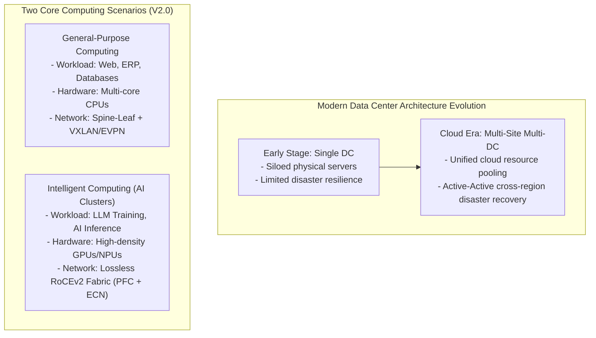
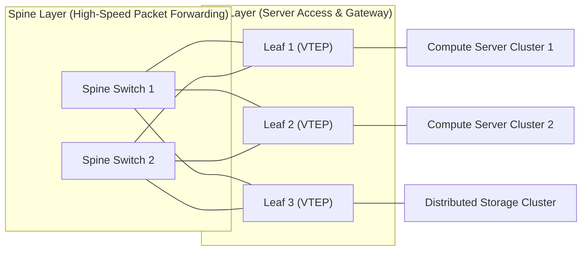

# 16. Data Center Network Basics (Spine-Leaf, EVPN/VXLAN & Lossless Fabric)

> 💡 Unit 16 of 23 - HCIA-Datacom course. ☰ MOC | ← Unit 15 | Unit 17 →

---

### 16.1 Data Center and DCN Architecture Overview

A **Data Center (DC)** is a dedicated infrastructure facility housing computing servers, storage arrays, and network communication systems:
1. **Infrastructure Layers:** Power distribution, cooling/environmental control, physical cabling, and security.
2. **Data Center Network (DCN):** Connects massive clusters of computing nodes and storage arrays, carrying internal east-west service traffic and north-south client access traffic.

---

### 16.2 General-Purpose DCN: Spine-Leaf Fabric & VXLAN/EVPN

Traditional 3-tier tree architectures (Access-Aggregation-Core) suffer from oversubscription and spanning-tree blocking during heavy server-to-server (East-West) traffic. Cloud data centers deploy **Spine-Leaf Architecture**:

#### Key Fabric & Overlay Technologies:
- **Spine-Leaf Topology:** Predictable ultra-low latency; any leaf is exactly two hops away from any other leaf. ECMP (Equal-Cost Multi-Path) load-balances traffic across all spine links simultaneously.
- **M-LAG (Multichassis Link Aggregation Group):** Cross-device link aggregation providing dual-homed link resilience for servers without running STP.
- **VXLAN (Virtual Extensible LAN):** A MAC-in-UDP overlay encapsulation standard:
  - Encapsulates Layer 2 Ethernet frames into Layer 3 UDP packets (Destination Port **4789**).
  - Uses a **24-bit VNI (VXLAN Network Identifier)**, expanding tenant isolation from 4,096 VLANs to **16,777,216 logical segments**.
- **EVPN (Ethernet VPN):** Functions as the standard BGP-based control plane for VXLAN, advertising MAC and IP reachability to automatically establish VXLAN tunnels without data-plane flooding.

---

### 16.3 Intelligent Computing DCN: Lossless AI Network (PFC, ECN & RoCE)

Distributed AI deep learning models require synchronous parameter exchanges (All-to-All communication) across thousands of GPUs. In this environment:
- Even a **0.1% packet loss** can cause TCP retransmissions that stall GPU computing pipelines, reducing cluster computing efficiency by over 50%.
- Data center networks deploy **Lossless Ethernet** combining RDMA, PFC, and ECN:

| Mechanism | Operating Layer | Functional Principle & Impact |
| :--- | :--- | :--- |
| **RDMA (Remote Direct Memory Access)** | Transport / Application | Directly accesses remote server memory bypassing the operating system kernel and CPU, cutting latency from milliseconds to microseconds. |
| **RoCEv2 (RDMA over Converged Ethernet v2)** | UDP / IP / Ethernet | Encapsulates InfiniBand transport packets over standard Ethernet/IP (UDP Port **4791**). |
| **PFC (Priority-based Flow Control)** | Layer 2 (802.1Qbb) | Hop-by-hop flow control. Divides an Ethernet link into 8 virtual queues. When buffer usage for a designated priority queue passes threshold, the switch transmits a PFC PAUSE frame upstream, stopping packet transmission on that specific queue without affecting others. |
| **ECN (Explicit Congestion Notification)** | Layer 3/4 (IP / TCP) | End-to-end congestion control. Switches mark the 2-bit ECN field in IP headers (`11` = CE) during congestion; the receiver notifies the sender (via CNP packets in RoCEv2) to gently throttle transmission rate before packet loss occurs. |

---

---

### 16.5 Chapter Summary Quiz

1. *(True/False)* In data center virtualization, VXLAN uses a 24-bit VXLAN Network Identifier (VNI), which enables isolation of up to approximately 16 million virtual networks.
   - A. True
   - B. False
   - *Rationale:* Traditional IEEE 802.1Q VLANs use a 12-bit VLAN ID ($2^{12} = 4096$). VXLAN expands this to 24 bits ($2^{24} = 16,777,216$), perfectly meeting the massive multi-tenant isolation needs of modern cloud data centers.

2. *(Single Choice)* Which of the following network architectures is standardly adopted in cloud data center networks to optimize east-west traffic and provide non-blocking forwarding?
   - A. Core-Aggregation-Access 3-tier Tree
   - B. Spine-Leaf Architecture
   - C. Ring Topology
   - D. Star-Hub Topology
   - *Rationale:* Spine-Leaf architecture provides direct, high-bandwidth interconnects between every leaf switch and every spine switch, eliminating spanning-tree blocked links via ECMP.

3. *(Single Choice)* Which technology operates at Layer 2 to pause packet transmission on a specific priority queue when buffer congestion occurs on an intelligent computing AI fabric?
   - A. ECN
   - B. RED
   - C. PFC
   - D. WRED
   - *Rationale:* Priority-based Flow Control (PFC, IEEE 802.1Qbb) implements per-priority hop-by-hop flow control, pausing only the congestion-prone queue to guarantee zero packet loss without blocking unrelated traffic.

---

