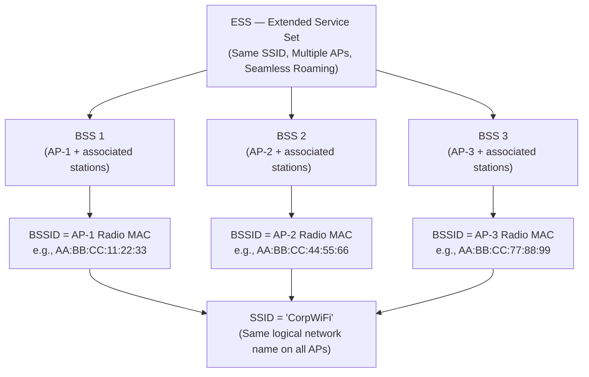
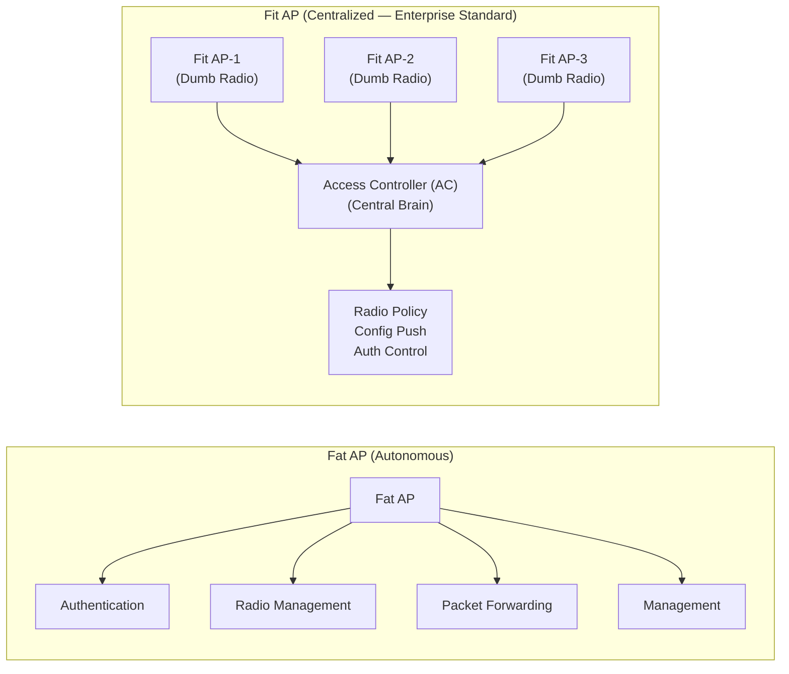
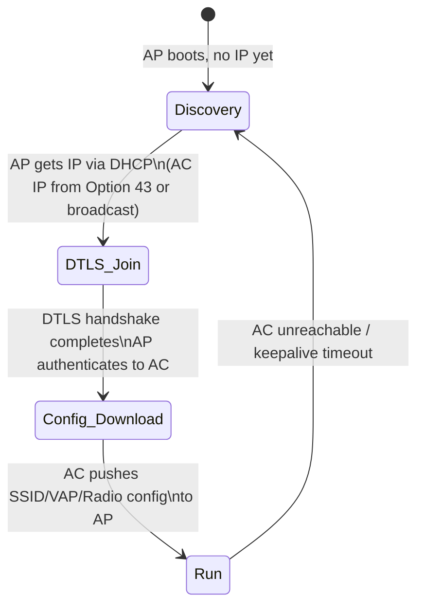
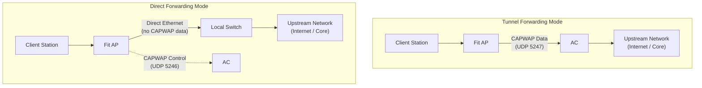

# 18. WLAN Networking Architecture (Fat/Fit AP, Leader AP & CAPWAP Tunnel)

> 💡 Unit 18 of 23 — HCIA-Datacom course. ☰ MOC | ← Unit 17 | Unit 19 →

> **Source slides (verified against official HCIA-Datacom V2.0 Training Material):**
> - Slide 1: WLAN Networking Architecture Overview
> - Slide 5: Basic WLAN Concepts (BSS, ESS, BSSID, SSID, VAP)
> - Slide 10: Fat AP (Autonomous) Networking Architecture & Limitations
> - Slide 12: WAC + Fit AP (Centralized) Networking Architecture
> - Slide 14: CAPWAP Protocol Mechanics (RFC 5415/5416, Ports 5246/5247 & DTLS)
> - Slide 21: Leader AP (Small-Scale Distributed AC) Architecture
> - Slide 26: Direct Forwarding Mode vs. Tunnel Forwarding Mode Flow Analysis
> - Slide 32: WAC Inline Deployment vs. Bypass Deployment

---

### 17.2 WLAN Topology Architecture

#### 1. Basic Service Set (BSS), ESS, BSSID, and SSID

| Term | Definition | Example |
| :--- | :--- | :--- |
| **SSID** (Service Set ID) | The human-readable wireless network name broadcast in Beacon frames | `"CorpWiFi"`, `"HomeNet"` |
| **BSSID** (Basic Service Set ID) | The unique MAC address of a specific AP radio. Each AP radio has its own BSSID. | `AA:BB:CC:11:22:33` |
| **BSS** (Basic Service Set) | The basic wireless coverage area of **one AP** with all its associated client stations | Single AP + clients |
| **ESS** (Extended Service Set) | Multiple BSSs interconnected via a Distribution System (DS/wired backbone), all sharing the same SSID. Enables seamless client roaming. | Enterprise campus WiFi |

#### 2. Fat AP vs Fit AP Architecture

#### 3. Leader AP Architecture

Leader AP networking uses one AP in **Fat mode** as the leader and other APs in **Fit mode**. The leader AP centrally manages and configures the Fit APs using CAPWAP, providing a smaller-scale alternative to deploying a separate WAC. The APs are generally on the same Layer 2 network, and the source identifies small and micro enterprises as a suitable scenario. It supports roaming between APs; the leader generally manages fewer Fit APs than a WAC. Leader AP networking and application scenario, p. 863

| Architecture | Central management element | Typical fit stated by V2 |
| :--- | :--- | :--- |
| WAC + Fit AP | Dedicated WAC | Centralized WLAN deployments where the WAC manages the Fit APs. |
| Fat AP | Each AP manages its own WLAN functions | Standalone/small deployment. |
| Leader AP | A Fat-mode AP manages other Fit APs over CAPWAP | Small/micro enterprise wanting centralized Fit AP management without a separate WAC. |

Do not confuse Leader AP with a normal Fat AP: the Fat-mode leader has a management role over the other Fit APs. This is a theory-level architecture delta; deployment limits and command syntax should be taken from the device-specific configuration guide before implementation.

| Feature | Fat AP (Autonomous) | Fit AP (Centralized / Lightweight) |
| :--- | :--- | :--- |
| **Intelligence** | Full protocol stack on the AP itself | AP is "thin", minimal logic; AC provides all intelligence |
| **Configuration** | Configured individually per AP | Centrally configured and pushed by the **AC** |
| **User Authentication** | Handled locally on the AP itself | Handled centrally by the **AC / AAA server** (Fit AP has NO local user database) |
| **Scalability** | Poor (manage each AP manually) | Excellent (hundreds of APs from one AC) |
| **AC required?** | **No** | **Yes**, Fit AP strictly cannot function independently without an AC |
| **Failure Behavior** | Continues operating independently | Enters **degraded / offline state**; cannot admit clients or update policy |
| **Use case** | Home, SOHO, small branch | Enterprise campus, hotel, large enterprise |
| **Huawei product** | Huawei Fat AP series | Huawei Fit AP + AC6005/AC6508/iMaster NCE-Campus |

> 💡 Exam Trap, Fit AP Autonomous Operation & User Database
> - **Trap 1:** An exam question may claim that a Fit AP can work independently without an AC or that it has an onboard user database to authenticate clients locally. **This is completely FALSE.** A Fit AP is a zero-touch "thin" radio endpoint. It possesses no independent control-plane intelligence or local user authentication database.
> - **Trap 2:** If the CAPWAP Control Tunnel to the AC is severed, a Fit AP **never converts itself automatically into a Fat AP**. Instead, it transitions to a **degraded/offline state**, halts user admissions, and immediately enters the Discovery phase searching for an AC.

---

---

### 17.3 CAPWAP Tunnel Protocol

**CAPWAP (Control and Provisioning of Wireless Access Points)** is the standardized protocol (RFC 5415) that links Fit APs to the AC, carrying both management (control plane) and user (data plane) traffic through UDP-based tunnels.

| Tunnel Type | Transport | Port | Content |
| :--- | :--- | :--- | :--- |
| **Control Tunnel** | UDP (DTLS encrypted) | **UDP 5246** | AP ↔ AC management: config push, keepalives, firmware updates, radio statistics |
| **Data Tunnel** | UDP | **UDP 5247** | User data forwarding (in **Tunnel Forwarding** mode only) |

> 💡 Memory Aid, CAPWAP Ports
> **Control = 5246** (C comes before D, 46 < 47) | **Data = 5247** (higher number)

#### AP Lifecycle States

| AP State | Activity |
| :--- | :--- |
| **Discovery** | AP broadcasts CAPWAP Discovery Request or uses DHCP Option 43 / DNS to locate AC IP |
| **DTLS Join** | AP establishes a DTLS-encrypted Control Tunnel to AC; AC authenticates AP (by MAC/SN) |
| **Config Download** | AC pushes the complete configuration to the AP: Radio profiles, SSID profiles, VAP profiles |
| **Run (Normal)** | AP is fully operational; periodic **keepalive** messages sent every 25 seconds to maintain the CAPWAP tunnel |

---

---

### 17.4 Forwarding Modes: Direct vs Tunnel

| Mode | User Traffic Path | Management Traffic | Advantage | Disadvantage |
| :--- | :--- | :--- | :--- | :--- |
| **Tunnel Forwarding** | AP → CAPWAP Data Tunnel → AC → Upstream network | Via Control Tunnel | Centralized QoS, ACL, policy enforcement at AC | Adds latency; AC becomes bottleneck for all user traffic |
| **Direct Forwarding** | AP → Local Switch/Router directly (no AC in data path) | Via Control Tunnel | Lower latency, AC not a bottleneck | Distributed enforcement; harder to apply uniform policies |

---

---

| :--- | :--- | :---: |

---

### 18.5 Chapter Summary Quiz

1. *(Multiple Choice)* Which of the following are significant advantages of the **WAC + Fit AP networking architecture** compared with traditional Fat AP networking? (Select all that apply)
   - A. Easier configuration and deployment in multi-AP scenarios
   - B. Centralized batch upgrade and firmware management for APs
   - C. Higher network security and unified access policy enforcement
   - D. Seamless Layer 2/Layer 3 roaming support across APs
   - *Rationale:* Official V2.0 Slide p. 871 confirms: Centralized WAC + Fit AP provides centralized batch provisioning, unified security policies, simplified firmware maintenance, and seamless mobility/roaming.

2. *(Single Choice)* What transport protocol and port number are utilized for establishing the **CAPWAP Data Tunnel**?
   - A. TCP Port 5246
   - B. UDP Port 5246
   - C. UDP Port 5247
   - D. TCP Port 5247
   - *Rationale:* RFC 5415/5416 mandates UDP port **5247** for CAPWAP data encapsulation, and UDP port **5246** for control signaling.

---

> 💡 🔗 Convergent unit: 19. WLAN Fundamentals and Configuration re-covers CAPWAP operationally (configuration side). This unit is the canonical architecture treatment.

