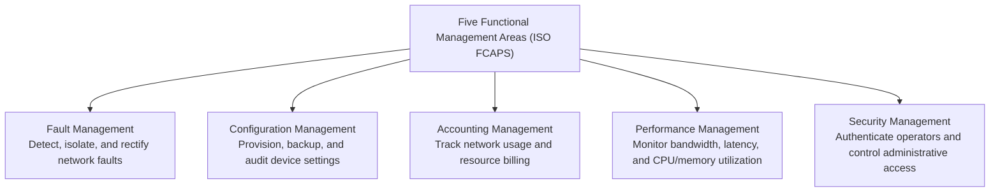
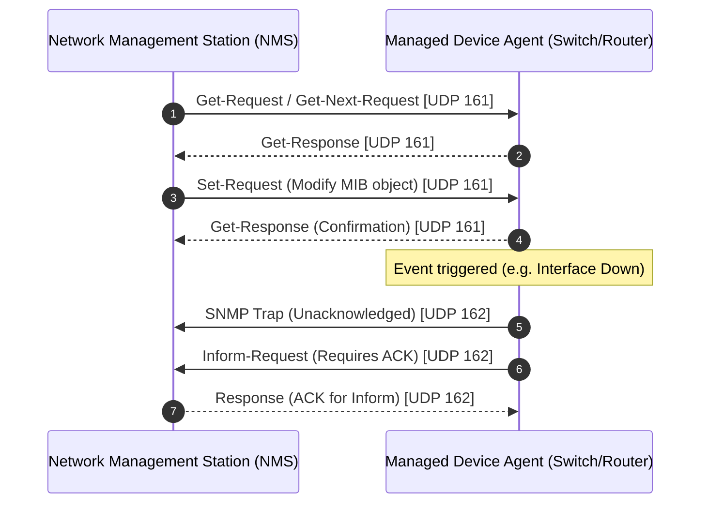

# 20. Network Device Management (SNMPv3, NETCONF/YANG, RESTCONF & iMaster NCE)

> 💡 Unit 20 of 23 - HCIA-Datacom course. ☰ MOC | ← Unit 19 | Unit 21 →

> **Source slides (verified against official HCIA-Datacom V2.0 Training Material):**
> - Slide 1: Network Device Management Overview
> - Slide 5: Traditional Network Management Architecture & Five Functional Areas (FCAPS)
> - Slide 13: SNMP Protocol Architecture & MIB Hierarchy
> - Slide 16: SNMPv1, SNMPv2c, and SNMPv3 Security Models
> - Slide 24: NETCONF Protocol Architecture, SSH Layer & RPC Operations
> - Slide 28: NETCONF Datastores (running, candidate, startup)
> - Slide 35: RESTCONF Protocol, HTTP Method Mapping & XML/JSON Formats
> - Slide 43: Huawei iMaster NCE Autonomous Network Architecture

---

### 20.1 Management Models & The FCAPS Framework

Network management encompasses all activities required to plan, operate, monitor, and optimize an enterprise network:

#### Comparison of Network Management Paradigms:
| Management Protocol / Platform | Transport Layer | Data Format | Datastore Architecture | Operational Scope |
| :--- | :--- | :--- | :--- | :--- |
| **SNMP (v1/v2c/v3)** | UDP Port 161 (Poll) / UDP 162 (Trap) | ASN.1 BER (Binary) | Single OID variables in MIB | Metric polling and alarm notifications |
| **NETCONF (RFC 6241)** | **SSH (TCP Port 22)** / TLS | **XML** | `running`, `candidate`, `startup` | Full device configuration and state manipulation |
| **RESTCONF (RFC 8040)** | **HTTPS (TCP 443 / 80)** | **XML or JSON** | Direct manipulation of `running` datastore | Web-friendly programmatic device configuration |
| **Huawei iMaster NCE** | Multi-protocol (NETCONF / gRPC / Telemetry) | Model-driven YANG | Centralized Cloud Engine Controller | Full-lifecycle network automation and AI-driven O&M |

---

### 20.2 SNMP Architecture & Version Progression

SNMP utilizes a centralized **Network Management System (NMS)** and distributed **Managed Agents** running on network devices:

- **SNMPv1:** Uses cleartext **Community Strings** (Read-Only / Read-Write); supports basic Get, Get-Next, Set, Trap.
- **SNMPv2c:** Adds **GetBulkRequest** (retrieves large MIB tables efficiently) and **InformRequest** (acknowledged alarm); still relies on plaintext community strings.
- **SNMPv3:** Introduces enterprise-grade cryptographic security:
  - **USM (User-Based Security Model):** Provides user authentication (HMAC-MD5 / SHA) and payload encryption (DES / AES).
  - **VACM (View-Based Access Control Model):** Controls which MIB subtrees a user group is permitted to view or modify.

---

### 20.3 Next-Gen Management: NETCONF & RESTCONF

Modern network programmability transitions from unstructured CLI text scraping to structured, model-driven protocols governed by **YANG data modeling** (RFC 6020):

#### 1. NETCONF Protocol Architecture (4 Layers):
1. **Secure Transport:** Mandates SSH encryption (Port **22**).
2. **Messages Layer:** Remote Procedure Call (`<rpc>` and `<rpc-reply>`).
3. **Operations Layer:** Standard operations:
   - `<get-config>`: Query configuration data.
   - `<get>`: Query configuration and running state data.
   - `<edit-config>`: Create, merge, replace, or delete configuration.
   - `<copy-config>`: Copy entire datastores.
   - `<lock>` / `<unlock>`: Prevent conflicting concurrent edits.
4. **Content Layer:** Configuration and state defined by YANG models formatted in XML.

#### 2. RESTCONF HTTP Operations:
RESTCONF provides a RESTful interface over HTTPS using standard HTTP verbs:
- **`GET`**: Retrieve resource data (read-only).
- **`POST`**: Create a new resource or execute a data-model RPC.
- **`PUT`**: Replace an existing resource or create if not present.
- **`PATCH`**: Incrementally merge/modify fields of an existing resource.
- **`DELETE`**: Delete a target resource.

---

| :--- | :--- | :---: |

---

### 20.5 Chapter Summary Quiz

1. *(True/False)* In SNMP operations, an Inform Request packet sent by an agent requires an explicit acknowledgment response from the NMS, whereas a Trap packet does not.
   - A. True
   - B. False
   - *Rationale:* SNMP Trap is an unconfirmed UDP notification. SNMP Inform Request requires the NMS to acknowledge receipt; if unacknowledged, the agent will retransmit the Inform packet.

2. *(Single Choice)* What transport protocol and port number are standardly mandated for establishing secure NETCONF management sessions on Huawei devices?
   - A. UDP Port 161
   - B. TCP Port 23
   - C. SSH over TCP Port 22
   - D. HTTPS over TCP Port 443
   - *Rationale:* RFC 6241 mandates SSH (TCP port 22) as the default secure transport layer for NETCONF RPC message exchanges.

3. *(Multiple Choice)* Which data encoding formats are officially supported by the RESTCONF protocol for payload representations? (Select all that apply)
   - A. XML
   - B. JSON
   - C. YAML
   - D. ASN.1 BER
   - *Rationale:* RESTCONF (RFC 8040) standardly supports both XML and JSON formatted messages.

---

