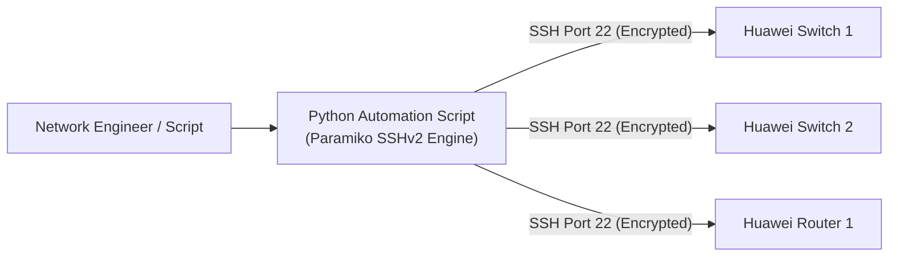
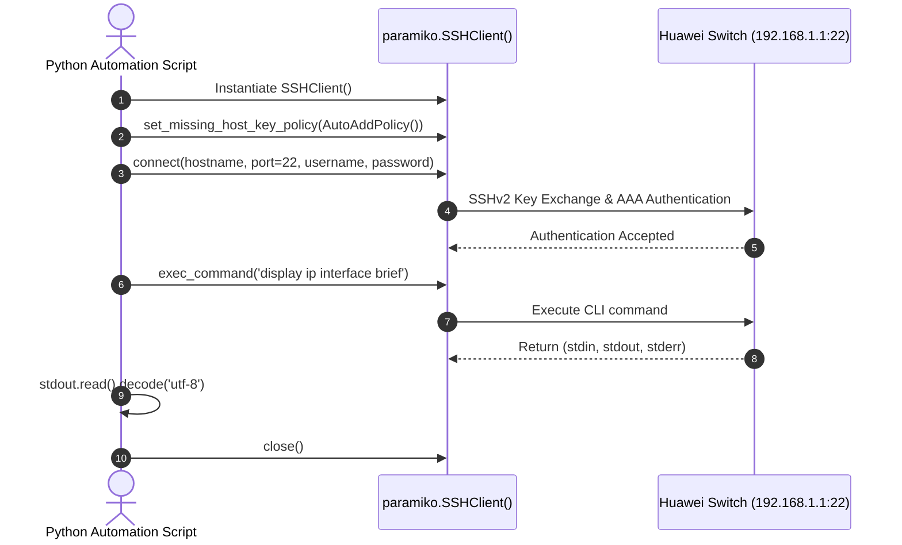

# 21. Network Programming and Automation (Python & Paramiko)

> 💡 Unit 21 of 23 — HCIA-Datacom course. ☰ MOC | ← Unit 20 | Unit 22 →


> **Source slides (verified against official HCIA-Datacom V2.0 Training Material):**
> - Slide 1: Network Programming and Automation Cover
> - Slide 5: Traditional O&M Challenges vs. Automated Efficiency
> - Slide 10: Programming Language Classification & Why Python for Networking
> - Slide 17: Python Basic Syntax, Data Types, Lists & Dictionaries
> - Slide 25: Paramiko Library Architecture & SSHv2 Client APIs
> - Slide 34: Automating Huawei Device Configuration via Paramiko Script

---

### 21.1 Automation Rationale & Python Fundamentals

Traditional manual network configuration via CLI copy-paste is error-prone and scales poorly across hundreds of campus switches. Network automation leverages Python scripts to execute repetitive configurations, verify state, and back up configurations reliably:



#### Core Python Data Structures for Network Engineers:
- **String (`str`):** Used to hold CLI commands, IP addresses, and command outputs.
- **List (`list`):** Ordered, mutable sequence (e.g. `devices = ['192.168.1.1', '192.168.1.2', '192.168.1.3']`).
- **Dictionary (`dict`):** Key-value mappings ideal for storing device connection parameters (e.g. `{'ip': '10.1.1.1', 'user': 'admin', 'port': 22}`).

---

### 21.2 Paramiko SSHv2 Automation Workflow

**Paramiko** is the foundational Python library implementing SSHv2 protocol client and server capabilities:



#### Production Python Automation Example (Huawei V2.0 Standard):
```python
import paramiko
import time

def backup_huawei_device(ip, username, password):
    # 1. Initialize Paramiko SSH Client
    ssh = paramiko.SSHClient()
    
    # 2. Automatically accept untrusted host keys for first login
    ssh.set_missing_host_key_policy(paramiko.AutoAddPolicy())
    
    try:
        # 3. Establish secure SSH connection over TCP port 22
        ssh.connect(hostname=ip, port=22, username=username, password=password, look_for_keys=False)
        
        # 4. Invoke interactive CLI shell for VRP commands
        channel = ssh.invoke_shell()
        time.sleep(1)
        
        # 5. Send commands
        channel.send("screen-length 0 temporary\n")  # Disable paging pauses
        channel.send("display current-configuration\n")
        time.sleep(3)
        
        # 6. Read command output buffer
        output = channel.recv(65535).decode('utf-8')
        print(f"[+] Successfully backed up configuration for {ip}")
        return output
        
    finally:
        # 7. Gracefully terminate SSH connection
        ssh.close()
```

---


| :--- | :--- | :---: |

---

### 21.4 Chapter Summary Quiz

1. *(True/False)* The Python Paramiko module implements the SSHv2 protocol, providing encrypted communication and remote command execution on network devices.
   - A. True
   - B. False
   - *Rationale:* Paramiko is an open-source Python implementation of the SSHv2 protocol, replacing legacy plaintext libraries like `telnetlib` for network device programmability.

2. *(Single Choice)* When using Paramiko to connect to a new Huawei network switch for the first time, what method must be called to prevent host key rejection exceptions?
   - A. `ssh.set_missing_host_key_policy(paramiko.AutoAddPolicy())`
   - B. `ssh.enable_first_time_login()`
   - C. `ssh.ignore_rsa_keys()`
   - D. `ssh.bypass_authentication()`
   - *Rationale:* `set_missing_host_key_policy(paramiko.AutoAddPolicy())` directs Paramiko to automatically save unknown server host keys without throwing an exception.

---

> 💡 🔗 Convergent unit: 14. Network Services and Applications (SSH - STelnet, SFTP, FTP) carries the canonical SSH/STelnet/SFTP service treatment; this unit covers SSH only as the Python automation transport (paramiko).

