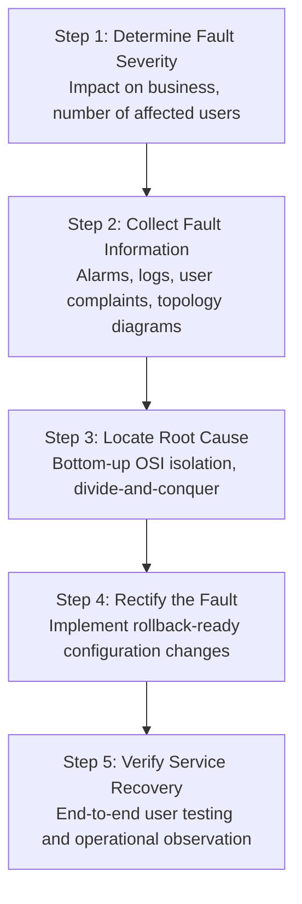

# 22. Network Troubleshooting (Methodology, Diagnostic CLI & 5 Case Studies)

> 💡 Unit 22 of 23 - HCIA-Datacom course. ☰ MOC | ← Unit 21 | Unit 23 →

> **Source slides (verified against official HCIA-Datacom V2.0 Training Material):**
> - Slide 1: Network Troubleshooting Overview
> - Slide 6: Structured 5-Step Troubleshooting Process
> - Slide 14: Core Diagnostic & Maintenance Command Families
> - Slide 21: Case 1: IP Address Acquisition Failure
> - Slide 27: Case 2: Intra-VLAN Communication Failure
> - Slide 34: Case 3: Network Ping Reachability Failure
> - Slide 42: Case 4: Fit AP Onboarding Failure on WAC
> - Slide 50: Case 5: Wireless Station (STA) Access Failure

---

### 22.1 Structured 5-Step Troubleshooting Process

Effective troubleshooting replaces ad-hoc guesswork with a disciplined, reproducible engineering methodology:

---

### 22.2 Core VRP Diagnostic Command Suite

| Diagnostic Command | Diagnostic Target & Operational Verification |
| :--- | :--- |
| **`display interface brief`** | Rapid scan of physical and protocol status across all ports (`UP` / `DOWN`). |
| **`display interface <type> <num>`** | In-depth examination: speed, duplex, CRC error counters, input/output packet rates. |
| **`display ip interface brief`** | Verification of Layer 3 IP address bindings and interface reachability. |
| **`display ip routing-table`** | Confirms active route existence, next-hop IP, and outgoing interface. |
| **`display mac-address`** | Inspects MAC address learning table, dynamic aging, and VLAN association. |
| **`display ap all`** | Inspects status (`Run`, `Idle`, `Fault`) of all Fit APs registered to the WAC. |
| **`display logbuffer`** | Live device syslog stream revealing port flaps, link resets, and protocol restarts. |

---

### 22.3 Five Canonical Troubleshooting Case Studies (V2.0 Curriculum)

#### Case 1: IP Address Acquisition Failure (DHCP Faults)
- **Root Causes:** DHCP server pool exhausted; DHCP service not globally enabled (`dhcp enable`); VLAN interface missing DHCP select mode (`dhcp select global` or `interface`); intermediate switch dropping DHCP broadcast (missing VLAN tag on trunk); DHCP Option 43/148 missing.
- **Verification:** `display ip pool name <pool> used`, `display dhcp server statistics`.

#### Case 2: Intra-VLAN Communication Failure
- **Root Causes:** Mismatched access VLAN configuration; trunk port missing allowed VLAN list (`port trunk allow-pass vlan`); duplex or speed mismatch causing collisions; physical link errors causing CRC drops.
- **Verification:** `display port vlan`, `display interface <interface>`.

#### Case 3: Network Ping Reachability Failure
- **Root Causes:** Missing or incorrect routing table entry; route recursion failure; ARP table entry incomplete (Incomplete ARP); ACL filtering traffic (`traffic-filter deny`); intermediate firewall dropping ICMP Echo Request.
- **Verification:** `display ip routing-table <target-ip>`, `display arp all`, `tracert <target-ip>`.

#### Case 4: Fit AP Onboarding Failure on WAC
- **Root Causes:** AP cannot obtain IP address from DHCP; AP cannot locate AC IP (Option 43 missing or DNS unresolvable); CAPWAP UDP 5246 blocked by intermediate ACL; AP MAC not authorized in AC whitelist (`ap-id <id> ap-mac <mac>`); AP and AC software versions incompatible.
- **Verification:** `display ap all`, `display ap state-collect-info`.

#### Case 5: Wireless Station (STA) Access Failure
- **Root Causes:** SSID broadcast hidden; PSK pre-shared key incorrect; VAP profile not active; Service VLAN DHCP exhausted; AP radio channel congested or transmit power too weak.
- **Verification:** `display vap all`, `display station ap-id <id>`.

---

| :--- | :--- | :---: |

---

### 22.5 Chapter Summary Quiz

1. *(Multiple Choice)* When inspecting a Huawei switch interface with `display interface GigabitEthernet 0/0/1`, which conditions can cause `Current state: UP` while `Line protocol current state: DOWN`? (Select all that apply)
   - A. Layer 2 encapsulation mismatch
   - B. The interface is administratively disabled with `shutdown`
   - C. Port blocked by Spanning Tree Protocol (STP)
   - D. Optical fiber completely unplugged
   - *Rationale:* If the cable is unplugged, `Current state` is physically DOWN. If `shutdown` is configured, it displays `Administratively DOWN`. `Current state: UP` with `Line protocol: DOWN` indicates physical Layer 1 connectivity is good, but Layer 2 data link protocol negotiation failed (e.g. encapsulation or STP).

2. *(Single Choice)* When a Fit AP cannot join the AC and `display ap all` does not show the AP, what is the first operational item to verify in the onboarding workflow?
   - A. Whether OSPF is configured on the AP
   - B. Whether the AP obtained an IP address and the AC IP via DHCP Option 43
   - C. Whether BGP is running between AP and AC
   - D. Whether the AP is running Wi-Fi 7
   - *Rationale:* In the AP onboarding lifecycle, the very first prerequisite is obtaining an IP address and discovering the AC IP (typically provided via DHCP Option 43). Without an IP, CAPWAP tunnel establishment cannot begin.

---

> 💡 🔗 Convergent unit: 14. Network Services and Applications (SSH - STelnet, SFTP, FTP) carries the canonical DHCP treatment; this unit uses DHCP only inside the troubleshooting cases.

