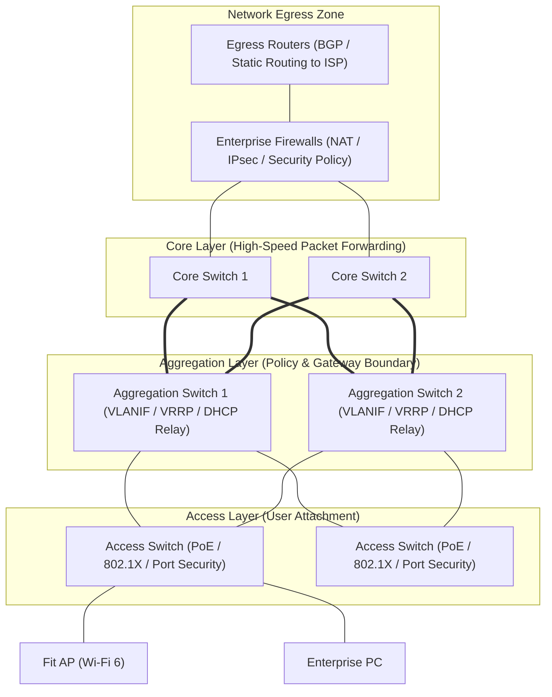
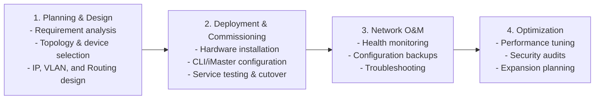

# 23. Typical Campus Networking Solution (Hierarchical Design, Project Lifecycle & Deployment)

> 💡 Unit 23 of 23 - HCIA-Datacom course. ☰ MOC | ← Unit 22

---

### 23.1 Campus Network Architecture & Hierarchical Design

An enterprise campus network interconnects workstations, wireless clients, and business servers within a defined geographic campus (e.g. enterprise park, university, factory):

#### Layer Responsibilities:
1. **Access Layer:** Directly connects end-user devices (PCs, IP phones, Wi-Fi APs, cameras); enforces port security, VLAN tagging, and PoE.
2. **Aggregation Layer:** Aggregates multiple access switches; acts as the default gateway for user subnets (VLANIF), implements security policies (ACLs), DHCP relay, and routing boundaries.
3. **Core Layer:** Provides non-blocking, ultra-high-speed packet routing between aggregation blocks and the network egress/data center zones; prioritizes forwarding throughput over complex packet inspection.

---

### 23.2 Campus Engineering Project Lifecycle

The implementation of a campus network strictly proceeds through four sequential phases:

#### Design Workstreams in Phase 1:
- **Physical Topology Design:** Choosing between 3-tier hierarchical and 2-tier collapsed core based on terminal count ($< 500$ terminals $\rightarrow$ collapsed core).
- **VLAN & IP Address Planning:** Allocating contiguous subnet blocks for summary routes; isolating guest, staff, IoT, and voice VLANs.
- **Reliability Design:** Deploying Eth-Trunk link aggregation, dual-chassis VRRP gateways, and redundant power supplies.
- **WLAN Coverage Planning:** Performing predictive RF site surveys, channel planning (1, 6, 11 in 2.4 GHz), and PoE power budgeting.

---

---

### 23.4 Chapter Summary Quiz

1. *(Multiple Choice)* In an enterprise campus network adopting a 3-tier hierarchical design, which of the following functions are primarily performed by the **Aggregation Layer**? (Select all that apply)
   - A. High-speed, low-latency backbone transit between campuses
   - B. Default gateway termination for user subnets via VLANIF interfaces
   - C. Enforcing security policies and ACL traffic filtering between subnets
   - D. Supplying PoE power directly to end-user workstations
   - *Rationale:* The aggregation layer acts as the policy, routing, and gateway boundary (Option B, C). Backbone transit is the core layer role (Option A), and end-device PoE power is delivered by access switches (Option D).

2. *(Single Choice)* In the official Huawei network engineering project lifecycle, which phase immediately follows Planning & Design?
   - A. Network Optimization
   - B. Deployment and Commissioning
   - C. Network O&M
   - D. Decommissioning
   - *Rationale:* The standard lifecycle proceeds: Planning & Design $\rightarrow$ Deployment & Commissioning $\rightarrow$ Network O&M $\rightarrow$ Network Optimization.

---

## Related Notes
- Cybersecurity MOC
- Network Security MOC
- OSPF
- Subnetting
- NAT fundamentals (Linux implementation)
- ACL, included in the Huawei course outline; a dedicated vault note is still pending.
- VRP Configuration

## Resources
> 💡 References
> - Source: HCIA-Datacom V2.0 Training Material (Huawei official course material)
> - See `references` in this note's properties for the full citation list.
> - V1.0 references are retained for comparative explanations and completed study work.

### Supplemental Textbook: Data Communications and Network Technologies

The local PDF Data Communications and Network Technologies.pdf is a useful broad networking textbook with 18 chapters, hands-on Huawei-device configuration, worked cases, and exercises. Its coverage overlaps strongly with this HCIA study path: network fundamentals, TCP/IP, VRP, addressing and subnetting, routing and OSPF, switching/VLANs, STP, ACL/AAA, NAT, DHCP, WLAN, IPv6, WAN, campus design, O&M, SDN/NFV, and network automation.

> 💡 Version and exam alignment
> Treat this as a **supplementary textbook**, not the controlling exam blueprint. Springer identifies its examination alignment as **HCIA-Routing & Switching V2.5** (book published in 2022/2023), while Huawei separately lists an **HCIA-Datacom V1.0** MOOC. Similar topic coverage does not establish that this textbook or a course page is aligned to the learner's current voucher exam code. For exam scope and weights, use the matching official exam outline and verify the voucher/course version before booking.

> **Primary source:** [Springer Nature, Data Communications and Network Technologies](https://link.springer.com/book/10.1007/978-981-19-3029-4) identifies the book's audience, chapter list, publication details, and HCIA-Routing & Switching V2.5 outline basis. Huawei hosts the same-titled PDF on its [official materials page](https://e.huawei.com/en/material/service/d2c5f81d2b464529a697a5aec6227a47) and lists a distinct [HCIA-Datacom V1.0 MOOC](https://e.huawei.com/eu/special_topic/region/WEU-Learn-ON/HCIA/Spain-Fundae/).

[^1]: **Frame Relay** is a standardized WAN technology that enables efficient data transmission over digital telecommunications channels using a packet-switching methodology.

